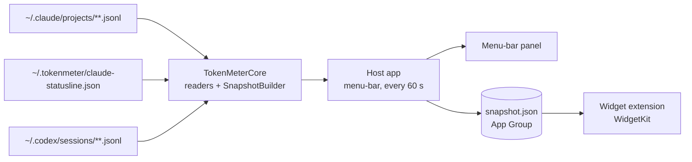
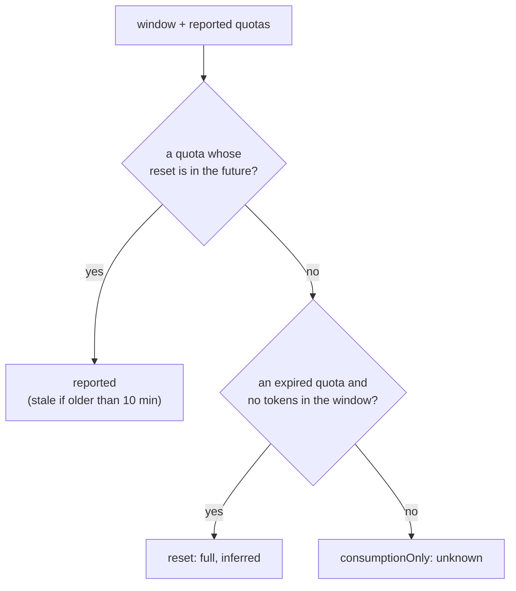

# Core Concepts

The ideas and the structure behind tokenmeter.

---

## 💡 The Philosophy

### 1. Never show a number you cannot account for

Plan limits are not published in tokens and neither provider has a public API for them. So a bar
is drawn from a figure only when the provider itself reported it, or when a window has plainly
reset. Everything else is labelled: dimmed, prefixed with `~`, or shown as unknown. A stale figure
that looks live is worse than an empty bar.

### 2. Read, do not call

tokenmeter holds no credentials and makes no network request. It reads files the two CLIs already
leave on disk. The cost is freshness, since the files move only while a CLI runs, and
[ADR 0006](../adr/0006-no-polling-of-provider-endpoints.md) accepts that trade.

### 3. Collect in one place, render in another

WidgetKit extensions are sandboxed and cannot do long work. So the app collects and the widget
draws, and a single file is the contract between them.

---

## 🏗 Technical Architecture

### The pieces

| Piece                  | Path                           | Role                                                                                              |
| :--------------------- | :----------------------------- | :------------------------------------------------------------------------------------------------ |
| **TokenMeterCore**     | `Sources/TokenMeterCore`       | Swift package: log readers, window maths, `Snapshot`, the snapshot store. No UI.                  |
| **Probe**              | `Sources/tokenmeter-probe`     | Terminal tool printing the same windows. A spike, not a product surface.                          |
| **Host app**           | `App/TokenMeter`               | Menu-bar only, **not sandboxed** so it can read the logs. Writes the snapshot, reloads WidgetKit. |
| **Widget extension**   | `Widget/TokenMeterWidget`      | **Sandboxed**. Reads the snapshot and renders it.                                                 |
| **Shared views**       | `Shared`                       | The bar and rows, compiled into both targets so they look the same.                               |
| **Status-line script** | `scripts/claude-statusline.sh` | Persists Claude Code's `rate_limits` for the readers.                                             |

The split is [ADR 0001](../adr/0001-stack-swiftui-widgetkit.md) and
[ADR 0003](../adr/0003-host-app-widget-and-app-group.md).

### The collection pipeline

Every 60 seconds, and whenever the panel opens, the app:

1. **Reads the logs incrementally.** Each file is parsed once and only newly appended, complete
   lines are read afterwards ([ADR 0004](../adr/0004-incremental-log-scanning.md)).
2. **Reads the quotas.** Claude's from the status-line file, Codex's from `rate_limits` in its logs.
3. **Builds a window per provider and length** (`5h`, `7d`): tokens inside the window, plus the
   matching reported quota if there is one.
4. **Writes `snapshot.json`** to the App Group and asks WidgetKit to reload.

### How a window gets its state

At draw time a reported figure whose reset has passed is turned into `reset` again, so a bar never
outlives its window ([ADR 0007](../adr/0007-expired-window-reads-as-reset.md),
[ADR 0008](../adr/0008-remember-last-quota-and-flag-stale.md)).

## Related

- [Reading the Bars](../reference/bars.md)
- [Data Sources](../reference/data-sources.md)
- [Decisions](../adr)
