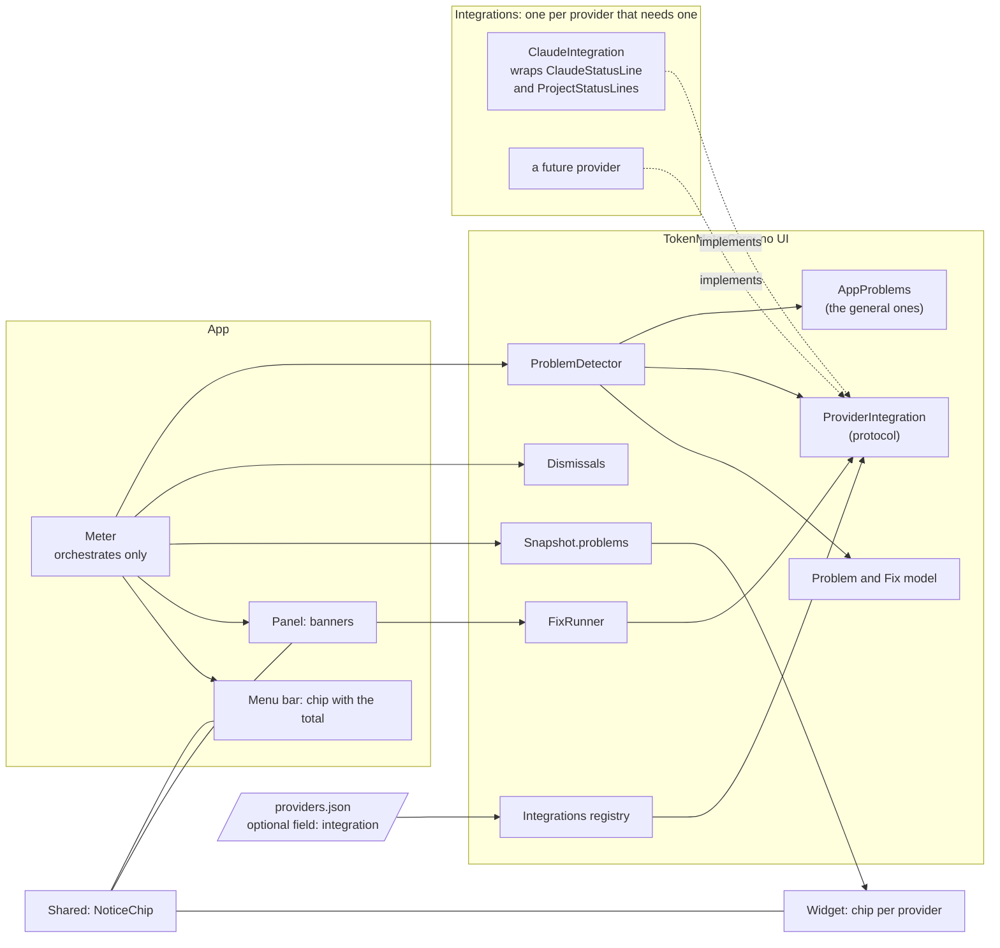
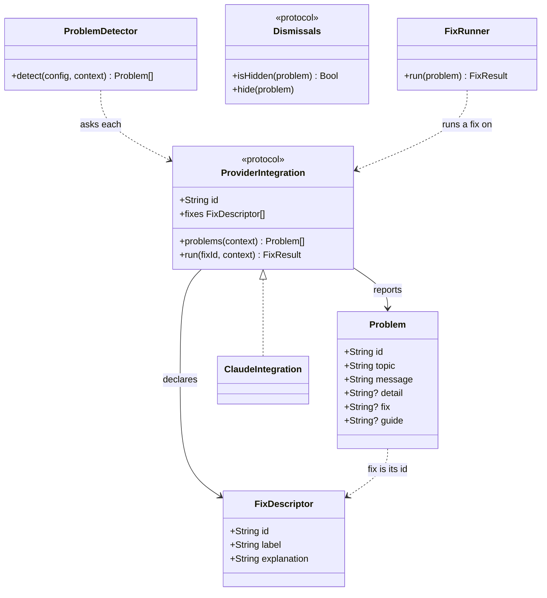
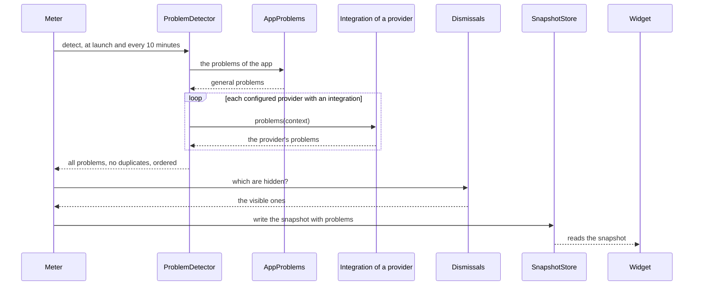
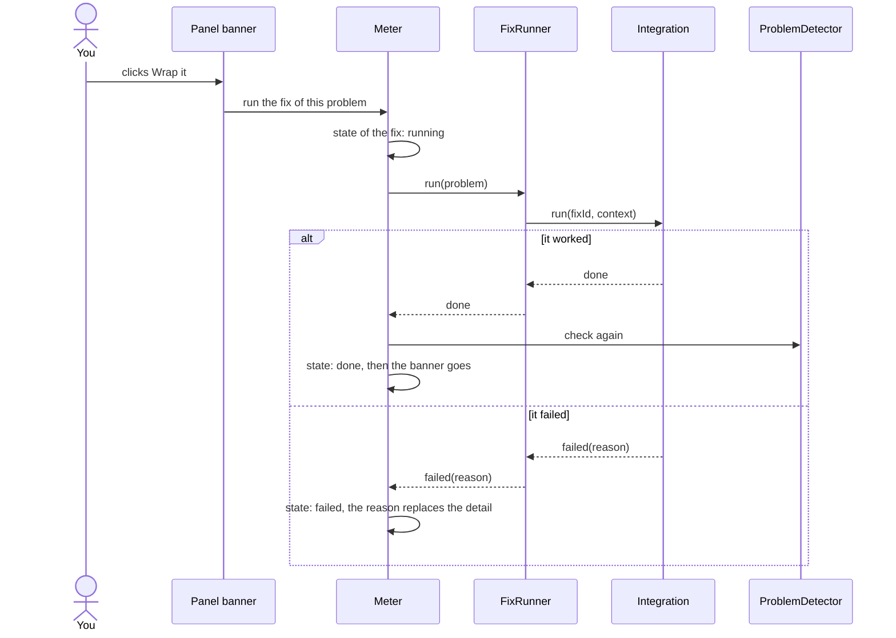
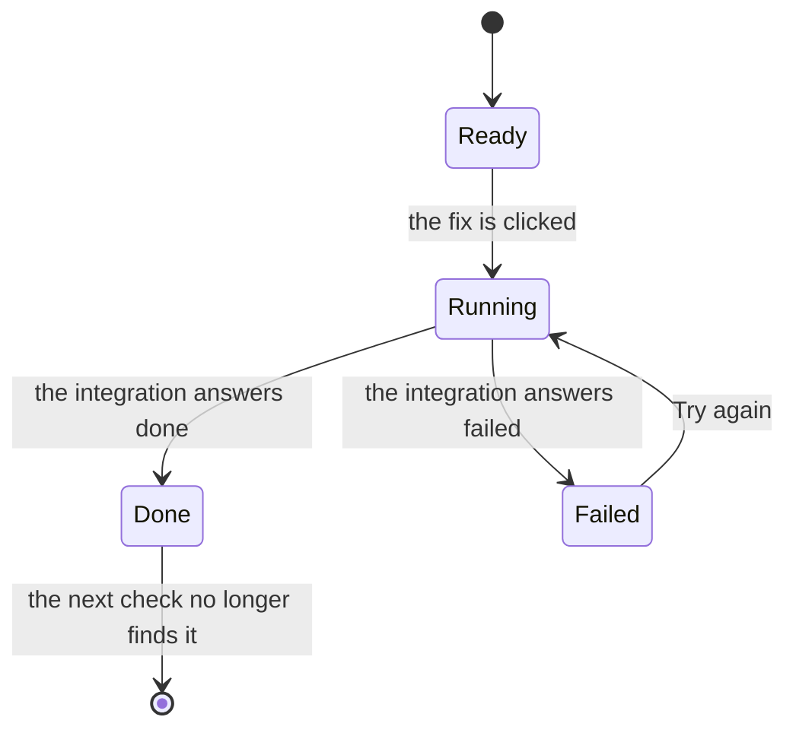
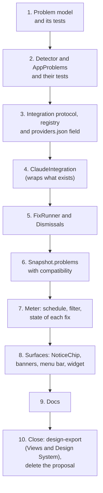

# Alerts with a fix, implementation plan

How the app will detect problems, show them and fix them, and the order in which it gets built. Nothing here is
written yet: the decisions are [ADR 0030](../../adr/0030-problems-with-a-topic-and-a-fix.md) (what a problem is, how it
shows and what its actions do) and [ADR 0031](../../adr/0031-problems-come-from-the-app-and-from-provider-integrations.md)
(where the code lives). This page is the map from them to commits.

## Intent

A problem has a topic (a provider or `general`), a message and, sometimes, a fix. The app finds them, the widget, the
menu bar and the panel show them, and the panel can run a fix. Each provider can have problems and fixes of its own,
and the common code never names a provider.

## The pieces



The arrows go one way: sources of problems, then the detector, then the snapshot, then the surfaces. A surface never
asks a check anything, and a check never knows a surface exists.

## Files

```text
Sources/TokenMeterCore/Problems/
  Problem.swift             the model: Problem, Fix descriptor, Topic
  ProblemDetector.swift     runs the sources, drops duplicates by id, orders them
  AppProblems.swift         the checks of the app itself (topic general)
  ProviderIntegration.swift the protocol and the descriptor of a fix
  Integrations.swift        id to implementation, one line each
  ClaudeIntegration.swift   the first integration
  FixRunner.swift           runs a fix through the integration that declared it
  Dismissals.swift          what was hidden, behind a protocol
Sources/TokenMeterCore/Snapshot.swift        gains `problems`
Sources/TokenMeterCore/ProviderConfig.swift  gains `integration`
App/TokenMeter/Meter.swift                   orchestrates, keeps the state of each fix
App/TokenMeter/ProblemBanner.swift           the panel's banners
Shared/NoticeChip.swift                      the chip of widget, menu bar and panel
Tests/TokenMeterCoreTests/Problems*Tests.swift  one file of tests per module
```

## The model



A problem's `fix` is only the id of a fix its provider's integration declared. The label of the button and the text of
**Learn more** come from that descriptor, so the interface knows nothing about what a fix means. `topic` is a provider
id or `general`; ids are written `<topic>.<check>[.<detail>]` and stay the same from one check to the next, because
Dismiss depends on them.

## A check cycle



The detector runs in the background at utility priority; `general` problems come first, then providers in the order of
`providers.json`. An unknown `integration` id is a `general` problem, not a crash.

## Running a fix





The state of a fix is interface state. It lives in `Meter` and is not in the model or in the snapshot.

## The order of work



| Step | Adds                                                                      | Tests that show it works                                          | Gate                                          |
| :--- | :------------------------------------------------------------------------ | :---------------------------------------------------------------- | :-------------------------------------------- |
| 1    | `Problem.swift`                                                           | encode and decode, a missing `fix`, an unknown topic              | `pnpm run check`                              |
| 2    | `ProblemDetector.swift`, `AppProblems.swift`                              | duplicates dropped, order, an unknown integration id              | `pnpm run check`                              |
| 3    | `ProviderIntegration.swift`, `Integrations.swift`, `ProviderConfig.swift` | an integration found by id, an older config still decodes         | `pnpm run check`                              |
| 4    | `ClaudeIntegration.swift`                                                 | each problem on a throwaway home, the fix leaves the problem gone | `pnpm run check`                              |
| 5    | `FixRunner.swift`, `Dismissals.swift`                                     | done and failed, hidden until the message changes                 | `pnpm run check`                              |
| 6    | `Snapshot.swift`                                                          | an older snapshot reads as having no problems                     | `pnpm run check`                              |
| 7    | `Meter.swift`                                                             | built, the schedule and the state of a fix by hand                | `pnpm run check` and `xcodebuild`             |
| 8    | `NoticeChip.swift`, `ProblemBanner.swift`, the widget and the menu bar    | built, then looked at on screen                                   | `pnpm run check`, `xcodebuild` and the screen |
| 9    | the docs: commands, Core API, troubleshooting                             | the docs build                                                    | `pnpm run check`                              |
| 10   | the Views and the Design System artifacts, the feature's status           | the Views canvas shows the new screens, as built                  | proposal canvas deleted when Fabio asks       |

Steps 1 to 9 are one commit each, three files at most, and leave the gate green. Step 10 is the close: `design-export`
refreshes the Views canvas and the Design System with the screens as built (with a fresh screenshot), the status
becomes _Implemented_, and the proposal canvas is deleted when Fabio asks. Steps 7 and 8 are the only ones the gate does
not build, so they are built with `xcodebuild` and looked at.

## Rules that keep it modular

| Rule                                                       | Why                                                  |
| :--------------------------------------------------------- | :--------------------------------------------------- |
| A source of problems is one file and knows no other.       | Adding one touches one file and one line.            |
| A fix is the descriptor and the action of one integration. | The interface never learns what a fix means.         |
| Ids are stable and follow `<topic>.<check>[.<detail>]`.    | Dismiss is keyed by id.                              |
| `Meter` orchestrates; it holds no check.                   | It does not turn into a catch-all.                   |
| The widget reads `Snapshot.problems` and computes nothing. | The widget stays a drawing of a snapshot (ADR 0001). |
| The common code names no provider; an integration may.     | The same rule as ADR 0015 to 0018.                   |

## Open

The open points of ADR 0030 are settled before the code that needs them: how long Dismiss lasts (before step 5), whether
**Restore original** stays in Settings, and whether the `general` problems are counted in the widget (both before
step 8).

## Related

- [Proposal](./proposal.md) and [overview](./index.md)
- [Architecture](../../develop/architecture.md) and [Core API](../../develop/core-api.md)
- [Add a Provider](../../develop/add-a-provider.md): the integration is an extension of it
- [ADR 0030](../../adr/0030-problems-with-a-topic-and-a-fix.md) and [ADR 0031](../../adr/0031-problems-come-from-the-app-and-from-provider-integrations.md)
