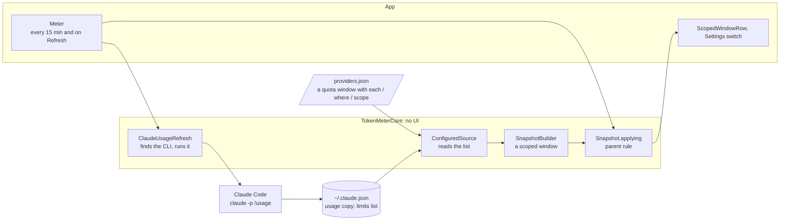

# Model limits, implementation plan

How a model's limit is read, kept and shown, and the order in which it was built. The decision is
[ADR 0034](../../adr/0034-limits-can-be-scoped-to-a-model.md).

## The pieces



The arrows go one way. tokenmeter never reads a credential: Claude Code does, and writes a copy of figures.

## Files

```text
Sources/TokenMeterCore/Snapshot.swift             WindowSpec gains scope and id; builder adds scoped windows; applying keeps the parent rule
Sources/TokenMeterCore/Models.swift               ReportedQuota gains scope
Sources/TokenMeterCore/ProviderConfig.swift       quota windows gain file, each, where, scope, observedAt; the migration adds the window
Sources/TokenMeterCore/ConfiguredSource.swift     reads a list of limits
Sources/TokenMeterCore/DefaultProviders.swift     the seed carries the window
Sources/TokenMeterCore/ClaudeUsageRefresh.swift   finds the CLI and runs /usage
Shared/UsageViews.swift                           ScopedWindowRow
App/TokenMeter/Meter.swift                        the refresh cadence, the models of a card
App/TokenMeter/SettingsView.swift                 a switch for each model
```

## The order of work

| Step | Adds                                         | Tests that show it works                                                      |
| :--- | :------------------------------------------- | :---------------------------------------------------------------------------- |
| 1    | a scoped window in the model and the builder | a model's figure is a window of its own and never becomes the week's          |
| 2    | the list reader in `ConfiguredSource`        | one limit for each matching entry, none for a plan without it, a missing file |
| 3    | the seed and the migration                   | an existing file gains the window once, with a backup                         |
| 4    | `ClaudeUsageRefresh`                         | runs with its arguments in its folder, a timeout, the CLI found or absent     |
| 5    | `Meter` and the surfaces                     | built; the line under Weekly; the switch in Settings                          |
| 6    | the docs and the close                       | the docs build; the Views and the Design System; the proposal deleted         |

## Open

- Showing "Up to 50%" needs the configuration to join two lists by position.
- How often the copy is refreshed in daily use: it was 15 days old on the author's Mac before this.

## Related

- [Proposal](./proposal.md) and [overview](./index.md)
