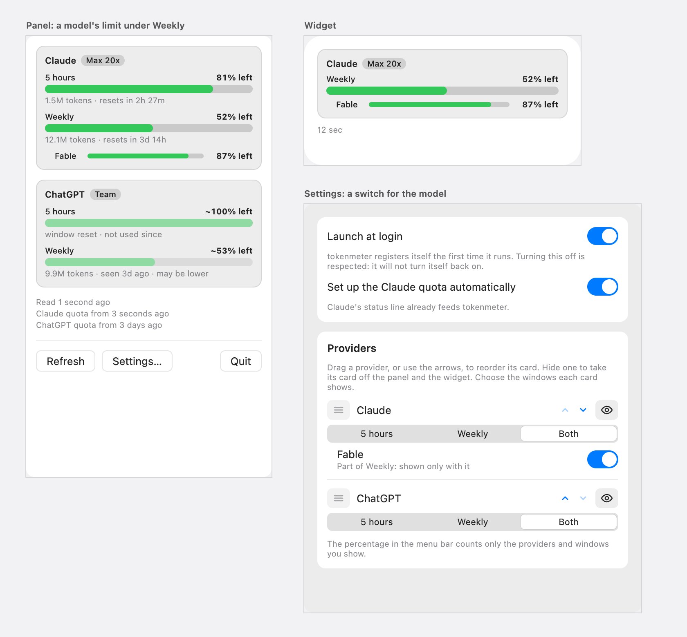
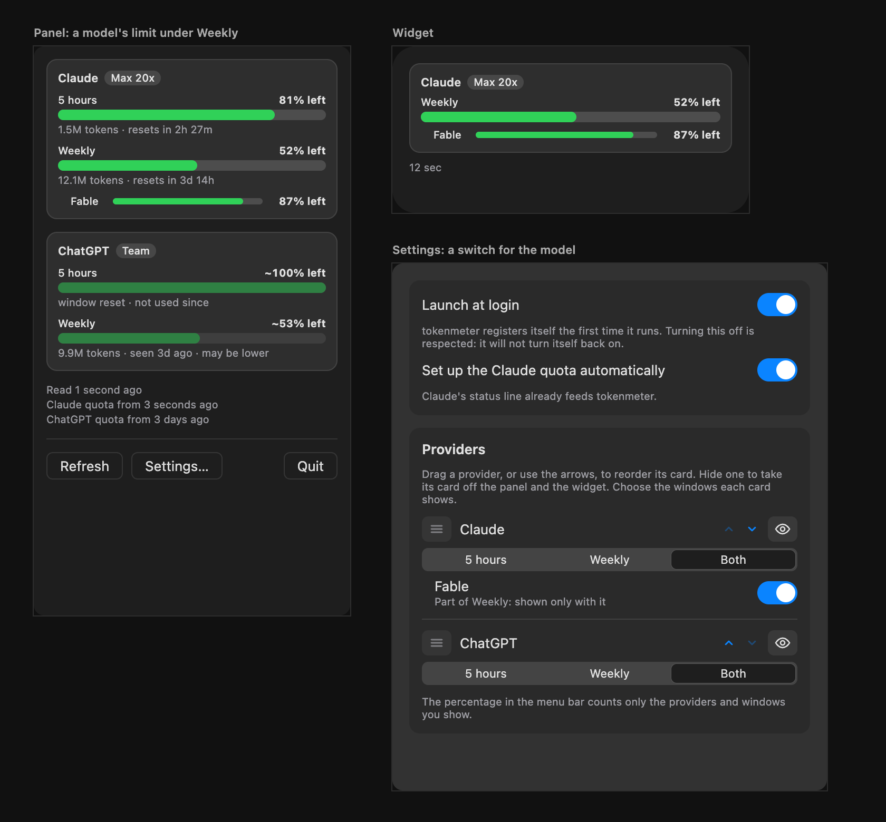

# Model limits, proposal

The design that was chosen after three rounds: a compact line, a switch of the design system in Settings, and Settings drawn
from the current screen. It was drawn as a canvas of artboards in Claude, which is deleted once the feature is implemented;
this page is what stays. The decisions behind it are in [ADR 0034](../../adr/0034-limits-can-be-scoped-to-a-model.md).

## The proposal

## What changes

| Surface  | What it shows                                                                                                                                       | Why                                                                             |
| :------- | :-------------------------------------------------------------------------------------------------------------------------------------------------- | :------------------------------------------------------------------------------ |
| Panel    | Under Weekly, one line indented: the model's name, a thin bar (6px) and the figure ("87% left"). The help text says "Part of Weekly" and the reset. | The limit is part of the week, and a line costs the card almost no height.      |
| Widget   | The same line, in the card of its provider.                                                                                                         | The widget draws what the snapshot holds.                                       |
| Settings | Under the choice of windows of the provider, a row with the model's name, "Part of Weekly: shown only with it" and a `Toggle`.                      | The model is not a third window: it needs Weekly, so it is a switch of its own. |

## Rules

- **It depends on the plan.** A plan without that limit has no line in the card and no switch in Settings. If a limit
  disappears later, its line goes and the choice is kept, harmless.
- **Any model of any provider** is shown the same way: the name and the figure come from the data and the design names none.
- **It never shows without Weekly.** Turning Weekly off hides its models; a model can be turned off on its own.
- **A refresh asks Claude Code.** The Refresh button and a timer of 15 minutes run Claude Code's own `/usage` in the
  background; if the CLI cannot be found or fails, the figure stays as old as the copy and reads `~` when it is more than ten
  minutes old, as any quota.
- **The reset is on the line only through its help text**, and the share of the week ("Up to 50%") is left out of the first
  version: the data gives it by position in a list, which the configuration cannot say yet.

## Settled by building

- The share of the weekly limit ("Up to 50%") is not shown: it needs a join by position that the configuration format does
  not have.
- The percentage in the menu bar counts the model's line like any visible window.

## Related

- [Overview](./index.md) and [implementation plan](./plan.md)
- [Provider cards](../2026-10-30-provider-cards/proposal.md)
