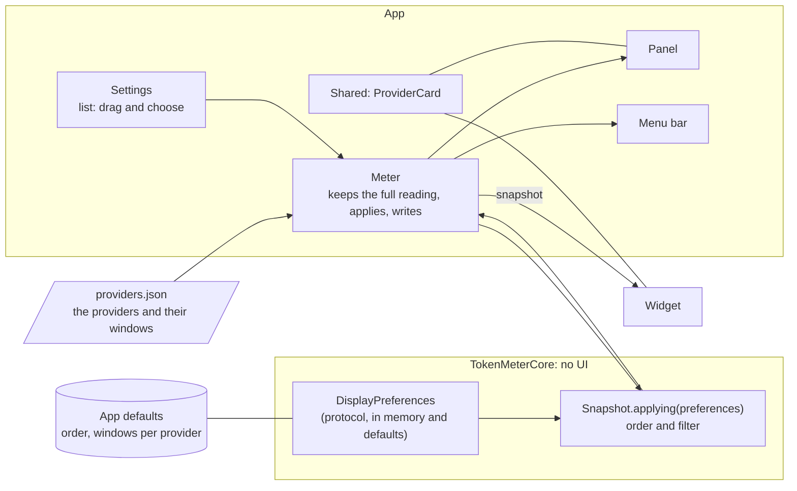
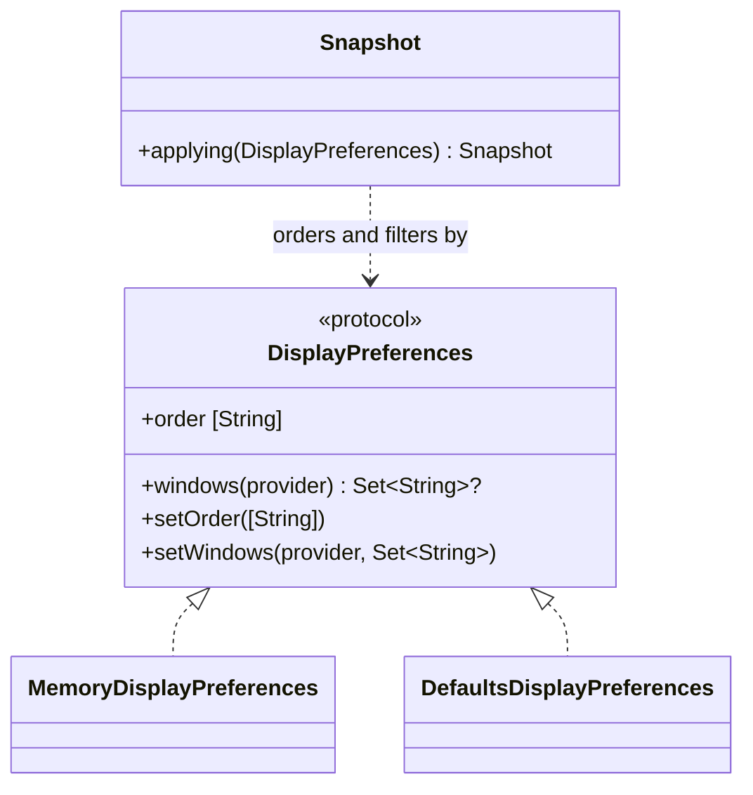
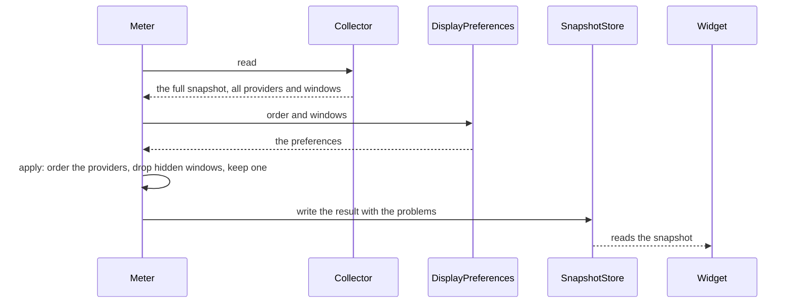
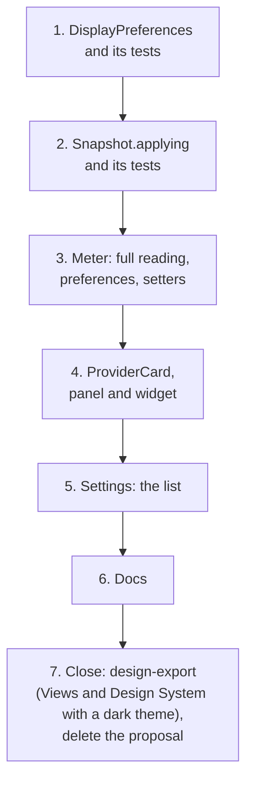

# Provider cards, implementation plan

How the cards get their order and their windows, and the order in which it is built. The decisions are in
[ADR 0035](../../adr/0035-provider-cards-order-and-windows-are-preferences.md); this page is the map from them to commits.
It builds on [Alerts with a fix](../2026-10-30-alerts-with-a-fix/index.md), whose banners sit above the cards.

## Intent

Preferences say which providers come first and which windows each shows. The app applies them to what it has read, writes
the result in the snapshot, and the panel, the widget and the menu bar draw it. Settings edits them.

## The pieces



The arrows go one way: the full reading, then the preferences applied, then the snapshot, then the surfaces. The widget
and the card compute nothing.

## Files

```text
Sources/TokenMeterCore/DisplayPreferences.swift   the protocol, the in-memory and the defaults versions
Sources/TokenMeterCore/Snapshot.swift             gains `applying(_:)`
App/TokenMeter/Meter.swift                        keeps the full reading, the preferences, the setters
App/TokenMeter/SettingsView.swift                 the list with the handle and the choice of windows
Shared/ProviderCard.swift                         the card used by the panel and the widget
App/TokenMeter/DragHandle.swift                   the handle to grab a card, a component of the design system
Shared/UsageViews.swift                           ProviderBlock becomes the card's content
Tests/TokenMeterCoreTests/DisplayPreferencesTests.swift
```

## The model



`windows(provider)` is `nil` when nothing was chosen, which means every window. Window names are the ones the provider
declares (`5h`, `7d`, or any other), so a provider with other windows is offered those.

## A refresh



## The order of work



| Step | Adds                                                                                                                                                                           | Tests that show it works                                                                      | Gate                                          |
| :--- | :----------------------------------------------------------------------------------------------------------------------------------------------------------------------------- | :-------------------------------------------------------------------------------------------- | :-------------------------------------------- |
| 1    | `DisplayPreferences.swift`                                                                                                                                                     | order kept and a new provider last, windows nil means all, the defaults version persists      | `pnpm run check`                              |
| 2    | `Snapshot.applying`                                                                                                                                                            | order, a hidden window dropped, one always kept, an unknown provider in the order ignored     | `pnpm run check`                              |
| 3    | `Meter.swift`                                                                                                                                                                  | built; the setters change the snapshot and the menu-bar percentage counts the visible windows | `pnpm run check` and `xcodebuild`             |
| 4    | `ProviderCard.swift`, `UsageViews.swift`, the panel, the widget                                                                                                                | built, then looked at on screen in light and in dark                                          | `pnpm run check`, `xcodebuild` and the screen |
| 5    | `SettingsView.swift`                                                                                                                                                           | built; dragging and the choice looked at on screen                                            | `pnpm run check`, `xcodebuild` and the screen |
| 6    | the docs: Settings guide, Core API                                                                                                                                             | the docs build                                                                                | `pnpm run check`                              |
| 7    | the Views and the Design System (the new components `ProviderCard`, `ProviderListRow` and `DragHandle`, the `card-fill` and handle tokens, a dark theme), the feature's status | the Views show the cards as built; the Design System has a dark theme                         | proposal canvas deleted when Fabio asks       |

Steps 1 to 6 are one commit each, three files at most, and leave the gate green. Steps 3 to 5 are not built by the gate,
so they are built with `xcodebuild` and looked at, in the light and the dark appearance. Step 7 is the close:
`design-export` refreshes the Views and the Design System, the status becomes _Implemented_, and the proposal canvas is
deleted when Fabio asks.

## Rules that keep it modular

| Rule                                                       | Why                                                   |
| :--------------------------------------------------------- | :---------------------------------------------------- |
| Preferences are read and applied in the core, never drawn. | The surfaces stay a drawing of a snapshot (ADR 0001). |
| The common code names no provider and no window.           | The same rule as ADR 0015 to 0018.                    |
| The card uses system colours and their opacities only.     | Light and dark hold without a value for either.       |
| `providers.json` is never written for a preference.        | The file is the user's (ADR 0033).                    |

## Open

- Whether a provider with more than two windows shows its choice as a menu or as a row of segments.
- How the widget shows a card whose windows are all hidden but one: unchanged, a card with one row.

## Related

- [Proposal](./proposal.md) and [overview](./index.md)
- [Architecture](../../develop/architecture.md) and [Core API](../../develop/core-api.md)
- [ADR 0035](../../adr/0035-provider-cards-order-and-windows-are-preferences.md)
