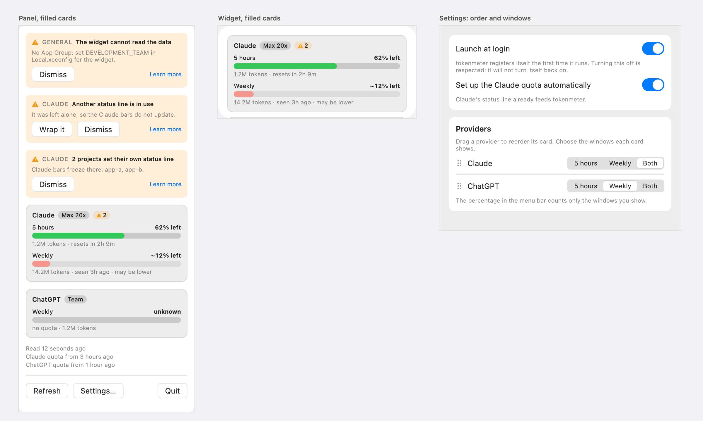
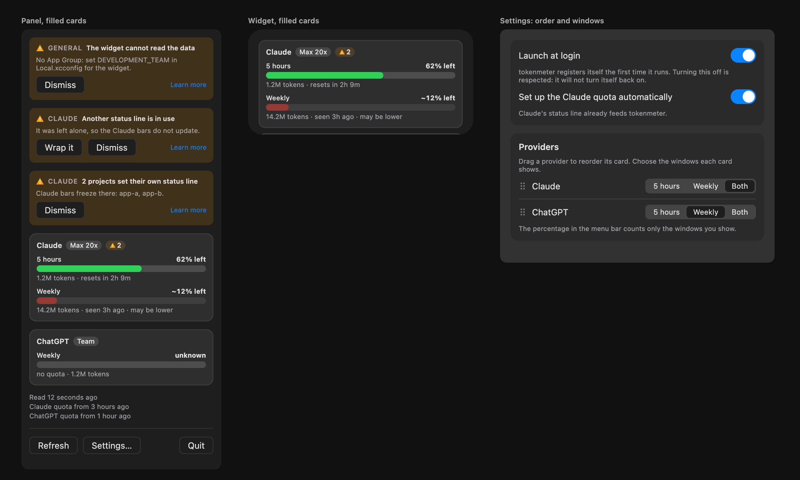

# Provider cards, proposal

The design that was chosen from two variants, filled and outlined cards. It was drawn as a canvas of artboards in
Claude, which is deleted once the feature is implemented; this page is what stays. The decisions behind it are in
[ADR 0035](../../adr/0035-provider-cards-order-and-windows-are-preferences.md).

## Intent

One card per provider, the windows you want, in the order you want. Nothing else about the bars, the rows or the banners
changes.

## The proposal

Light and dark, as drawn. Claude shows both windows and ChatGPT only Weekly, in that order.

## What changes

| Surface  | What it shows                                                                                                                                                                | Why                                                                                   |
| :------- | :--------------------------------------------------------------------------------------------------------------------------------------------------------------------------- | :------------------------------------------------------------------------------------ |
| Panel    | The problem banners, then one card per provider: name, plan, the problem chip and the windows chosen.                                                                        | The card groups what belongs to one provider and nothing else.                        |
| Widget   | The same cards. The medium widget still holds one card fully and clips the next, so the order decides which provider it shows.                                               | It is the one reason to reorder that costs nothing to explain.                        |
| Settings | A list of the providers with a handle to drag and two arrows (up, down) as the way that always works, and for each a choice of windows: **5 hours**, **Weekly** or **Both**. | One place for both preferences. With more than two windows the choice becomes a menu. |
| Menu bar | Unchanged. Its percentage is the lowest of the **visible** windows.                                                                                                          | Hiding a window must not leave the menu bar speaking about it.                        |

## Rules

- **The card is filled** with the colour of the text at 7% (`Color.primary`) and has a hairline of the same colour at 10%
  (`border-divider`), a `radius-group` corner and `space-10` of padding. The fill is a new token, `card-fill`. At 4% and
  with no hairline the first build did not read as a group on the dark panel.
- **Both is the default.** A provider nobody touched looks as before, inside a card.
- **At least one window always stays visible.** Choosing the only visible window again does nothing.
- **A hidden window is ignored.** It is not drawn, it is not in the menu-bar percentage, and it raises no problem.
- **A new provider goes last.** The order is kept per provider id, so removing one from `providers.json` loses nothing.
- **"Daily" is the 5 hours window.** No provider reports a daily limit today; a provider that declared one would appear in
  the choice by its own name.

## Appearance

The card, the chip and the banners use only system colours and opacities of them, so the light and the dark appearance
both hold. The design system defines only the light one for now, so the dark image above uses the macOS system dark
colours, values assumed, and the design system gains a dark theme when the feature is closed.

## Settled by building

- **Reordering is a drag and two arrows.** The first build used the list's own move gesture, which a grouped form on macOS
  does not offer: nothing could be dragged. The row now drags on its own and has an up and a down arrow, so the order can be
  changed without dragging. The name has a line of its own and the choice of windows sits under it, so a name is never
  squeezed. The handle is a tinted area that darkens and shows an open hand under the pointer, and a drag starts only
  from it, so the area to act on is clear and the choice of windows is never grabbed by mistake.

## Related

- [Overview](./index.md) and [implementation plan](./plan.md)
- [Reading the Bars](../../use/bars.md)
