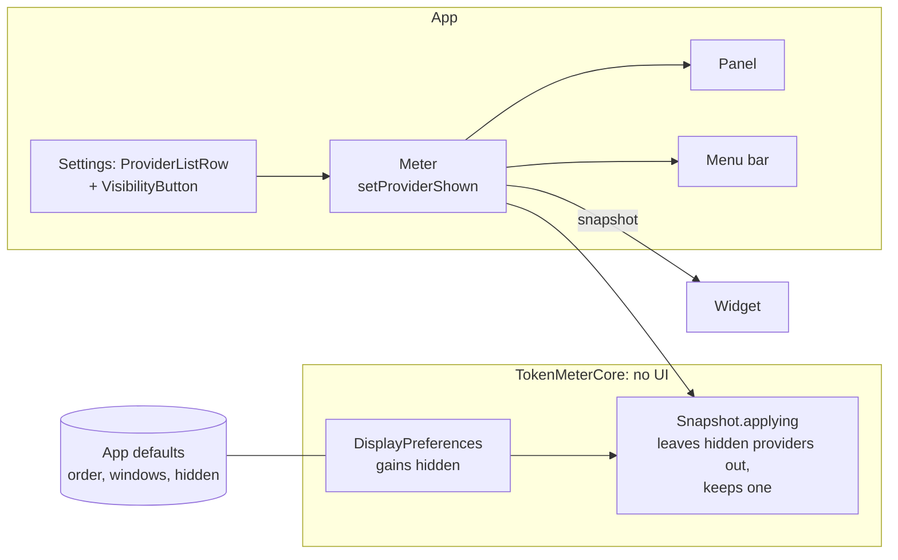

# Hide a provider, implementation plan

How a provider gets hidden, and the order in which it is built. The decision is
[ADR 0036](../../adr/0036-a-provider-can-be-hidden.md); this page is the map from it to commits. It extends
[Provider cards](../2026-10-30-provider-cards/plan.md).

## Intent

A preference says which providers are hidden. The app applies it to what it has read, as it already does for the order and
the windows, and the panel, the widget and the menu bar draw the result. Settings edits it.

## The pieces



## Files

```text
Sources/TokenMeterCore/DisplayPreferences.swift  gains `hidden` and `setHidden`
Sources/TokenMeterCore/Snapshot.swift            `applying` leaves hidden providers out
App/TokenMeter/Meter.swift                       `isShown` on a card provider, `setProviderShown`
App/TokenMeter/VisibilityButton.swift            the eye, a component of the design system
App/TokenMeter/SettingsView.swift                the eye in the row, the dimming of a hidden one
```

## The order of work

| Step | Adds                                        | Tests that show it works                                                                                     | Gate                                          |
| :--- | :------------------------------------------ | :----------------------------------------------------------------------------------------------------------- | :-------------------------------------------- |
| 1    | `DisplayPreferences`, `Snapshot.applying`   | hidden left out with its problems kept, one always stays, place and windows kept when shown again            | `pnpm run check`                              |
| 2    | `Meter`, `VisibilityButton`, `SettingsView` | built; the last shown provider cannot be hidden                                                              | `pnpm run check`, `xcodebuild` and the screen |
| 3    | the docs: guide, Core API                   | the docs build                                                                                               | `pnpm run check`                              |
| 4    | close: the Views and the Design System      | the Views show the eye and the dimmed row; the Design System has `VisibilityButton`; the proposal is deleted | proposal canvas deleted                       |

Steps 1 to 3 are one commit each and leave the gate green. Step 4 is the close, as for every feature.

## Rules that keep it modular

| Rule                                                | Why                                                   |
| :-------------------------------------------------- | :---------------------------------------------------- |
| The preference is applied in the core, never drawn. | The surfaces stay a drawing of a snapshot (ADR 0001). |
| The common code names no provider.                  | The same rule as ADR 0015 to 0018.                    |
| The eye is its own view in its own file.            | It is a component of the design system.               |

## Related

- [Proposal](./proposal.md) and [overview](./index.md)
- [ADR 0036](../../adr/0036-a-provider-can-be-hidden.md)
