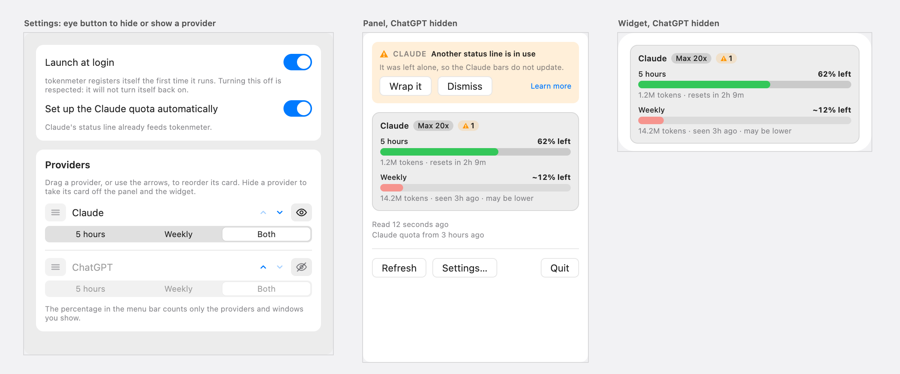
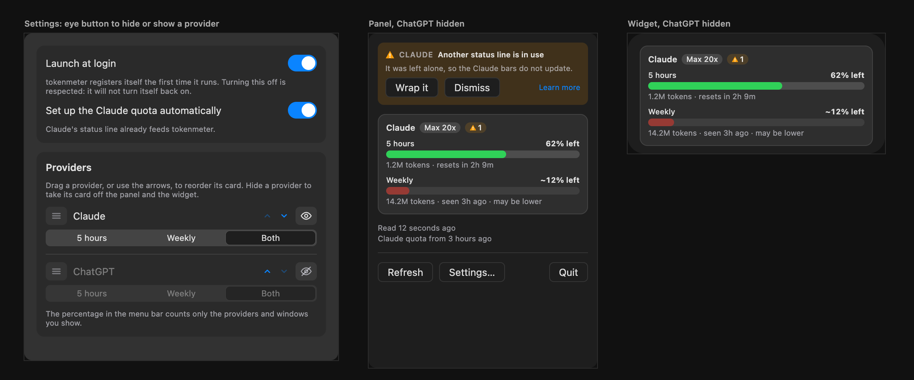

# Hide a provider, proposal

The design that was chosen from two variants, an eye button and a text button. It was drawn as a canvas of artboards in
Claude, which is deleted once the feature is implemented; this page is what stays. The decisions behind it are in
[ADR 0036](../../adr/0036-a-provider-can-be-hidden.md).

## The proposal

Light and dark, as drawn. ChatGPT is hidden, so the panel and the widget show only Claude, and the medium widget no longer
clips a second card.

## What changes

| Surface  | What it shows                                                                                                                                                  | Why                                                                       |
| :------- | :------------------------------------------------------------------------------------------------------------------------------------------------------------- | :------------------------------------------------------------------------ |
| Settings | An eye button at the end of each provider's row, after the arrows. Open eye: shown, click to hide. Crossed eye: hidden, click to show. A hidden row is dimmed. | One place for order, windows and visibility, and the row stays reachable. |
| Panel    | The cards of the shown providers only. The banners are unchanged.                                                                                              | A hidden provider has no card.                                            |
| Widget   | The same cards. The first shown provider takes the room.                                                                                                       | Hiding one is a way to choose what the medium widget clips.               |
| Menu bar | Unchanged. Its percentage is the lowest of the shown providers' shown windows.                                                                                 | Hiding must not leave the menu bar speaking about it.                     |

## Rules

- **A hidden provider keeps its place and its choice of windows.** Showing it again puts it back as it was.
- **One provider always stays.** The eye of the last shown provider is disabled.
- **A hidden provider's problems still show** as banners in the panel: they concern the person, not the card.
- **A provider added later is shown.**
- **The eye is a system colour at an opacity** (`handle-fill` as its background), so the light and the dark appearance both
  hold. It is a component of the design system, `VisibilityButton`.

## Settled by building

Nothing yet.

## Related

- [Overview](./index.md) and [implementation plan](./plan.md)
- [Provider cards](../2026-10-30-provider-cards/proposal.md)
