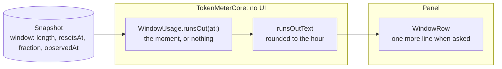

# Burn rate, implementation plan

How the line is worked out and drawn, and the order it is built in. The decision is
[ADR 0002](../../adr/0002-quota-model-and-data-sources.md).

## The pieces



## Files

```text
Sources/TokenMeterCore/RunOut.swift       the estimate and its text; staleAfter moves here so both use one value
Shared/UsageViews.swift, ProviderCard.swift  the line, drawn only where asked
App/TokenMeter/MenuContent.swift          the panel asks for it
```

## The order of work

| Step | Adds                                  | Tests that show it works                                                                             |
| :--- | :------------------------------------ | :--------------------------------------------------------------------------------------------------- |
| 1    | the ADR, the plan and the proposal    | the docs build                                                                                       |
| 2    | `RunOut.swift`, `staleAfter` in core  | runs out before reset; lasts says nothing; stale, reset, unknown, too early and no reset say nothing |
| 3    | the line in `WindowRow`, in the panel | `xcodebuild`; the panel on screen; the widget is unchanged                                           |
| 4    | close: Views, status, Use and Develop | `pnpm run check`; the row moves to Implemented                                                       |
