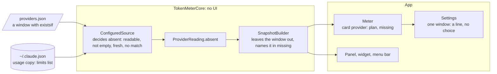

# Windows by plan, implementation plan

How a window gets dropped when the plan lacks it, and the order in which it was built. The decision is
[ADR 0037](../../adr/0037-a-window-exists-only-if-the-data-lists-it.md).

## The pieces



## Files

```text
Sources/TokenMeterCore/ProviderConfig.swift      ExistsIf; the migration adds the rule to Claude's 5 hours
Sources/TokenMeterCore/ProviderSource.swift      ProviderReading.absent
Sources/TokenMeterCore/ConfiguredSource.swift    decides which windows are absent
Sources/TokenMeterCore/Snapshot.swift            the builder drops them; ProviderSnapshot.missing
Sources/TokenMeterCore/DefaultProviders.swift    the seed carries the rule
Shared/UsageViews.swift                          WindowSpec.limitName
App/TokenMeter/Meter.swift, SettingsView.swift   plan and missing in a card provider; the line in Settings
```

## The order of work

| Step | Adds                                            | Tests that show it works                                                                      |
| :--- | :---------------------------------------------- | :-------------------------------------------------------------------------------------------- |
| 1    | the ADR                                         | the docs build                                                                                |
| 2    | `existsIf`, `absent`, the builder and `missing` | absent only when fresh data lists others; unknown is not absent; a model goes with its window |
| 3    | the seed and the migration                      | an old file gets the rule once, with a backup                                                 |
| 4    | `Meter` and Settings                            | built; run on the author's real data: Claude has Weekly and the model, no 5 hours             |
| 5    | the docs and the close                          | the docs build; the Views and the Design System; the proposal deleted                         |

## Related

- [Proposal](./proposal.md) and [overview](./index.md)
