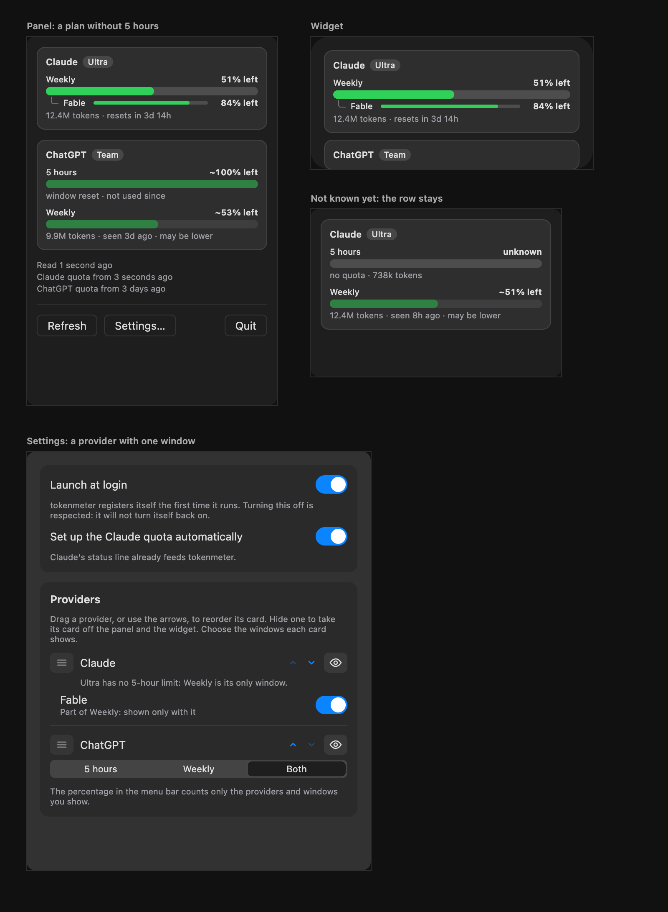

# Windows by plan, proposal

The design that was chosen: a card without the windows the plan lacks, Settings without a choice of one window, and the row
kept while nothing is known. It was drawn as a canvas of artboards in Claude, which is deleted once the feature is
implemented; this page is what stays. The decisions behind it are in
[ADR 0037](../../adr/0037-a-window-exists-only-if-the-data-lists-it.md).

## The proposal

## What changes

| Surface  | What it shows                                                                                                                                                                              | Why                                                                          |
| :------- | :----------------------------------------------------------------------------------------------------------------------------------------------------------------------------------------- | :--------------------------------------------------------------------------- |
| Panel    | A card without the windows the plan lacks. Claude on Ultra has Weekly and the model's line; ChatGPT keeps its two windows.                                                                 | A grey "unknown" row says nothing true.                                      |
| Widget   | The same cards. The shorter card leaves room for the start of the next one.                                                                                                                | The widget draws what the snapshot holds.                                    |
| Settings | A selector with one segment for each window the plan has, chosen independently, in the accent colour when on; a model is a sub-segment under its window. Choosing none hides the provider. | The same control serves one window or many, and a model comes with the plan. |
| Menu bar | Unchanged. Its percentage counts only the windows that exist.                                                                                                                              | A window that does not exist must not set the number.                        |

## Rules

- **Unknown is not absent.** A window goes only when data that can be believed lists the other limits and does not name it:
  the file is readable, the list is not empty and it is at most six hours old. Otherwise the row stays, with "unknown".
- **A window can come back.** When a fresh list names it again, the row returns.
- **A model of a missing window goes with it.**
- **No plan or model is named in the code.** The segments come from the data.
- **ChatGPT is unchanged**: its logs declare their own windows.

## Settled by building

Nothing yet.

## Related

- [Overview](./index.md) and [implementation plan](./plan.md)
- [Model limits](../2026-10-30-model-limits/proposal.md)
