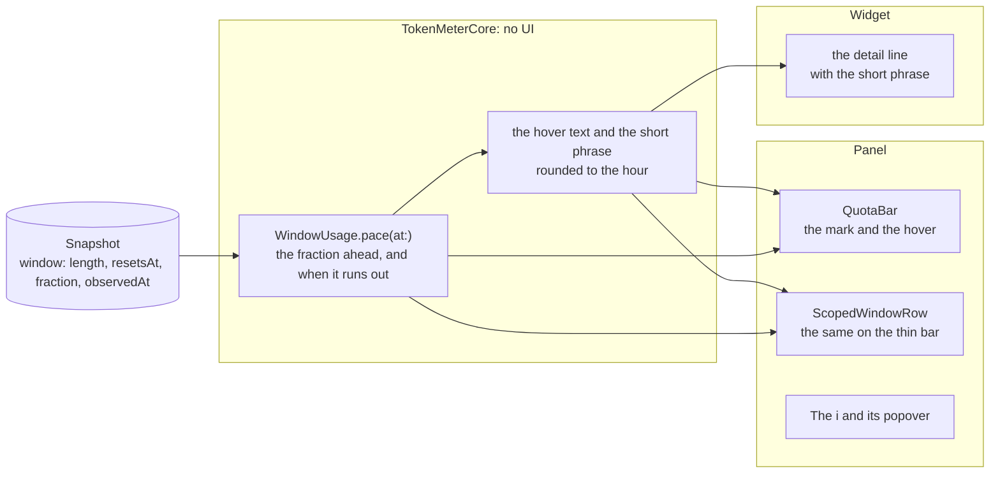

# Pace on the bars, implementation plan

How the mark, the hover, the `i` and the widget phrase are worked out and drawn, and the order they are built in. The
decision is [ADR 0039](../../adr/0039-the-pace-is-drawn-on-the-bar.md).

## The pieces



## Files

```text
Sources/TokenMeterCore/RunOut.swift        the pace: the fraction ahead, the hover text, the short phrase
Shared/UsageViews.swift                    QuotaBar draws the mark; WindowRow loses the line; ScopedWindowRow gets the mark
Shared/ProviderCard.swift                  the i beside the provider's name, when the panel asks for it
App/TokenMeter/MenuContent.swift           the panel asks for the mark, the hover and the i
Tests/TokenMeterCoreTests/RunOutTests.swift
docs/use/bars.md                           a section for Learn more
```

## The order of work

Three files at most per step, the gate green, and `xcodebuild` for the steps that touch the app or the widget.

| Step | Adds                                                                                              | Tests that show it works                                                                                                                                          |
| :--- | :------------------------------------------------------------------------------------------------ | :---------------------------------------------------------------------------------------------------------------------------------------------------------------- |
| 1    | the ADR, the proposal and this plan                                                               | the docs build                                                                                                                                                    |
| 2    | in core: the fraction ahead, the hover text for a lasting window and the short phrase             | the fraction is `(resetsAt − observedAt) / length`; remaining under it means runs out, over it lasts; no value under ADR 0038's conditions; the phrase is rounded |
| 3    | the mark on `QuotaBar`, the hover on the bar, the permanent line removed, in the panel            | `xcodebuild`; the panel on screen, light and dark; a bar with and without a mark                                                                                  |
| 4    | the mark and the hover on a model's thin bar                                                      | `xcodebuild`; Fable on screen; the model's reset is its window's                                                                                                  |
| 5    | the `i` beside the provider's name, with its popover, `x` and Learn more                          | `xcodebuild`; the popover on screen; the panel stays open while it is; the link opens the docs                                                                    |
| 6    | the short phrase in the Weekly detail line of the widget                                          | `xcodebuild`; the medium widget on the desktop; the small widget unchanged                                                                                        |
| 7    | the section of the Bars page that Learn more opens, and the Use pages that said the line is there | the docs build                                                                                                                                                    |
| 8    | close: Views and Design System, status, Use and Develop pages                                     | `pnpm run check`; the row moves to Implemented                                                                                                                    |

Steps 3 and 4 are the same drawing in two places and can be one commit if it stays under three files. Step 2 is the only
one that decides a number, so it is the one with the most tests.

## What is not known until it is built

- **The `i` popover inside the menu-bar panel.** If it closes the panel, step 5 changes shape: the explanation would be a
  tooltip, or a section of the panel itself.
- **The widget's real height.** Step 6 is judged on the desktop, not on the drawing.
- **The contrast of the orange text** on a light card, which was not measured.
- **What the hover says when the quota lasts**: proposed "At this pace it lasts until the reset", to be confirmed in step 2.
