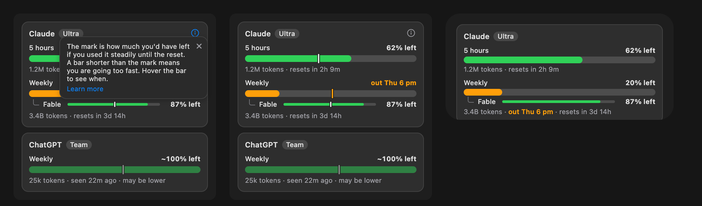

# Pace on the bars, proposal

The design that was chosen. [ADR 0039](../../adr/0039-the-pace-is-drawn-on-the-bar.md) is the decision.

## What changes

| Surface           | What it shows                                                                                                                                                                               | Why                                                            |
| :---------------- | :------------------------------------------------------------------------------------------------------------------------------------------------------------------------------------------ | :------------------------------------------------------------- |
| Panel, a bar      | A mark where the bar would end at a steady use. Orange when the quota runs out before the reset, the text colour when it lasts. No mark when it cannot be estimated.                        | It shows at a glance whether the quota lasts.                  |
| Panel, the figure | While the pointer is on a bar, its figure, "20% left", says "out Thu 6 pm" in orange, "lasts", or "22 min ago" for an old reading, with a short fade. It goes back when the pointer leaves. | The date is there when wanted, takes no row and moves nothing. |
| Panel, a model    | The same mark on its thin bar, 8 px tall, and the same swap on its own figure, which its bar gives way to, smoothly. No line of its own.                                                    | The model's limit had a figure and nowhere to say it.          |
| Panel, the `i`    | Beside the provider's name. A click opens a popover with the explanation, an `x` and a Learn more link to the docs.                                                                         | Nothing else explains the mark.                                |
| Widget            | In the Weekly detail line, in short, orange and semibold: "3.4B tokens · out Thu 6 pm · resets in 3d 14h". No mark, no hover. The small widget is unchanged.                                | The widget has no pointer, and no room for a row.              |
| Settings          | Unchanged.                                                                                                                                                                                  | There is nothing to choose.                                    |

The popover says: "The mark is how much you'd have left if you used it steadily until the reset. A bar shorter than the
mark means you are going too fast. Hover the bar to see when."

## The variants that were drawn

- **A, B, C** put the answer in text: a line under the window, one line in the footer, or inside the detail line. C is
  kept for the widget.
- **D, E** put a mark on the bar, alone or with the short phrase. Alone, the mark could not be read without an
  explanation.
- **F** painted the gap between the bar and the mark. It was not seen working at 10 px.
- **G, H, I, J, L** worked the `i`, the model's bar and the hover. The chosen ones are the `i` beside the name (G), the
  mark and the hover on the bar and on a model's thin bar (I, L).
- **The hover** was drawn as a bubble above the row (A), as the detail line swapped (B, C), as a status line at the bottom (D) and
  as the bar's own figure (E). E was chosen: the bubble covered the row above, and the swap of the detail line read as a
  layout shift.
- **The popover** was drawn to close by itself after a timer, with a shrinking line. It closes with an `x` instead.

## Rules

- **The mark exists where ADR 0038's conditions hold, except that nothing used is fine and a stale figure counts**: a fresh, reported
  figure with a reset time in the future and at least 10% of the window gone. Where nothing was used it lasts. A mark with the bar to its right says it lasts, and no mark says nothing can be said.
- **The position is a fraction of the window**, `(resetsAt − observedAt) / length`, so it needs nothing the snapshot lacks.
- **The date is rounded to the hour** and written as today, tomorrow or the weekday, in the hover and in the widget.
- **The mark is information, not a control.** The `i` and the `x` are buttons, and the bar is only hovered.

## Open

- Whether a popover opened from inside the menu-bar panel keeps the panel open.
- Whether the medium widget already cuts what is under its first card: computed from the drawing, not seen.
- The contrast of the orange text on a light card was not measured.
