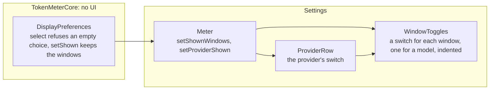

# Settings switches, implementation plan

How the preferences change and how Settings draws a switch for the provider and one for each window, and the order it is
built in. The decision is [ADR 0041](../../adr/0041-the-provider-switch-alone-hides-a-provider.md).

## The pieces



What does not change: the snapshot, `Snapshot.applying`, the panel, the widget and the menu bar. They read `hidden` and the
chosen windows, which keep their meaning.

## Files

```text
Sources/TokenMeterCore/DisplayPreferences.swift    select refuses an empty choice and no longer hides; setShown keeps the windows
App/TokenMeter/Meter.swift                         setShownWindows loses canHide; hiding no longer clears anything
App/TokenMeter/WindowToggles.swift                 new: the list of switches, replaces WindowSelector
App/TokenMeter/SettingsView.swift                  the provider's switch in place of the eye; the list under it
App/TokenMeter/WindowSelector.swift                removed
App/TokenMeter/VisibilityButton.swift              removed
Tests/TokenMeterCoreTests/SnapshotTests.swift      the tests of select and setShown change
docs/use/configure-providers.md                    the arrange-the-cards section
docs/develop/core-api.md                           the line of DisplayPreferences.select
```

## The order of work

Three files at most per step, the gate green, and `xcodebuild` for the steps that touch the app.

| Step | Adds                                                                                                                          | Tests that show it works                                                                                                                                                                                                                                                                                                                 |
| :--- | :---------------------------------------------------------------------------------------------------------------------------- | :--------------------------------------------------------------------------------------------------------------------------------------------------------------------------------------------------------------------------------------------------------------------------------------------------------------------------------------- |
| 1    | the ADR, the proposal and this plan                                                                                           | the docs build                                                                                                                                                                                                                                                                                                                           |
| 2    | in core and `Meter`: `select` refuses an empty choice and never hides, `setShown` and hiding keep windows and models          | an empty choice is refused and changes nothing; turning a window off leaves the provider shown; hiding keeps the windows and the hidden models; showing gives them back; a provider hidden with no windows saved comes back with every window; selecting a window still turns its models on. `xcodebuild` because `Meter` calls `select` |
| 3    | `WindowToggles.swift`: the list, a row for each window, a model indented, dimmed and disabled when off                        | `xcodebuild`; not used yet                                                                                                                                                                                                                                                                                                               |
| 4    | `SettingsView`: the provider's switch in place of the eye, the list under it; `WindowSelector` and `VisibilityButton` removed | `xcodebuild`; Settings on screen with `./scripts/preview.sh`: a provider off keeps its list dimmed, the last window does not turn off, a model is dimmed with its window, the last provider's switch is disabled                                                                                                                         |
| 5    | the Use page and the API table say what the switch does                                                                       | the docs build                                                                                                                                                                                                                                                                                                                           |
| 6    | after the merge, on a `docs/` branch: the Views and Design System as built, the status, the row in the list                   | `design-export`; `pnpm run check`; the row moves to Implemented                                                                                                                                                                                                                                                                          |

After step 5 come the review and the preview with `./scripts/preview.sh`, and the merge into `main`; step 6 follows them.

Step 2 is the only one that decides a rule, so it is the one with the tests. Steps 3 and 4 are one drawing in two commits
so that no commit leaves a view that nothing uses and the old one still in place.

The close step names the components of the Design System: **ProviderToggle** (the provider's switch) and **WindowToggleRow**
(a window's row, with a model's indented) are new, and the cards of **VisibilityButton** and **WindowSelector** go. The
Views lose the Settings states of one window, of Weekly off and of nothing selected, and gain the ones of the proposal.

## What is not known until it is built

- **The size of the switch in a grouped form.** Three sizes were tried and did not line up; every switch is now the form's own
  size, and the level is told by the indent and the text.
- **The indentation of a model** under its window's label, which was drawn in HTML.
- **The tooltip of the last window** on a disabled switch: a disabled control may not show one, and then the rule is
  explained by the line under the list.
- **Whether a click on a dimmed list does nothing** or moves the focus; judged on screen.
