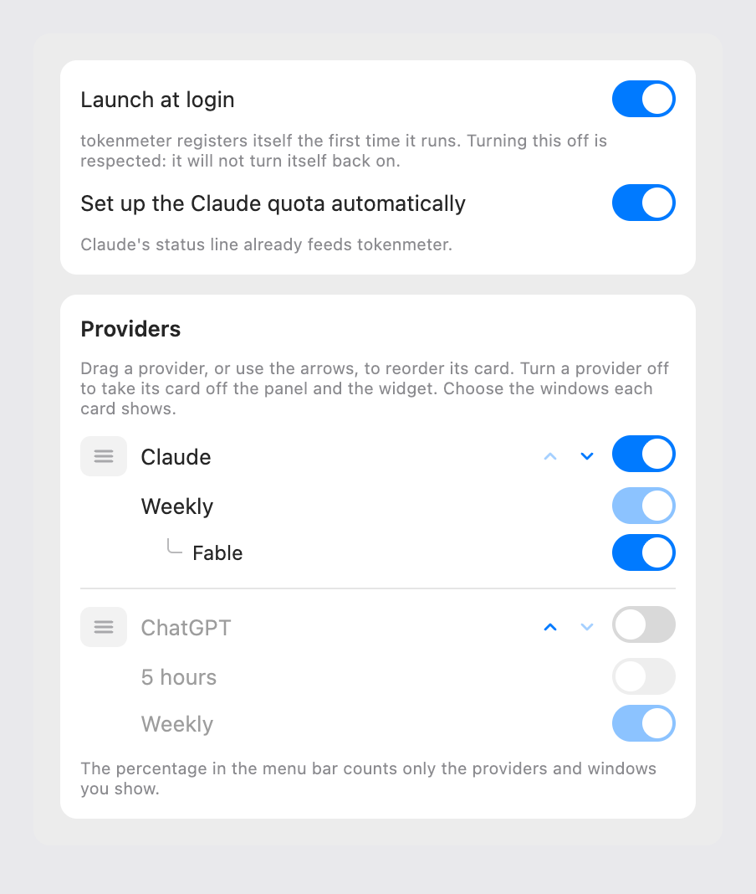

# Settings switches, proposal

The design that was chosen. It was drawn as a canvas in Claude, which is deleted once the feature is implemented; this
page is what stays.

Claude is drawn as it is for the Ultra plan, with Weekly alone and Fable under it. ChatGPT is the provider that is off.

## What changes

| Surface  | What it shows                                                                                                                                                                                        | Why                                                                     |
| :------- | :--------------------------------------------------------------------------------------------------------------------------------------------------------------------------------------------------- | :---------------------------------------------------------------------- |
| Settings | A switch beside the provider's name, in place of the eye. Under the provider a vertical list, one row per window with its switch, and a model's limit indented under its window with a smaller text. | A master switch with options under it is the pattern of macOS Settings. |
| Panel    | Unchanged.                                                                                                                                                                                           | What a card shows is the same.                                          |
| Widget   | Unchanged.                                                                                                                                                                                           | Same.                                                                   |
| Menu bar | Unchanged. Its percentage counts the providers that are on.                                                                                                                                          | Same.                                                                   |

## Rules

- **The provider's switch is the only thing that hides it.** Turning a window off never hides the provider.
- **The last window stays on.** Its switch does not turn off and its tooltip says to turn the provider off.
- **A provider that is off keeps its list**, dimmed and not touchable, with the choice it had. Turning it on gives it back
  as it was, not with every window selected.
- **A model's limit** is a child of its window: dimmed and not touchable when the window is off.
- **At least one provider stays on**, as today.
- The switch is the `Toggle` that Settings already uses for "Launch at login".

## The variants that were drawn

- **A, chosen:** a switch for the provider and one for each window.
- **B:** the eye and the pills in a row, kept as today, with the same rule that the eye alone hides, and the pills of a
  hidden provider dimmed. It is shorter, but it keeps two kinds of control.
- Before these, a hidden provider with its row of pills removed was drawn and dropped: it made "only Weekly" a two-step
  choice for a hidden provider, and the choice could not be read.

## Settled by building

- **Every switch has the same size.** The drawing had a smaller switch for a model; built with three sizes, the switches did not
  line up, so the level is told by the indent and the text size. The image above is the drawing, with the smaller one.

## Open

- The exact indentation of a model's limit is settled on screen.
- The dark appearance is not drawn: the design system defines the light one only.

## Related

- [Overview](./index.md)
