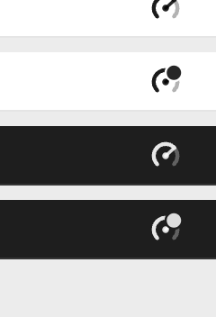

# Menu bar icon only, proposal

The design that was chosen. It was drawn as a canvas in Claude, which is deleted once the feature is implemented; this
page is what stays.

## What changes

| Surface  | What it shows                                                                                                                              | Why                                                          |
| :------- | :----------------------------------------------------------------------------------------------------------------------------------------- | :----------------------------------------------------------- |
| Menu bar | The gauge icon. With a **dot** on its top right when the panel lists a problem; the dot is 8 px on an 18 px icon, set off by a clear ring. | One signal, as other apps do, and it says nothing it cannot. |
| Panel    | Unchanged: the problems are listed with their message and their fix.                                                                       | The detail is where the user can act on it.                  |
| Settings | The note "The percentage in the menu bar counts only the providers and windows you show" is removed.                                       | There is no percentage in the bar any more.                  |

## Rules

- **The bar shows no figure.** A percentage taken across several providers does not say which plan it is about.
- **The dot has one meaning**: something in the panel is worth opening it for. Today that is a problem the app reports.
  What it is, and how many, is in the panel.
- **The dot is the colour of the icon.** The icon is a template image, which has one colour, the system's, so it follows
  the light and the dark menu bar; a coloured dot is not possible without losing that.
- **The icon is named for screen readers**: "tokenmeter", and "tokenmeter, needs attention" with the dot.

## Sizes that were compared

The dot was drawn at 5.6, 8 and 9.6 px. The small one gets lost on a real bar, the large one covers the end of the arc; the
medium one, 8 px, was chosen. This was judged on the drawing, not on a real menu bar.
