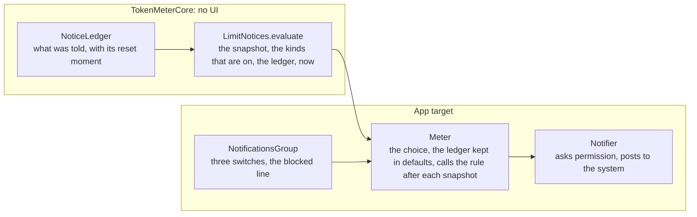

# Notifications, implementation plan

How the app decides that a notice is due, tells it once, and shows it, and the order it is built in. The decision is
[ADR 0012](../../adr/0012-limit-notices.md).

## The pieces

## Order

| Step | Commit                                                                      | Files                                                             |
| :--- | :-------------------------------------------------------------------------- | :---------------------------------------------------------------- |
| 1    | `feat(core): the rule that says which notices are due, and the ledger`      | `LimitNotices.swift`, `LimitNoticesTests.swift`                   |
| 2    | `feat(app): the notifier and the choice of notices in Meter`                | `Notifier.swift`, `Meter.swift`                                   |
| 3    | `feat(app): a group Notifications in Settings`                              | `NotificationsGroup.swift`, `SettingsView.swift`                  |
| 4    | `docs(use): notifications and the changelog`                                | `use/notifications.md`, `use/what-it-does.md`, `use/changelog.md` |
| 5    | `docs(develop): the rule in the core API, the notifier in the architecture` | `core-api.md`, `architecture.md`, `AGENTS.md`                     |
| 6    | Reconciliation, on a `docs/` branch after the merge                         | the Views and the Design System, the status, the row              |

## Tests and checks

- **Unit, in the core** (`LimitNoticesTests`): each threshold and its edge, that a kind that is off is silent, that a window is
  told once and not again at the next reading, that a window that resets arms again, that the most urgent is the only one posted
  and the others are written as told, that a kind switched on later tells what is due, that an old reading, an inferred figure, a
  figure with no quota and a window with no reset notify nothing, that a model's limit and its window are told apart, that the
  pace notice needs a pace that runs out before the reset, and that the ledger forgets an entry a day after its reset.
- **Gate**: `pnpm run check`, and `xcodebuild` of the app, which the gate does not build.
- **By hand, not verified until it is run**: the permission prompt, a notice on a real Mac, a click on it, the blocked line and
  the button that opens System Settings, and Focus modes.
