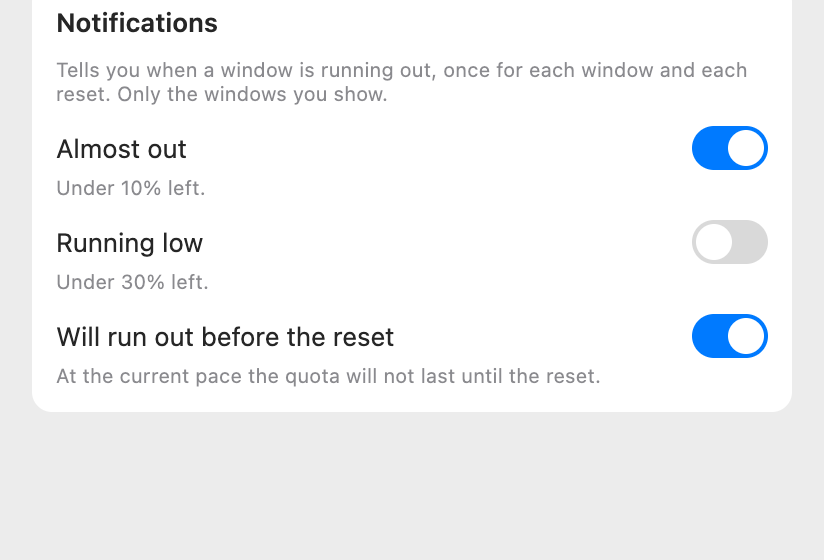
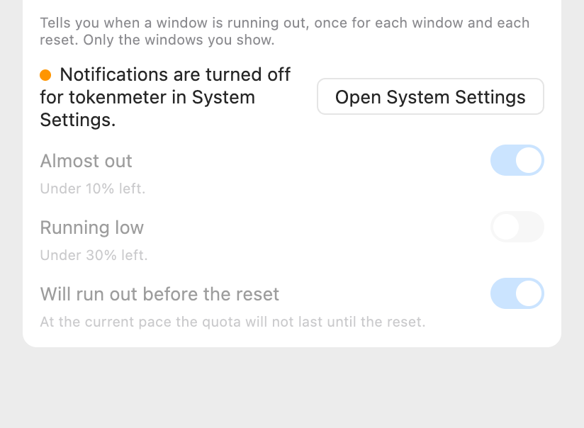

# Notifications, proposal

The design that was chosen, variant A of two. It was drawn as a canvas in Claude, which is deleted once the feature is implemented;
this page is what stays. The notification itself is drawn by macOS, not by the app: only the group in Settings is designed.

## What changes

| Surface       | What it shows                                                                                                                       | Why                                                             |
| :------------ | :---------------------------------------------------------------------------------------------------------------------------------- | :-------------------------------------------------------------- |
| Settings      | A group "Notifications" with a note and three switches, each with a line that says what it does. All off at first.                  | Each notice is decided by itself, and it is clear what it does. |
| Settings, too | When macOS has notifications off for the app, a line that says so and a button that opens System Settings; the switches are dimmed. | An acceptance that produces nothing would look like a defect.   |
| Notification  | One line: the provider and the window, what is left and when it resets. Drawn by the system.                                        | It says what to do next without opening anything.               |
| Panel, widget | Unchanged.                                                                                                                          | The notification is the new part.                               |

## Rules

- **Off by default.** The permission of macOS is asked the first time a switch is turned on, not when the app starts.
- **Three notices**, each its own switch: **Almost out**, under 10% left; **Running low**, under 30% left; **Will run out before
  the reset**, when the pace says the quota will not last until the reset. The 10% and the 30% are a choice, not a measurement.
- **Once for each window and each reset.** The key is the provider, the window, a model limit when there is one and the moment of
  the reset; when a window resets the notices arm again.
- **Only what you show.** A window or a provider you turned off in Settings does not notify.
- **Only a recent reading.** A figure the app marks with "~" because it is old does not notify: it may already have changed.
- **One line, no emoji**: a title "Claude · Weekly" and under it "9% left · resets in 2d 6h".
- **One notice at a time for a window.** When several are due at once, only the most urgent is shown, in the order _almost out_,
  _will run out_, _running low_; the others due at that moment count as told. A jump from 50% to 8% says "almost out" once, not
  three times.
- **A switch that is off tells nothing and remembers nothing**: turning it on later tells whatever is still due, so turning one on at
  25% tells it at once, because it is true.
- **Told once is kept**, for each window and reset, and forgotten a day after the reset. Nothing is told while macOS has the
  permission denied; Settings says so.
- **No network, no credentials.**

## Decisions that were proposed and not answered

These were proposed in the description and the design was drawn on them; no one said no, and no one said yes.

| Question                               | Proposed                                                          |
| :------------------------------------- | :---------------------------------------------------------------- |
| The two thresholds and the three kinds | 10%, 30% and "will run out before the reset", each its own switch |
| The default                            | Off                                                               |

## The other variant

Variant B had one switch, "Notify me when a window is running out", and the three choices under it, dimmed while it was off.
It was not chosen: it costs a click more for three rows.
