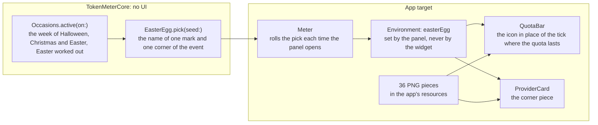

# Seasonal easter eggs, implementation plan

How the app knows that it is the week of an event, picks the pieces, and draws them, and the order it is built in. There is no
ADR: nothing here is structural beyond what the other features already have (a pure rule in the core, a value read by the
views). The rules of the product are in the [proposal](./proposal.md).

## The pieces

## Order

| Step | Commit                                                                              | Files                                                                                                |
| :--- | :---------------------------------------------------------------------------------- | :--------------------------------------------------------------------------------------------------- |
| 1    | `feat(core): the weeks of Halloween, Christmas and Easter, and the pick of a piece` | `EasterEggs/Occasion.swift`, `EasterEggs/EasterEgg.swift`, `EasterEggsTests.swift`                   |
| 2    | merged into step 1: the weeks and the pick are one folder and one test file         |                                                                                                      |
| 3    | `feat(app): the pieces of Halloween` and the same for Christmas and Easter          | 12 PNG images each, as data                                                                          |
| 4    | `feat(app): the icon in place of the pace tick, and the corner piece of a card`     | `Shared/EasterEggs/EasterEggs.swift`, `UsageViews.swift`, `ProviderCard.swift`                       |
| 5    | `feat(app): the panel rolls the pick of the easter egg each time it opens`          | `Meter.swift`, `MenuContent.swift`                                                                   |
| 6    | `docs(use)`: the easter eggs and the changelog, then a page of licences             | `use/seasonal-easter-eggs.md`, `use/changelog.md`, `use/licenses.md`, `Licenses/Sparkle-LICENSE.txt` |
| 7    | `docs(develop): the occasions in the core API and the pieces in the architecture`   | `core-api.md`, `architecture.md`, `AGENTS.md`                                                        |
| 8    | Reconciliation, on a `docs/` branch after the merge                                 | the Views and the Design System, the status, the row                                                 |

The images of step 3 are data, not code: they are the 36 pieces, twelve for each event, so each commit is bigger than three
files by nature.

## Tests and checks

- **Unit, in the core**: Easter Sunday for known years (2024 to 2030), the first and last day of each week and the day
  before and after, a day at the very end of a week in a time zone other than UTC, that the weeks never overlap, that the
  pick is the same for the same seed and always inside the set, and that each event has six marks and six corners with
  distinct names.
- **Gate**: `pnpm run check`, and `xcodebuild` of the app and the widget.
- **By eye, on a copy of the real views**: a harness outside the repository draws a card and a bar with an event's pieces on
  the light and the dark appearance, with the real views of `Shared/` and the real images.
- **Not possible to see in the app today**: the app shows the details only in the week of an event, and there is no mock
  mode to force one. The first time they will be seen in the app is in the week of the next event.
