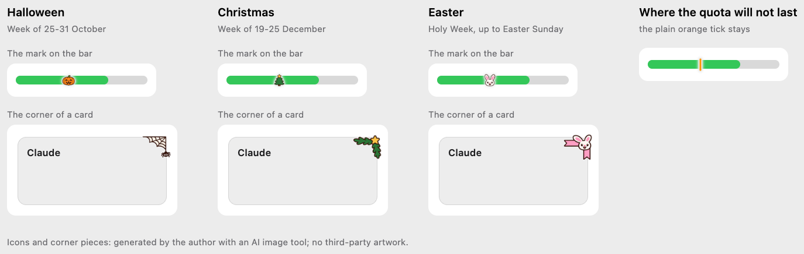
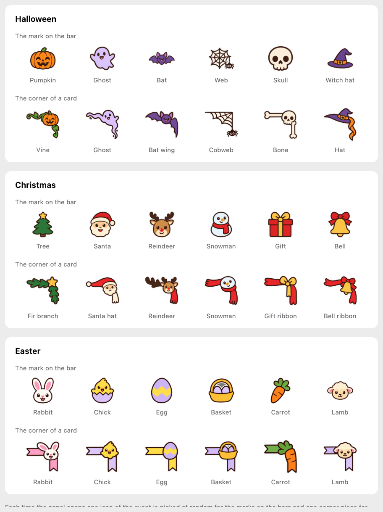
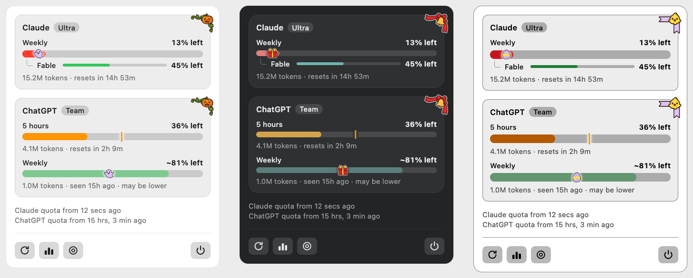

# Seasonal easter eggs, proposal

The design that was chosen. It was drawn as a canvas in Claude, which is deleted once the feature is implemented; this
page is what stays. **Every number in the images is a sample.**

## What changes

| Surface  | What it shows                                                                                                                               | Why                                                        |
| :------- | :------------------------------------------------------------------------------------------------------------------------------------------ | :--------------------------------------------------------- |
| Panel    | In the week of an event, a small icon of the event on each bar that has a pace mark and whose quota lasts, and a corner piece on each card. | A smile in two fixed places, never in the way of a figure. |
| Widget   | Nothing: it has no pace mark and no room.                                                                                                   | The widget stays as it is.                                 |
| Menu bar | Nothing.                                                                                                                                    | The dot there means something.                             |
| Settings | Nothing: there is no switch.                                                                                                                | The author's decision.                                     |

## The events

| Event     | The week it is on                                                                                                        |
| :-------- | :----------------------------------------------------------------------------------------------------------------------- |
| Halloween | The seven days up to 31 October: 25 to 31 October.                                                                       |
| Christmas | The seven days up to 25 December: 19 to 25 December.                                                                     |
| Easter    | The seven days up to Easter Sunday, which is worked out for each year (2026: 30 March to 5 April; 2027: 22 to 28 March). |

An event is a row of data: a name, the days it is on, an icon set and a corner set. A fourth event is a fourth row.

## Rules

- **Two places only.** The **mark on the bar**: the small icon takes the place of the pace tick where the quota lasts until
  the reset. The **corner of a card**: a piece that sits across the top right corner of each card.
- **Where the quota will not last, the plain orange tick stays.** The tick is a warning and the joke must never hide it.
- **One icon for the bars and one piece for the corners, picked at random each time the panel opens**, from the event's set,
  and kept while the panel stays open, so nothing changes under the person's eyes at each refresh.
- **The colours of the theme never change** for an event, and neither do the figures, the labels or the layout. A person who
  chose a theme for legibility keeps it.
- **Always on in its week.** No switch, no setting.
- **The widget and the menu bar do not take part.**
- **The pieces are PNG images generated by the author with an AI image tool**, in one style: a white sticker border around a
  dark outline, so that they read on the light and on the dark appearance. There is no third-party artwork, and the
  documentation says so on a page of licences.

## The pieces

| Event     | Icons for the bars                           | Corner pieces                                                              |
| :-------- | :------------------------------------------- | :------------------------------------------------------------------------- |
| Halloween | pumpkin, ghost, bat, candy, skull, witch hat | pumpkin with a vine, ghost, bat wing, cobweb, skull with a bone, hat       |
| Christmas | tree, Santa, reindeer, snowman, gift, bell   | fir branch with a star, Santa hat and scarf, reindeer, snowman, gift, bell |
| Easter    | rabbit, chick, egg, basket, carrot, lamb     | the same six, on a ribbon                                                  |

## What was not seen

The pieces were judged at 16 px on a render, not in the app, at 1x and 2x. The corner pieces overhang the card by about 6
points to look pinned on: that was chosen on the drawing. The weeks of Halloween and Christmas were chosen by the author;
Easter's week is worked out and is tested with known dates.
