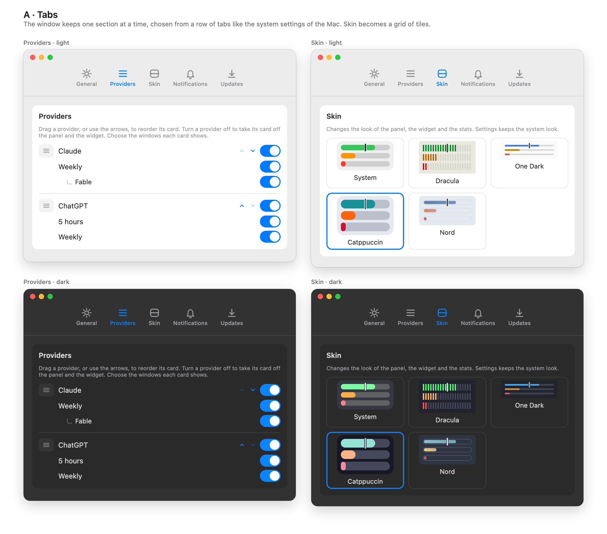

# Settings in tabs, proposal

The design that was chosen among five (tabs, a sidebar, sections that open, two columns, and Settings inside the panel). It was
drawn as a canvas in Claude, which is deleted once the feature is implemented; this page is what stays.

## What changes

| Surface  | What it shows                                                                                                               |
| :------- | :-------------------------------------------------------------------------------------------------------------------------- |
| Settings | A row of five tabs under the title bar, each an icon and a name, and the selected tab's section below. Fixed window height. |
| Skins    | The five skins are a grid of tiles, three to a row, each with its small preview and its name, the chosen one with a ring.   |
| Panel    | Nothing.                                                                                                                    |
| Widget   | Nothing.                                                                                                                    |

## The tabs

| Tab           | What is in it                                                                                  |
| :------------ | :--------------------------------------------------------------------------------------------- |
| General       | Launch at login; set up the Claude quota automatically, its status line and Restore original.  |
| Providers     | The cards in their order, each provider's switch, its windows and the model limits under them. |
| Skin          | The five skins.                                                                                |
| Notifications | The three kinds of notice, and the line about macOS permission when it is off.                 |
| Updates       | The switch, the version, the status line and Check now.                                        |

## Decisions taken in the design

- **Tabs, not a sidebar or a list that opens.** They are the smallest change and the one a Mac user already knows from System
  Settings; a sidebar costs a much wider window, and a list that opens hides the state of the other sections.
- **A fixed window height**, so the window does not jump when the tab changes. A section taller than the window scrolls.
- **The window opens on General.**
- **Settings keeps the system look**: the skins never apply to it.

## Not decided here

How the tabs are drawn in SwiftUI in a plain `Window` (the app opens Settings that way because `SettingsLink` does not work from a
menu-bar-only app) and the exact height are the plan's.
