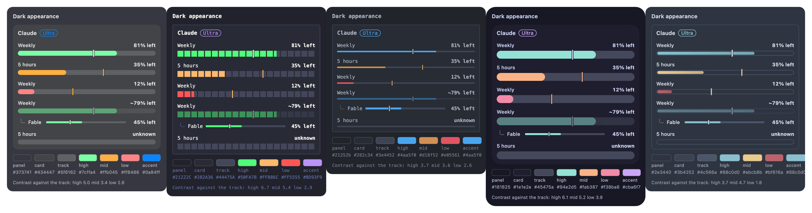
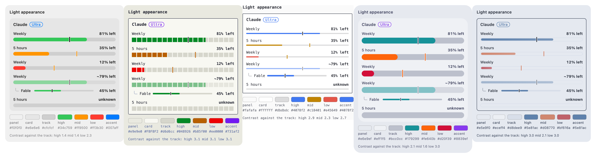
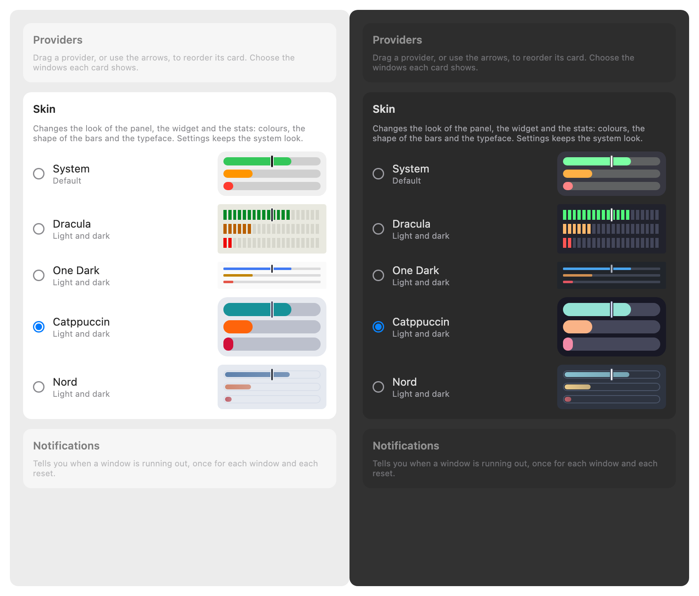

# Skins, proposal

The design that was chosen. It was drawn as a canvas in Claude, which is deleted once the feature is implemented; this page is
what stays. **Every number in the images is a sample.**

## What a skin is

A skin is a name that carries: the colour of the panel, of the card, of the bar track, of the text and of the accent; the three
colours of a quota (plenty, middle, low); the shape of the bar; the typeface; and the roundness of the cards. It has a dark and a
light version and follows the appearance of the Mac.

| Skin       | Look                                                               | Plenty | Source of the colours                                      |
| :--------- | :----------------------------------------------------------------- | :----- | :--------------------------------------------------------- |
| System     | The look of today, the window's translucent material               | green  | Apple's system colours                                     |
| Dracula    | Terminal: a bar of square blocks, monospace figures, a sharp card  | green  | The Dracula theme; its light version is derived, see below |
| One Dark   | Editor: a thin flat line, monospace figures                        | blue   | One Dark Pro and One Light                                 |
| Catppuccin | Soft: thick pill bars, very round cards                            | teal   | Catppuccin Mocha and Latte                                 |
| Nord       | Frost: an outlined bar with a blue fill, a card with only a border | blue   | Nord, Polar Night and Snow Storm                           |

## What changes

| Surface  | What it shows                                                                                                  |
| :------- | :------------------------------------------------------------------------------------------------------------- |
| Panel    | The skin's panel colour in place of the window's translucent material, its cards, bars, text and typeface.     |
| Widget   | The same, from the skin written in the snapshot the app publishes.                                             |
| Stats    | The quota colours of the skin in its bars and figures.                                                         |
| Settings | A group, _Skin_, with one choice of five and a small preview of each. The window itself keeps the system look. |
| Menu bar | Nothing.                                                                                                       |

## What stays

- The thresholds that colour a bar (under 15% low, under 40% middle) and what every figure says.
- The pace tick: light on a dark panel and dark on a light one where the quota lasts, and the skin's middle colour where it will
  not last, so the warning is never lost in a palette.
- The model row, indented under its window, with its hook, its thin line and its figure.
- The seasonal easter eggs, drawn over whichever skin is chosen.

## Decisions taken in the design

- **One skin for all providers**, not one for each.
- **The panel is a solid colour**, not the translucent material. It is the point of a theme, and it also applies to the widget.
- **Dracula's light version is derived, not official.** Dracula's own light theme (Alucard) is not in the free MIT repository, so
  its colours are not used; the light version is the Dracula palette darkened by us until each colour reaches 3 : 1 against the
  track, on a surface derived from the theme's foreground. It is named a derivation in the licence page.
- **One Light's card and track are derived** from its background (`#fafafa`); the quota colours and the text are the theme's.
- **The skin is never a licence to hide a warning**: the tick that says a quota will not last keeps a colour that stands out in
  every skin.

## Not decided here

- Where the choice is stored and how the widget learns it, and how a skin is drawn in a Shared view: the
  [ADR](../../adr/0013-skins.md).
- The contrast of a quota colour against the track is low in some light versions (System, Catppuccin Latte and Nord Snow Storm
  are under 3 : 1 for the middle colour). A bar is also read by its length and its figure, but it is a limit worth knowing.
