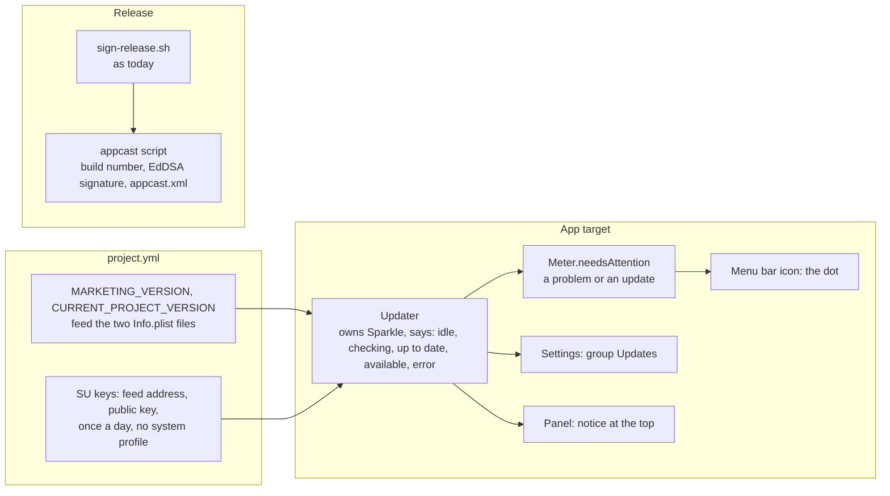

# Updates, implementation plan

How the app checks, tells and installs, and the order it is built in. The decision is [ADR 0011](../../adr/0011-updates.md).
Only the app target gets Sparkle; `TokenMeterCore` and the widget do not change.

## The pieces

## Order

| Step | Commit                                                                      | Files                                                                      |
| :--- | :-------------------------------------------------------------------------- | :------------------------------------------------------------------------- |
| 1    | `build: the version comes from project.yml`                                 | `project.yml`, the two `Info.plist`                                        |
| 2    | `build(app): add Sparkle to the app target`                                 | `project.yml`, `App/TokenMeter/Info.plist`                                 |
| 3    | `feat(app): the updater, with its five states`                              | `Updater.swift`, `TokenMeterApp.swift`                                     |
| 4    | `feat(app): a group Updates in Settings`                                    | `UpdatesGroup.swift`, `SettingsView.swift`                                 |
| 5    | `feat(app): the notice in the panel and the dot for an update`              | `UpdateNotice.swift`, `MenuContent.swift`, `Meter.swift`                   |
| 6    | `build(release): the build number, the signature and the feed`              | `scripts/appcast.sh`, `scripts/test-appcast.sh`, `scripts/sign-release.sh` |
| 7    | `docs(use): updates, the changelog and what the app contacts`               | `use/updates.md`, `use/changelog.md`, `use/what-it-does.md`                |
| 8    | `docs(develop): the network claim, the release steps and the version`       | `data-sources.md`, `concepts.md`, `package-and-distribute.md`              |
| 9    | `docs: the network claim in the README, the install page and the ADR index` | `README.md`, `use/install.md`, `AGENTS.md`                                 |
| 10   | Reconciliation, on a `docs/` branch after the merge                         | the Views and the Design System, the status, the row in the list           |

The first release with the updater is not a step here: notarizing and publishing ask first and live in their own flow.

## Tests and checks

- **Unit**: `scripts/test-appcast.sh` builds a feed from a made-up zip with a throwaway key made with OpenSSL, and checks the
  item (version, build, length, signature, the changelog link) and that a build number that does not go up is refused. It
  follows `test-install-statusline.sh`. The state machine of `Updater` is thin around Sparkle and lives in the app target, which
  the gate does not build; `xcodebuild` does.
- **Gate**: `pnpm run check`, and `xcodebuild` of the app with Sparkle resolved, and `codesign --verify --deep --strict` on a
  signed export before a release.
- **By hand, before the first release**: a check started from the menu with a click; an update served from a local feed, with the
  widget on the desktop watched; an update of a build that has a store from the last version; the feed address as the redirect of
  the latest release; a download with Gatekeeper's quarantine. **Each of these is not verified until it is run**, and the release
  notes say which were not.

## What the author does

- Makes the signing key once, with Sparkle's `generate_keys` (the command is given in the release page), and keeps a copy in a
  password manager. The agent never sees the private key.
- Says yes to notarizing and to publishing, each time.
