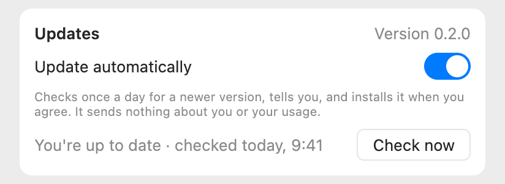
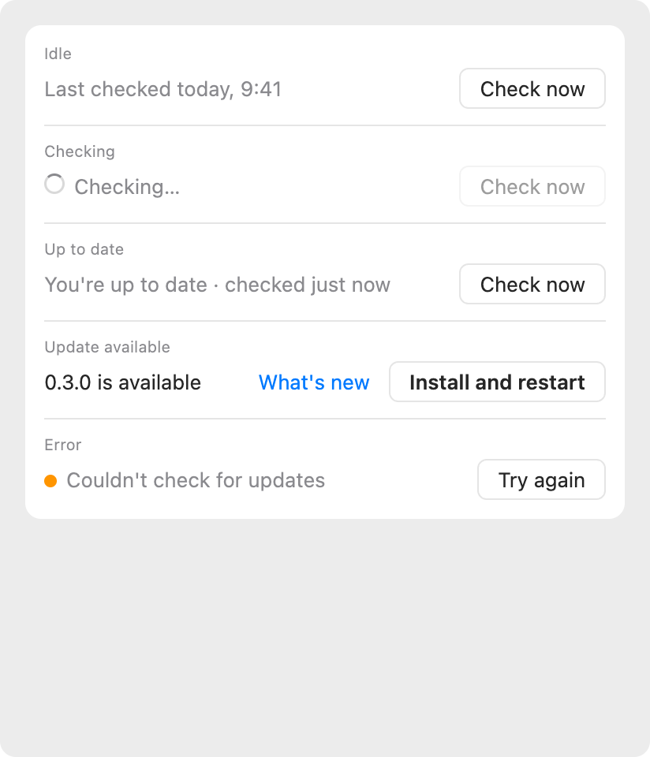
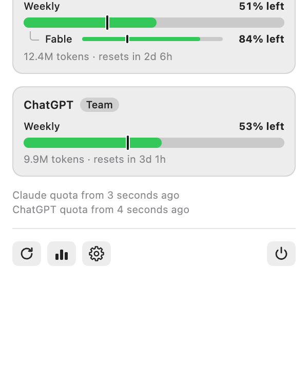

# Updates, proposal

The design that was chosen. It was drawn as a canvas in Claude, which is deleted once the feature is implemented; this
page is what stays. **Every number in the images is a sample.**

## What changes

| Surface  | What it shows                                                                                                                                          | Why                                                          |
| :------- | :----------------------------------------------------------------------------------------------------------------------------------------------------- | :----------------------------------------------------------- |
| Settings | A group "Updates": the version once, in its title; a switch "Update automatically", on; a note; a status line with a button. The line has five states. | The version is shown once, and the choice is where you look. |
| Panel    | A notice at the top, in the style of the existing notices, with an arrow in a circle: "Version 0.3.0 is available", **What's new** and **Install**.    | The first thing seen when the panel opens.                   |
| Menu bar | The dot on the icon, the one the [icon-only menu bar](../2026-11-02-menu-bar-icon-only/index.md) already has, now also for an update.                  | The only signal for whoever never opens the panel.           |
| Widget   | Nothing. It changes when the app does.                                                                                                                 | It has no room, and no action.                               |

## Rules

- **On by default, and off with one switch.** The note says what it does: it checks once a day, tells you, and installs when
  you agree. It sends nothing about you or your use.
- **It tells you, and you choose.** The system's own update window is the one that asks and installs; the panel notice and
  the dot are for whoever did not see it. An update is never installed without a yes.
- **It says what changed.** **What's new** opens the changelog of that version.
- **It does not start again from nothing.** After an update the app opens, migrates what it keeps, and reads only what is
  new since the last time: the statistics are not rebuilt.
- **The version is read from the app**, never written by hand in the interface.
- **The dot has one meaning**: something is worth opening the panel for. A problem and an update are both that.

## What the technical trials showed

A trial with Sparkle, on this Mac, with made-up versions in a temporary folder and nothing of the real data:

- The app builds in Swift 6 with Sparkle; the helper programs are signed by the existing export and the signature verifies.
  Notarization was not tried.
- A full update from a local feed worked: the app quit, was replaced and opened as the new version, and the widget inside it
  carried the new version on disk and in the system's list. **The widget on the desktop was not seen refreshing.**
- Updates must be signed with an EdDSA key; the signature of the same Apple team is not enough. The key is made once on the
  author's Mac.
- A scheduled check showed the system's window above other windows but did not take the focus. A check started from the
  menu, with a real click, was not tried.
- The app's version and build were written by hand in both Info.plist files (1.0, build 1), and Sparkle compares the
  build: the build number has to go up in every release. **v0.2.0 does not contain the updater**, so the first version that
  does is installed by hand, and from then on the app updates itself.

## Decisions taken

| Question                      | Choice                                                                                                                                      |
| :---------------------------- | :------------------------------------------------------------------------------------------------------------------------------------------ |
| Where the list of versions is | `appcast.xml` attached to each GitHub release, at the address of the latest release. To be checked: that the updater follows that redirect. |
| The signing key               | Made on the author's Mac with Sparkle's tool, kept in the Keychain, with a copy in a password manager.                                      |
| The build number              | An integer that goes up by one in every release; v0.2.0 reported build 1.                                                                   |
