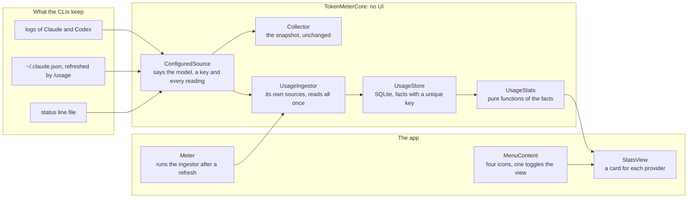

# Usage stats, implementation plan

How the facts are kept, how the statistics are drawn from them, and the order it is built in. It is **version 1** of the
[proposal](./proposal.md): the store, the stats view behind the icon, the ceiling hit, the quota left at the end of each
window and the models. The verdict and the chip in the widget are not in it. The decision is
[ADR 0010](../../adr/0010-the-usage-store.md).

## The pieces



What does not change: the snapshot, `Snapshot.applying`, the widget, the menu bar, Settings and the Claude status line script.
The widget never reads the store.

## Files

```text
docs/adr/0010-the-usage-store.md                    the decision
Sources/TokenMeterCore/UsageStore.swift             new: SQLite, the two tables, insert that ignores, highest percentage
Sources/TokenMeterCore/Models.swift                 UsageEvent gets a model and a key
Sources/TokenMeterCore/ProviderSource.swift         ProviderReading gets the readings of a window the log carried
Sources/TokenMeterCore/ProviderConfig.swift         usage.model and usage.families; the migration for an existing file
Sources/TokenMeterCore/ConfiguredSource.swift       reads the model, builds the key, keeps every reading of a window
Sources/TokenMeterCore/DefaultProviders.swift      the paths in the seed
Sources/TokenMeterCore/UsageIngestor.swift          new: its own sources, reads all once, then what is new
Sources/TokenMeterCore/UsageStats.swift             new: windows, ceiling hit, model families, ranges
App/TokenMeter/Meter.swift                          runs the ingestor, holds the stats and which view is shown
App/TokenMeter/MenuContent.swift                    the four icons, one switches the view
App/TokenMeter/StatsView.swift                      new: the stats view
Tests/TokenMeterCoreTests/UsageStoreTests.swift     new
Tests/TokenMeterCoreTests/UsageIngestorTests.swift  new
Tests/TokenMeterCoreTests/UsageStatsTests.swift     new
docs/use/stats.md                                   new: what the view says and what it leaves out
docs/develop/data-sources.md                        what is kept, and how far back
docs/develop/core-api.md                            the store and the statistics
```

## The order of work

Three files at most per step, the gate green (`pnpm run check`), and `xcodebuild` for the steps that touch the app.

| Step | Adds                                                                                                                      | Tests that show it works                                                                                                                                                                                                                                     |
| :--- | :------------------------------------------------------------------------------------------------------------------------ | :----------------------------------------------------------------------------------------------------------------------------------------------------------------------------------------------------------------------------------------------------------- |
| 1    | the ADR and this plan                                                                                                     | the docs build                                                                                                                                                                                                                                               |
| 2    | `UsageStore`: the file in a folder it makes, the version of the schema, the write-ahead log, the two tables               | a new file has the schema and its version; a message with the same key is ignored; a reading keeps the highest percentage and the first and last time seen; closing and opening again keeps everything; a corrupt file is made again empty                   |
| 3    | `UsageEvent` with a model and a key, read by `ConfiguredSource` from the paths of the config                              | a Claude line gives the model and the key made of its `dedupeBy` paths; a Codex line gives a key made of its file and its time; a line with no model leaves it empty                                                                                         |
| 4    | `usage.model` and `usage.families` in the config, in the seed, and the migration that adds them to a file that exists     | the migration adds them once, keeps the `.bak`, does nothing when they are there and does not touch a file that is not version 1; the seed decodes                                                                                                           |
| 5    | `ProviderReading` carries every reading of a window the log has, not only the last                                        | two lines of one window give one reading with the highest percentage; two windows give two; the quotas of the snapshot are the same as before                                                                                                                |
| 6    | the model of a Codex turn, from the line that opens it (`log.context`), so its tokens have a model                        | the tokens after a turn line take its model; the tokens before any turn line have none; the file offsets still resume where they stopped                                                                                                                     |
| 7    | `UsageIngestor`: its own sources, all files once, then what is new, into the store                                        | a month of fixture logs gives the messages once; reading again adds nothing; a new line is added; a window seen in two reads is one reading; a broken line is skipped                                                                                        |
| 8    | `UsageStats`: the windows that closed, the ceiling hit, the quota left as at least, the model families, the ranges        | the same facts give the same figures; a window with no reading is not observed; 100% is a hit and 97% is not; families add up versions and drop `<synthetic>`; three models and "N more"; under 2% is "Other"; four windows for a month and six for the rest |
| 9    | `Meter` runs the ingestor after a refresh and once at launch, off the main thread, and holds the stats and the view shown | `xcodebuild`; the refresh does not wait for the store; the choice of view is kept across launches                                                                                                                                                            |
| 10   | `MenuContent` has four icons with a name and a tooltip, one switches the view; `StatsView` draws a card for each provider | `xcodebuild`; the view on screen with `./scripts/preview.sh`: the icon changes, a provider with no readings says so, a model list longer than three folds                                                                                                    |
| 11   | the Use page, the Develop pages and the status of the ADR                                                                 | the docs build                                                                                                                                                                                                                                               |
| 12   | after the merge, on a `docs/` branch: the Views and Design System as built, the status, the row in the list               | `design-export`; `pnpm run check`; the row moves to Implemented                                                                                                                                                                                              |

After step 11 come the review and the preview with `./scripts/preview.sh`, and the merge into `main`; step 12 follows them.

Steps 2 and 8 are the ones that decide a rule, so they carry the tests. Step 6 is the one that changes how a log is read, so
it is last of the collector's steps and can be dropped without changing the others: a Codex message then has no model and the
list shows one row for the provider.

The close step names the components of the Design System: **StatsToggle** and **IconBar** (the four icons) and the cards of
the stats view are new. The Views gain the Stats view of the panel and the panel with icons.

## What is not known until it is built

- **SQLite from the system library in Swift 6**, in the package and in the app, with the write-ahead log. Step 2 is a spike
  first: if the module does not build in both, the plan stops there and says so.
- **How long the first read of all the files takes.** The ingestor runs it once off the main thread, and the figure goes into
  the Develop page.
- **A window of Codex split across two files with the same time of reset**: the highest percentage wins.
- **Whether `/usage` keeps refreshing `~/.claude.json` without a session open.** The app asks for it and logs the outcome;
  a long run is the only test.
- **The migration on the author's own `providers.json`**, which is not the seed. It is tried on a copy before it runs.

## Left for later versions

The verdict (stay, move down, wait), the chip in the widget and the second widget with the verdicts only. They need a few weeks
of readings to say anything, and they ask for the store to exist first.
