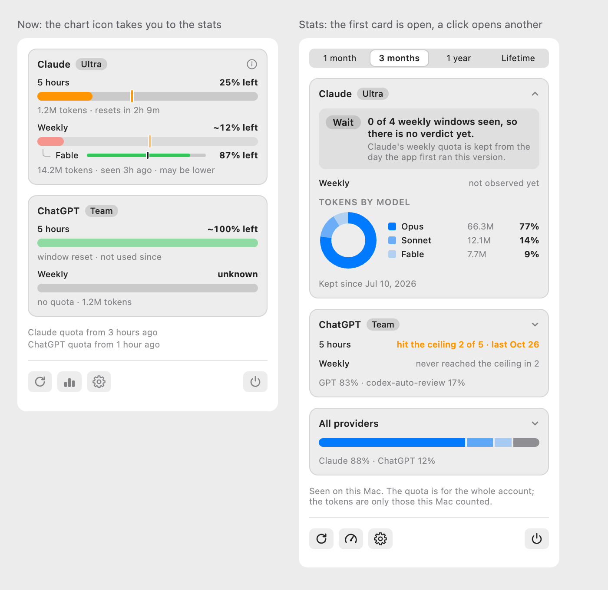
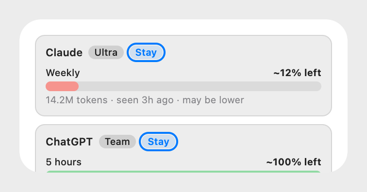

# Usage stats, proposal

The design that was chosen. It was drawn as a canvas in Claude, which is deleted once the feature is implemented; this
page is what stays. **Every number in the images is a sample**, not real use.

## The question it answers

Not "how much is left" but **"how is my use going, and is this plan the right one?"** Each statistic is there because it
helps decide something. What does not help decide is left out: the total since the beginning is a range, not a
headline, and a pie of the split between input, output and cache is not drawn.

## What changes

| Surface  | What it shows                                                                                                                                                                                         | Why                                                       |
| :------- | :---------------------------------------------------------------------------------------------------------------------------------------------------------------------------------------------------- | :-------------------------------------------------------- |
| Panel    | A chart icon in the row of buttons switches to the stats view in place; there the icon becomes a gauge and takes back. All four buttons are icons, each with a name for screen readers and a tooltip. | One place, no new window, and the answer is one tap away. |
| Stats    | A card for each provider: whether the ceiling was hit in each window, the quota left at the end of the last windows, and its **first three models** with "N more…". The range is chosen at the top.   | A card for each provider grows by a line, not by a block. |
| Widget   | Version 2: a chip with the verdict next to the plan capsule. No new card: the widget has no room, and it already clips two providers.                                                                 | The answer where you already look.                        |
| Menu bar | Unchanged.                                                                                                                                                                                            | Same.                                                     |
| Settings | Unchanged in the first version.                                                                                                                                                                       | The providers shown are the ones that are on.             |

## Rules

- **Only what the data supports.** A number is shown if it was measured or counted. There is no estimate, and no size of
  a plan in tokens: in the Codex logs the tokens counted for a window did not follow its percentage (two checks, from
  0.000 to 0.054 M tokens per point on the 5-hour window), so a ceiling in tokens cannot be derived.
- **A past that was not measured stays empty**, and the window says "not observed". Claude's quota is read **while the app
  runs**, every 15 minutes, because the app asks Claude Code to run `/usage`; ChatGPT's comes from the Codex logs, so only
  when Codex was used on this Mac. A value recorded as the lowest point of a window is "at least", never "exactly": it can
  only be too optimistic, so "you hit it" can be missed but never invented.
- **Tokens are "on this Mac"**, the quota is for the whole account. Use on another computer, on the web or in the
  phone shows in Claude's quota at the next reading, and never in the tokens.
- **A model is shown by family**: `fable-5` and `fable-5-1` count as one, and `<synthetic>` is dropped. At most three
  for each provider, then "N more…"; under 2% they are grouped as "Other". No pie and no stacked bar: with N models
  they cannot be read.
- **N providers**: one card each, in the order of Settings, and a provider that is off does not appear. The panel scrolls.
- **The verdict looks at the window that limits you**, and says it. For the largest plan there is no "move up".

## Where the data comes from

Checked on 2026-11-02 against the author's own files, reading only field names, dates and numbers.

| Source                                      | What it holds                                                                                                     | How far back          | Used for                      |
| :------------------------------------------ | :---------------------------------------------------------------------------------------------------------------- | :-------------------- | :---------------------------- |
| Claude logs (`~/.claude/projects`)          | tokens and model for each message; 14 refusals for the weekly limit                                               | 2026-10-04            | tokens, models, hit ceiling   |
| `~/.claude.json` (`cachedUsageUtilization`) | the last quota percentages of the account, with the time; the app asks Claude Code to refresh it every 15 minutes | the last reading only | Claude quota, from now on     |
| Codex logs (`~/.codex/sessions`)            | tokens, the model of the turn, and `rate_limits` with percentage                                                  | 2026-10-26            | ChatGPT quota, tokens, models |
| Status line file (`~/.tokenmeter`)          | the last reading Claude Code sent                                                                                 | the last reading only | the present quota, as today   |

Things that were found and shape the design:

- **Claude's logs repeat each message**: 127,180 lines with tokens for 59,237 different messages. Added up as they
  come, the output tokens are 106 M; with one line for each message they are 42 M. The app already removes the
  repeats (`dedupeBy` in the Claude provider); every new count must reuse that rule.
- **Claude's quota percentage is not in its logs**, except as a refusal when the limit is hit. It is in
  `~/.claude.json`, which the app already asks Claude Code to refresh every 15 minutes (`ClaudeUsageRefresh`, with Claude
  Code's own credentials: the app handles none), but only the last reading is kept.
- **The percentage of Codex never went down inside a window** in 4,904 readings, so it is a measure that can be trusted.
- **Claude Code prunes its old logs.** What is not read before it is pruned is lost, so the app reads and keeps.

## How it is built, in short

The collector that already reads the logs every 60 seconds puts what it sees in a queue, and a single writer puts it in a
small SQLite file as **facts with a source and a time**. The statistics are queries on that file. The script of the
Claude status line does not change and never touches the database. Because the store does not know where a fact came
from, another source can be added later, an API for the quota for example, without changing what is drawn. The
decision and the plan come next, and are not part of this page.

## Versions

| Version | What it adds                                                                                                                                                       |
| :------ | :----------------------------------------------------------------------------------------------------------------------------------------------------------------- |
| 1       | The store of facts, and the stats view behind the icon with its range (1 month to Lifetime): the ceiling hit, the quota left at the end of each window, the models |
| 2       | The verdict (stay, move down, wait) and the chip in the widget; it needs a few weeks of readings to say anything                                                   |
| 3       | A second widget with the verdicts only, if it is needed                                                                                                            |

## The variants that were drawn and not chosen

- **A window of its own** (`Stats…` button, with a long page): it works for two providers and not for N, and it is one
  more window to open.
- **Curves and bands** (a line of the tokens for each week, the plans drawn as bands or as sloping lines, a ladder of
  plans with a square for each week): each was hard to read, and the ones with the size of a plan rested on the
  tokens-per-percent estimate that does not hold.
- **Pies**: one for the models of a provider, and a ring inside a ring for providers and models. They stop being
  readable past five slices.
- **A second widget** with the verdicts only: kept for version 3.

## Not drawn yet

- The rows of the quota left at the end of each window, inside the card, and the states "not observed" and "no use seen
  here". The first design had them in a window of its own.
- The dark appearance: the design system defines the light one only.
- How the chip looks for a provider with two windows, and with a verdict that is "wait".

## Not verified

- That the refresh of `~/.claude.json` keeps working over a long run with no session open, and what it holds for a plan
  that has the 5-hour window; the author's plan, Ultra, has none.
- A tap on a widget opens the app by a URL that the app has to handle: not checked.
- SQLite from the system library in Swift 6, with the write-ahead log, inside this project.
- How the icon that changes (the chart and the gauge) reads to someone who sees it for the first time.

## Related

- [Overview](./index.md)
