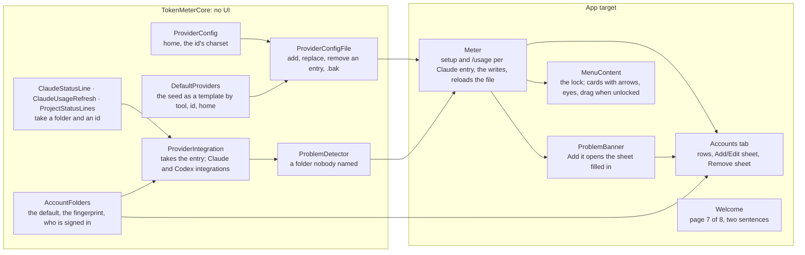
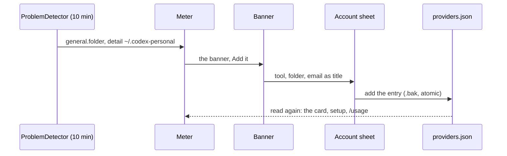

# Accounts, implementation plan

How the [proposal](./proposal.md) is built: the `home` of an entry, the writer of the file, the status line and `/usage` for
each account, the folders the app finds, the email, the Accounts tab with its sheets, the lock on the panel and the welcome
page. The decision is [ADR 0014](../../adr/0014-accounts-and-the-home-of-a-provider.md).

Built on 2026-11-04 as below, with these departures: step 8 took three commits (the entry form of the protocol beside the old
one, the detector and the fix runner, the old form removed) and step 9 two; step 10 two (the integration and the migration, then
the seed and the app); steps 14, 15 and 19 two each (the data, then the view); steps 20 and 21 one, because the app does not build
with the page's case alone; step 18 came after 17, as planned. The welcome's picture of the accounts is the app's own cards drawn
with sample data, not a screenshot, so `Assets.xcassets` did not change; the docs' `welcome.png` still shows the seven pages of
0.8.0 and says so.

## The pieces

## Where each thing goes

| Layer | Folder                             | What                                                                                                    |
| :---- | :--------------------------------- | :------------------------------------------------------------------------------------------------------ |
| Core  | `Sources/TokenMeterCore/`          | `ProviderConfig` (home, writer), `DefaultProviders` (template), the status line, `/usage` and overrides |
| Core  | `Sources/TokenMeterCore/Problems/` | `AccountFolders`, `CodexIntegration`, the entry in `ProviderIntegration`, the folder problem            |
| Core  | `Sources/TokenMeterCore/Welcome/`  | the eighth page                                                                                         |
| Tests | `Tests/TokenMeterCoreTests/`       | one test file per piece, named as the piece                                                             |
| App   | `App/TokenMeter/Accounts/`         | the tab, the account sheet, the Remove sheet                                                            |
| App   | `App/TokenMeter/`                  | `Meter`, `MenuContent` and the arrange controls, `ProblemBanner`, `SettingsTabs`, `SettingsView`        |
| App   | `App/TokenMeter/Welcome/`          | the page and its picture                                                                                |

The widget does not change: the snapshot is the same, the email is not in it, and a card there has no controls.

## The steps

One commit each, three files at most, the gate green and `xcodebuild` for the app from step 11 on.

| Step | Commit                                                                                                                                                                                              | Files                                                                                           |
| :--- | :-------------------------------------------------------------------------------------------------------------------------------------------------------------------------------------------------- | :---------------------------------------------------------------------------------------------- |
| 1    | `feat(core): a provider entry has a home, and its id names files`                                                                                                                                   | `ProviderConfig.swift`, `ProviderTests.swift`                                                   |
| 2    | `feat(core): the seed is a template of the tool, by id and home`                                                                                                                                    | `DefaultProviders.swift`, `ProviderConfig.swift`, `ProviderTests.swift`                         |
| 3    | `feat(core): the file is written whole: add, replace and remove an entry`                                                                                                                           | `ProviderConfig.swift`, `ProviderConfigWriteTests.swift`                                        |
| 4    | `feat(core): the status line is set up in a folder, its files named by the entry`                                                                                                                   | `ClaudeStatusLine.swift`, `ClaudeStatusLineTests.swift`                                         |
| 5    | `feat(core): /usage runs in a folder, the overrides are read from it`                                                                                                                               | `ClaudeUsageRefresh.swift`, `ProjectStatusLines.swift`, their two test files                    |
| 6    | `feat(scripts): the status line script writes a file per account`                                                                                                                                   | `claude-statusline.sh`, `install-statusline.sh`, `test-install-statusline.sh`                   |
| 7    | `feat(core): a tool's folders: the default, the fingerprint, who is signed in`                                                                                                                      | `Problems/AccountFolders.swift`, `AccountFoldersTests.swift`                                    |
| 8    | `feat(core): an integration takes the entry, and its problems name the account`                                                                                                                     | `Problems/ProviderIntegration.swift`, `Problems/ClaudeIntegration.swift`, `FixRunner.swift`     |
| 9    | `test(core): the Claude integration and the fix runner by entry`                                                                                                                                    | `ClaudeIntegrationTests.swift`, `FixRunnerTests.swift`, `ProblemDetectorTests.swift`            |
| 10   | `feat(core): a Codex integration, and the migration that names it`                                                                                                                                  | `Problems/CodexIntegration.swift`, `ProviderConfig.swift`, `ProviderConfigMigrationTests.swift` |
| 11   | `feat(core): the problem that says a folder nobody named was found`                                                                                                                                 | `Problems/ProblemDetector.swift`, `Problems/AppProblems.swift`, `ProblemDetectorTests.swift`    |
| 12   | `feat(app): Meter sets up each Claude account in its folder and refreshes its /usage`                                                                                                               | `Meter.swift`, `ClaudeAccounts.swift`                                                           |
| 13   | `feat(app): Settings, General says each account's status line, Restore original by account`                                                                                                         | `SettingsView.swift`, `ClaudeSetupGroup.swift`                                                  |
| 14   | `feat(app): the Accounts tab in place of Providers`                                                                                                                                                 | `Accounts/AccountsTab.swift`, `SettingsTabs.swift`, `SettingsView.swift`                        |
| 15   | `feat(app): the account sheet: Add and Edit write the file`                                                                                                                                         | `Accounts/AccountSheet.swift`, `Meter.swift`                                                    |
| 16   | `feat(app): Remove asks first`                                                                                                                                                                      | `Accounts/RemoveAccountSheet.swift`, `Accounts/AccountsTab.swift`                               |
| 17   | `feat(app): the lock on the panel: arrows, eyes and drag when unlocked`                                                                                                                             | `MenuContent.swift`, `ArrangeableCard.swift`, `WindowToggles.swift`                             |
| 18   | `refactor(app): the Providers tab goes`                                                                                                                                                             | `SettingsView.swift`, `DragHandle.swift`, `WindowToggles.swift`                                 |
| 19   | `feat(app): the banner's Add it opens the sheet filled in`                                                                                                                                          | `ProblemBanner.swift`, `Meter.swift`                                                            |
| 20   | `feat(core): the welcome has eight pages`                                                                                                                                                           | `Welcome/WelcomeState.swift`, `WelcomeTests.swift`                                              |
| 21   | `feat(app): the welcome page An account is a folder, and the two sentences`                                                                                                                         | `Welcome/WelcomePages.swift`, the picture's asset                                               |
| 22   | `docs(use): accounts, and the settings page`                                                                                                                                                        | `use/accounts.md`, `use/settings.md`, `use/configure-providers.md`                              |
| 23   | `docs(use): the Claude quota per account, the problems, the changelog`                                                                                                                              | `use/enable-claude-quota.md`, `use/troubleshooting.md`, `use/changelog.md`                      |
| 24   | `docs(use): the welcome's eight pages`                                                                                                                                                              | `use/welcome.md`, `use/what-it-does.md`, `assets/welcome.png`                                   |
| 25   | `docs(develop): the core API, the architecture, AGENTS.md`                                                                                                                                          | `develop/core-api.md`, `develop/architecture.md`, `AGENTS.md`                                   |
| 26   | Reconcile, on a `docs/` branch after the merge: `design-export` of the panel, Settings and the welcome; status; the row to _Implemented_; the ADR `accepted` if not yet; offer to delete the canvas | `index.md`, `features/index.md`, the Views and the Design System                                |

Steps 1 to 11 are core and run in the gate's tests; 12 to 21 are the app and need `xcodebuild`; a step that proves too big for
three files is split before it is written, never squeezed.

## Tests

- **The entry** (`ProviderTests`): `home` decodes and is optional; an id outside `[A-Za-z0-9._-]` is refused with its name in
  the message; the seed still decodes; the template gives, for Claude and for Codex, the paths of the folder and the id, and
  for the default folder and the seed id it gives the seed itself.
- **The writer** (`ProviderConfigWriteTests`): add, replace and remove on a temporary file keep the other entries byte for
  byte in content, write the `.bak` first, refuse a file that cannot be decoded and a repeated id, and leave a hand-written
  path alone when the folder changes while rewriting the ones the template gave.
- **The folder** (`ClaudeStatusLineTests`, `ClaudeUsageRefreshTests`, `ProjectStatusLinesTests`): the status line goes into
  `<folder>/settings.json` with the id as the command's argument, the wrapper and the original are named by the id, two
  entries do not touch each other's files; the `/usage` process gets `CLAUDE_CONFIG_DIR`; the overrides come from the folder's
  `projects/`.
- **The script** (`test-install-statusline.sh`): with an argument it writes `<id>-statusline.json`, without it the file of
  today, and the installed status line carries the argument.
- **The folders** (`AccountFoldersTests`): a folder with the fingerprint is a Claude or a Codex folder, one without is neither,
  a folder deeper than the top is not looked at, the email comes from `.claude.json` and from the token's payload (a token made
  in the test), an API-key login gives none, and the reader returns a string or nothing, never the token.
- **The integration** (`ClaudeIntegrationTests`, `FixRunnerTests`, `ProblemDetectorTests`): the problem's topic and id are the
  entry's id, the fix wraps in the entry's folder, the detector lists one `general.folder` problem per folder nobody named and
  none for a folder an entry's `home` names, an absent `home` naming the default; the Codex integration has no fix and is found by
  the migration's id.
- **The welcome** (`WelcomeTests`): eight pages, the seventh is the accounts, Next from it is Settings, Done from the eighth.
- **Gate**: `pnpm run check`, and `xcodebuild` of the app from step 12.
- **By hand, in the preview, not verified until it is run**: a second Claude folder made with `CLAUDE_CONFIG_DIR` and a
  login, its card, its status line set up there, its `/usage`; Add it from the banner; Edit of a title and of a folder; Remove and
  what stays; the lock, the drag of a card, an eye on a window; the Accounts tab with one account (Remove disabled); the eighth
  page of the welcome in both appearances.

## Not verified at the time of writing

That Claude Code passes the argument of a status line command written in `settings.json`; that `/usage` honours
`CLAUDE_CONFIG_DIR` from a process the app launches; that a card drags inside the menu bar panel as a row does in Settings;
and what the wrapper does when two folders had their own status line.
