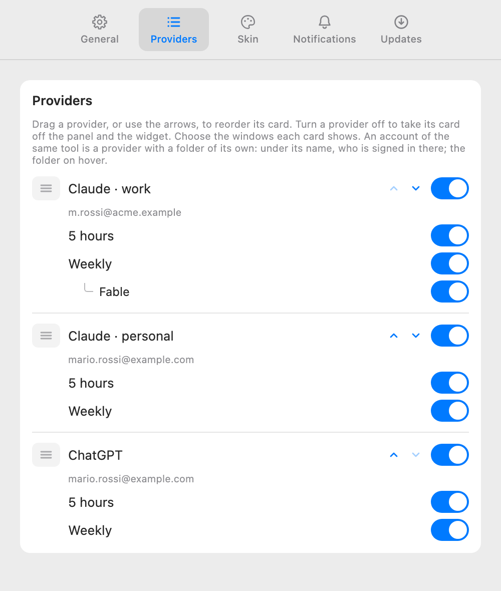
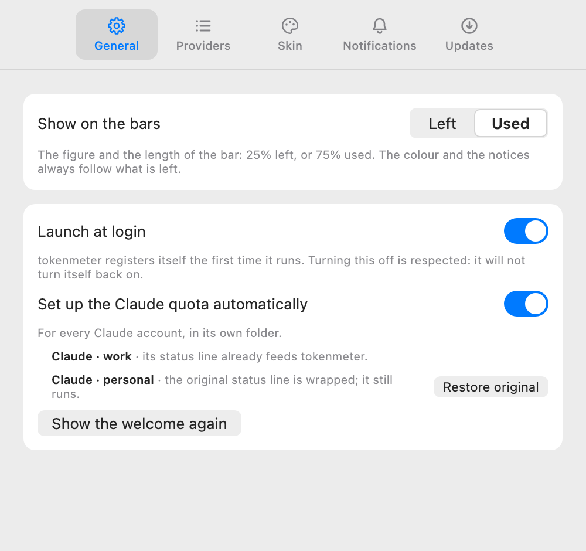
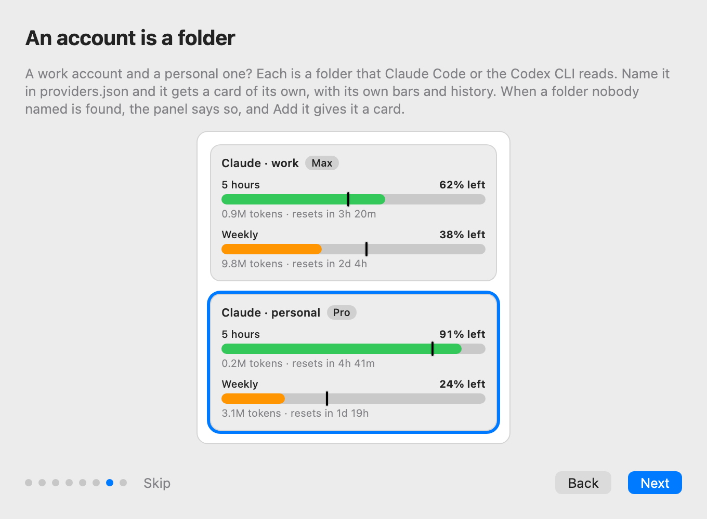

# Accounts, proposal

The design that was chosen, drawn as a canvas in Claude, which is deleted once the feature is implemented; this page is what
stays. The images are the canvas's artboards, built from the app's own tokens with invented data. **Every number, name and
email in them is a sample.**

## What an account is

An account is a **configuration folder** of the tool: the one Claude Code uses when `CLAUDE_CONFIG_DIR` is set, the one the
Codex CLI uses when `CODEX_HOME` is set. Each folder keeps its own login, its own settings and its own logs. In tokenmeter it is a
provider entry of `providers.json` with a field, `home`, that names the folder: the folder where the status line is set up,
where `/usage` runs and where the login is read. The other paths of the entry stay as they are written, with `~` the person's
home as today. Nothing else is new: an account has its own id, title, plan, quota, history, preferences and notices because a
provider already has them, by id.

Who has one account changes nothing. The two entries the app writes the first time stay as they are and read the usual
folders, `~/.claude` and `~/.codex`.

## The alias and the email

The **title** of the entry is the account's alias, the name on its card and in its notices: "Claude · work". The **email** the
folder is signed in with is a fact the app reads, never writes: Claude Code keeps it in the folder's `.claude.json`, the Codex
CLI inside the identity token of its `auth.json`. It is shown where the person goes on purpose, under the account's name in
Settings, and in the banner that says a folder was found, so the person knows which account it is before adding it. It is not
on the cards: the panel is glanced at, and the widget sits on the desktop. A login with an API key has no email: the folder is
shown instead.

## What changes

| Surface  | What it shows                                                                                                                                                                    |
| :------- | :------------------------------------------------------------------------------------------------------------------------------------------------------------------------------- |
| Panel    | One card for each entry, with its title, its plan and its bars. The lines of the quota age name the entries the same way.                                                        |
| Widget   | The same cards, from the snapshot.                                                                                                                                               |
| Stats    | One stats card for each entry, with its own history.                                                                                                                             |
| Settings | In General, one switch "Set up the Claude quota automatically" for every Claude entry, with a line per account under it and **Restore original** beside the one that is wrapped. |
|          | In Providers, the entry like any other, with the email under its name and the folder on hover.                                                                                   |
| Notices  | Named by the entry's title: "Claude · work · Weekly".                                                                                                                            |
| Problems | The status-line problems name the account they are about. A new one, _A Claude folder is not in providers.json_, with the folder and its email in the detail and **Add it**.     |
| Welcome  | A page of its own, the seventh of eight, before Settings.                                                                                                                        |
| Docs     | A Use page, _Accounts_: what a folder is, what Add it writes, and the recipe by hand for a folder the app cannot find.                                                           |

## The status line and `/usage`, for each account

The automatic setup of the Claude quota, which today writes the status line into `~/.claude/settings.json` and asks Claude
Code to run `/usage`, does the same for each Claude entry in **its** folder:

- the status line goes into that folder's `settings.json`, and the command it runs carries the entry's id as an argument, so
  the script writes its file apart from the others, whatever the environment it runs in;
- `/usage` runs with `CLAUDE_CONFIG_DIR` set to the folder, every 15 minutes and on refresh, as today;
- the problems of the status line (another status line in use, a project with its own) are checked in each folder, and say
  which account they are about.

## Finding a folder nobody named

There is no list of accounts anywhere: a folder is one because the person points the tool at it. What the app can do is
recognise one. A Claude Code folder holds `.claude.json` and `projects/`; a Codex folder holds `auth.json` and `config.toml`.
Once every ten minutes, with the other checks, the app looks at the hidden folders at the top of the home (`~/.claude-work`,
`~/.codex-personal`, never deeper) and, for one that has the fingerprint and that no entry of `providers.json` names, lists a
problem that says which folder and which email. **Add it** writes the entry into `providers.json`, a copy of the tool's entry
with the folder as its `home` and the email as its title, keeping a backup of the file as the app's own migrations do; the
card appears at the next read. **Dismiss** hides the problem until the folder changes. **Learn more** opens the Use page, for
the person who prefers to write the entry by hand, or whose folder is somewhere the app does not look.

What the app does not read: the shell's configuration files, the Keychain and the environment of other processes. What it
cannot do: tell apart two logins that took turns in the same folder, whose history is one.

## The welcome

A page of its own, _An account is a folder_, the seventh of eight, before the Settings page: a work account and a personal
one are two folders, each gets a card, and the panel says when it finds one nobody named. The picture is the panel with the
two Claude cards, the second outlined. The pages become eight; the tour keeps one concept per page and no summary page.

## What was verified

- With `CLAUDE_CONFIG_DIR` set, Claude Code 2.1.317 creates `.claude.json`, `projects/`, `sessions/`, `plugins/` and `backups/`
  in that folder (tried on an empty temporary folder, no login). Its documentation says `settings.json` and the credentials
  live there too.
- With `CODEX_HOME` set, the Codex CLI 0.166.0 creates its state in that folder (tried the same way); OpenAI's documentation
  says `auth.json` lives there, and the community's reading is that `sessions/` does too.
- On the author's Mac, on 2026-11-04, the keys only: `.claude.json` has `oauthAccount.emailAddress` (with the organisation
  and the plan's display name beside it); the Codex `auth.json` has `tokens.id_token`, whose claims include `email`, and an
  `auth_mode` that says whether the login is a key.
- Two Claude entries with their own folders already give two cards and two histories with the code as it is (tried on
  2026-11-02 with made-up data); what is missing is everything around: the status line, `/usage`, the problems, the email
  and the word when a folder is found.

## Decisions taken in the design

- **Add it over a form and over the recipe alone.** Three variants were drawn: the recipe by hand with Learn more; Add it on
  the banner; a form in Settings › Providers. The banner already knows the folder and the email, so one button is enough; the
  form is a later feature, if a folder the app does not look at turns out common.
- **The email is a caption, not a title.** The alias stays the person's word; the email says which login a folder holds, in
  Settings and in the banner, and nowhere the panel or the widget shows.
- **The folder on hover.** A path is for the person who looks for it; the email is what tells accounts apart.
- **One page in the tour, before Settings.** The Settings page is about the tabs, and an account is not set up in a tab; a
  sentence there was drawn and set aside.

## Not decided here

The code decides the shape of the `home` field, the fingerprint of a folder, how often it is looked for, how Add it writes the
entry and how the Codex email is read from a file of credentials without keeping anything else of it: ADR 0014.
