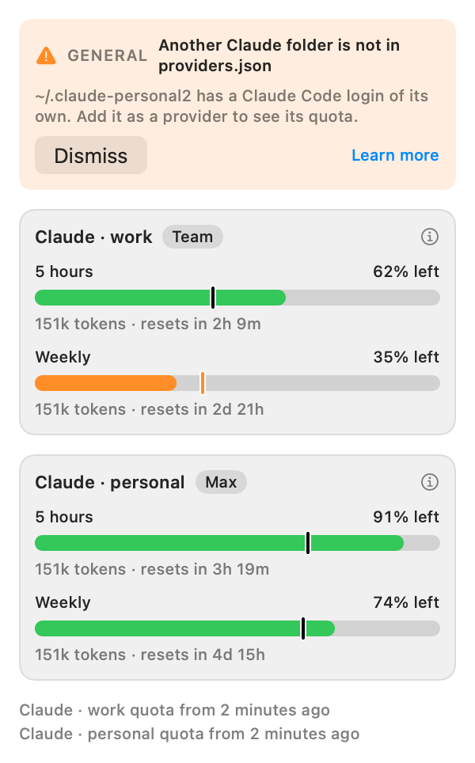

# Accounts, proposal

The design that was chosen, in words: this feature has no surface of its own, so no canvas was drawn. The image is the app's
own views drawn with sample data. **Every number in it is a sample.**

## What an account is

An account is a **configuration folder** of the tool: the one Claude Code uses when `CLAUDE_CONFIG_DIR` is set, the one the
Codex CLI uses when `CODEX_HOME` is set. Each folder keeps its own login, its own settings and its own logs. In tokenmeter it is a
provider entry of `providers.json` with a field, `home`, that names the folder; every path the entry writes with `~` is read
from there. Nothing else is new: an account has its own id, title, plan, quota, history, preferences and notices because a
provider already has them, by id.

Who has one account changes nothing. The two entries the app writes the first time stay as they are and read the usual
folders, `~/.claude` and `~/.codex`.

## What changes

| Surface  | What it shows                                                                                                                                         |
| :------- | :---------------------------------------------------------------------------------------------------------------------------------------------------- |
| Panel    | One card for each entry, with the title the person gave it ("Claude · work"), its plan and its bars. The line of the quota age names it the same way. |
| Widget   | The same cards, from the snapshot.                                                                                                                    |
| Stats    | One stats card for each entry, with its own history.                                                                                                  |
| Settings | The entry in the Providers tab, like any other; the one switch "Set up the Claude quota automatically" applies to every Claude entry.                 |
| Notices  | Named by the entry's title: "Claude · work · Weekly".                                                                                                 |
| Problems | A new one, _Another Claude folder is not in providers.json_, with the folder in its detail and the recipe behind **Learn more**. The same for Codex.  |
| Docs     | A Use page, _Accounts_, with the recipe: copy the Claude entry, give it an id, a title and the folder; the same for Codex.                            |

## The status line and `/usage`, for each account

The automatic setup of the Claude quota, which today writes the status line into `~/.claude/settings.json` and asks Claude
Code to run `/usage`, does the same for each Claude entry in **its** folder:

- the status line goes into that folder's `settings.json`, and the command it runs carries the entry's name as an argument,
  `claude-statusline.sh work`, so the script writes its file apart from the others, under `~/.tokenmeter/claude/`, whatever the
  environment it runs in;
- `/usage` runs with `CLAUDE_CONFIG_DIR` set to the folder, every 15 minutes and on refresh, as today;
- the problems of the status line (another status line in use, a project with its own) are checked in each folder, and say
  which account they are about.

## Finding a folder nobody named

There is no list of accounts anywhere: a folder is one because the person points the tool at it. What the app can do is
recognise one. A Claude Code folder holds `.claude.json` and `projects/`; a Codex folder holds `auth.json` and `config.toml`.
Once every ten minutes, with the other checks, the app looks at the hidden folders at the top of the home (`~/.claude-work`,
`~/.codex-personal`, never deeper) and, for one that has the fingerprint and that no entry of `providers.json` names, lists a
problem. The problem has no fix: the file is the person's, and the app does not write entries into it. **Dismiss** hides it
until the folder changes.

What the app does not read: the shell's configuration files, the Keychain and the environment of other processes. What it
cannot do: tell apart two logins that took turns in the same folder, whose history is one.

## What was verified

- With `CLAUDE_CONFIG_DIR` set, Claude Code 2.1.317 creates `.claude.json`, `projects/`, `sessions/`, `plugins/` and `backups/`
  in that folder (tried on an empty temporary folder, no login). Its documentation says `settings.json` and the credentials
  live there too.
- With `CODEX_HOME` set, the Codex CLI 0.166.0 creates its state in that folder (tried the same way); OpenAI's documentation
  says `auth.json` lives there, and the community's reading is that `sessions/` does too.
- Two Claude entries with their own folders already give two cards and two histories with the code as it is (tried on
  2026-11-02 with made-up data); what is missing is everything around: the status line, `/usage`, the problems and the word
  when a folder is found.

## Not decided here

The code decides the shape of the `home` field, where `~` resolves in each kind of path, the fingerprint of a folder and how
often it is looked for. A button that writes an entry into `providers.json` from Settings is a later feature, with a decision of
its own, because the file is the person's.
