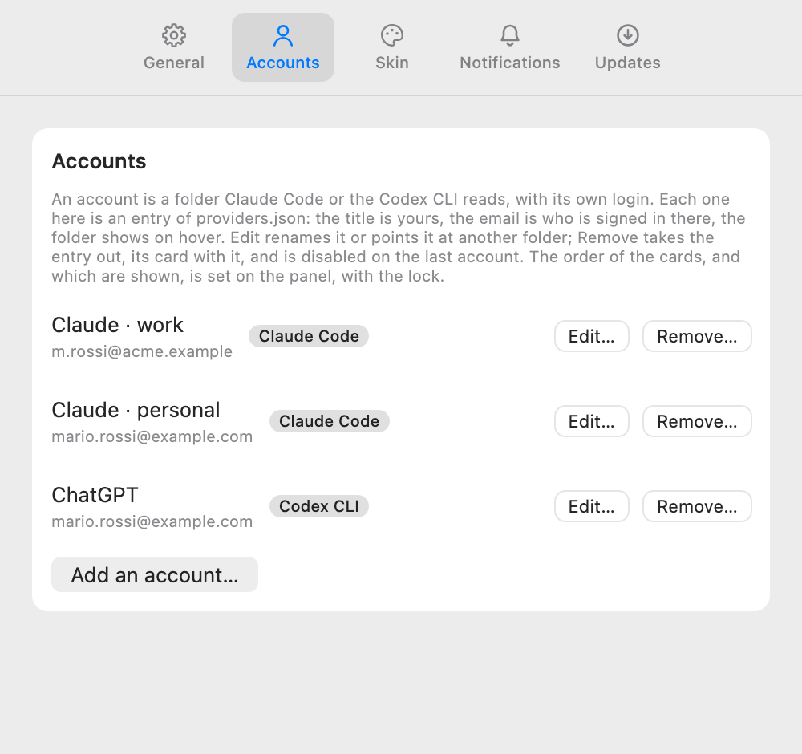
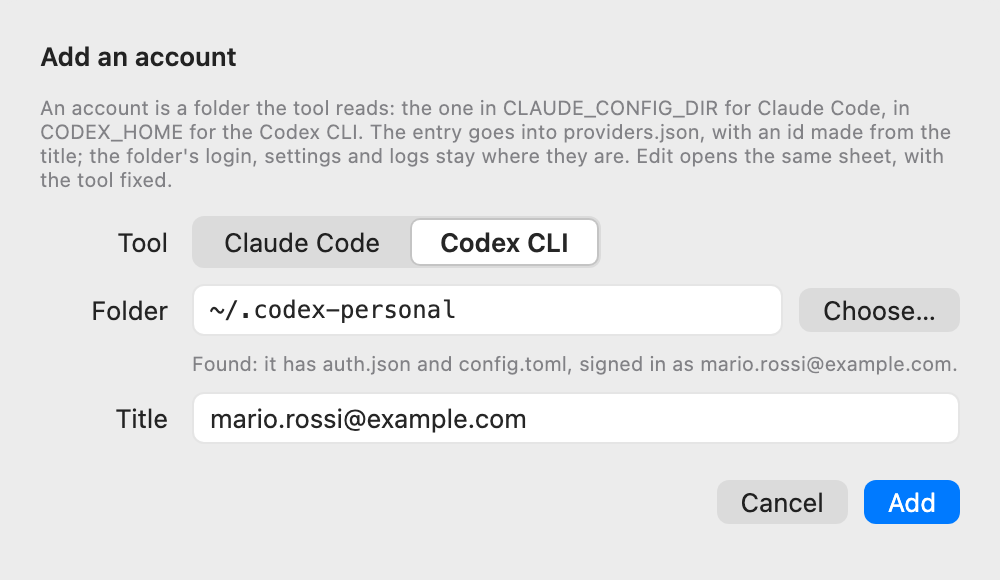
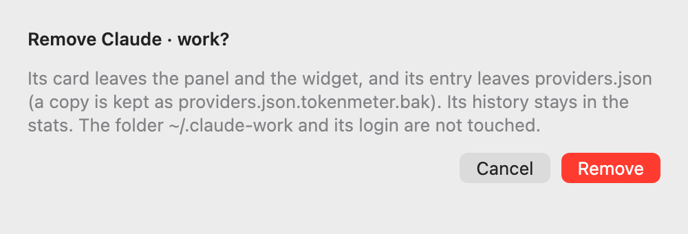
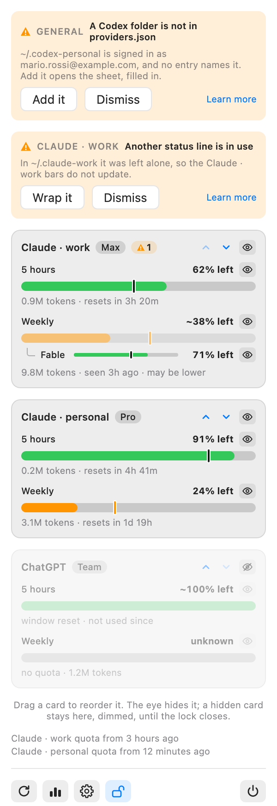

# Accounts, proposal

The design that was chosen, drawn as a canvas in Claude, which is deleted once the feature is implemented; this page is what
stays. The images are the canvas's artboards, built from the app's own tokens with invented data. **Every number, name and
email in them is a sample.**

## What an account is

An account is a **configuration folder** of the tool: the one Claude Code uses when `CLAUDE_CONFIG_DIR` is set, the one the
Codex CLI uses when `CODEX_HOME` is set. Each folder keeps its own login, its own settings and its own logs. In tokenmeter it is a
provider entry of `providers.json` with a field, `home`, that names the folder: the folder where the status line is set up,
where `/usage` runs and where the login is read. The other paths of the entry stay as they are written, with `~` the person's
home as today. Nothing else is new: an account has its own id, title, plan, quota, history, preferences and notices because a
provider already has them, by id.

Who has one account changes nothing. The two entries the app writes the first time stay as they are and read the usual
folders, `~/.claude` and `~/.codex`.

## Two things, two places

**Managing** the accounts, which exist, and **arranging** the panel, which are shown and in what order, are two things, and the
design keeps them apart:

- the accounts are managed in **Settings**, in a tab of their own, **Accounts**, which takes the place of the Providers tab;
- the order and the visibility of the cards, and of the windows in them, are set **on the panel itself**, behind a lock.

## Settings › Accounts

One row per entry: the **title**, which is the account's alias and the name on its card and in its notices ("Claude · work");
under it the **email** the folder is signed in with; a chip with the tool; the folder on hover. On hover a row shows
**Edit…** and **Remove…**; under the list, **Add an account…**. The two entries the app writes the first time are rows like the
others: they can be renamed, pointed at another folder, and removed.

The email is a fact the app reads, never writes: Claude Code keeps it in the folder's `.claude.json`, the Codex CLI inside the
identity token of its `auth.json`. It is shown where the person goes on purpose, in Settings and in the banner that says a
folder was found. It is not on the cards: the panel is glanced at, and the widget sits on the desktop. A login with an API key
has no email: the folder is shown instead.

**Add an account…** and **Edit…** open the same sheet: the tool (Claude Code or the Codex CLI; fixed when editing), the folder
with a **Choose…** button that opens the system's Open panel, a line that says what was found in the folder (the login, or
that there is none), and the title, filled in with the email as soon as the folder is chosen. **Add** writes the entry into
`providers.json`.

**Remove…** asks first, and says what goes and what stays: the card leaves the panel and the widget, the entry leaves the file,
the history stays in the stats, and the folder and its login are not touched.

Settings writes `providers.json` the way the app's own migrations do, keeping a copy as `providers.json.tokenmeter.bak`. The
file stays the person's: an entry written by hand is read like the others, and a change by hand wins at the next read.

## The panel, behind a lock

A **lock** joins the icon row, beside Refresh, Stats and Settings. Closed, the panel is the panel of today. Open:

- every card has an up and a down arrow, and an **eye** that hides it; a hidden card stays on the unlocked panel, dimmed, with a
  crossed eye that shows it again; the eye of the last shown card is disabled;
- a card can be **dragged** to another place; the arrows are the way that always works; the row it would land on is outlined as
  in the lists of Settings;
- every window has an eye of its own, with the rules of today: the last window of a card stays on, and a model's limit follows
  its window;
- the lock closes when the panel closes. Nothing drags and nothing hides while it is closed: the cards keep their hover.

The widget follows the order and shows the cards that are shown; it has no interaction of its own.

## What changes

| Surface  | What it shows                                                                                                                                                         |
| :------- | :-------------------------------------------------------------------------------------------------------------------------------------------------------------------- |
| Panel    | One card for each entry, with its title, its plan and its bars; the lines of the quota age name the entries the same way. The lock, and the unlocked panel.           |
| Widget   | The same cards, in the same order, from the snapshot.                                                                                                                 |
| Stats    | One stats card for each entry, with its own history.                                                                                                                  |
| Settings | **General**: the one switch "Set up the Claude quota automatically", with a line per Claude account under it and **Restore original** beside the one that is wrapped. |
|          | **Accounts** in place of **Providers**: the rows, Edit…, Remove…, Add an account…, and the two sheets. Five tabs, as today.                                           |
| Notices  | Named by the entry's title: "Claude · work · Weekly".                                                                                                                 |
| Problems | The status-line problems name the account they are about. A new one, _A Claude folder is not in providers.json_, with the folder and its email, and **Add it**.       |
| Welcome  | A page of its own, the seventh of eight, before Settings; the buttons page says the lock; the Settings page says Accounts.                                            |
| Docs     | A Use page, _Accounts_: what a folder is, the sheet, the lock, and the recipe by hand for a folder the app cannot find.                                               |

## The status line and `/usage`, for each account

The automatic setup of the Claude quota, which today writes the status line into `~/.claude/settings.json` and asks Claude
Code to run `/usage`, does the same for each Claude entry in **its** folder:

- the status line goes into that folder's `settings.json`, and the command it runs carries the entry's id as an argument, so
  the script writes its file apart from the others, whatever the environment it runs in;
- `/usage` runs with `CLAUDE_CONFIG_DIR` set to the folder, every 15 minutes and on refresh, as today;
- the problems of the status line (another status line in use, a project with its own) are checked in each folder, and say
  which account they are about.

## Finding a folder nobody named

There is no list of accounts anywhere: a folder is one because the person points the tool at it. What the app can do is
recognise one. A Claude Code folder holds `.claude.json` and `projects/`; a Codex folder holds `auth.json` and `config.toml`.
Once every ten minutes, with the other checks, the app looks at the hidden folders at the top of the home (`~/.claude-work`,
`~/.codex-personal`, never deeper) and, for one that has the fingerprint and that no entry of `providers.json` names, lists a
problem that says which folder and which email. **Add it** opens the sheet of Settings › Accounts, filled in with the tool, the
folder and the email as the title; **Add** there writes the entry, so there is one place that writes the file. **Dismiss** hides
the problem until the folder changes. **Learn more** opens the Use page, for the person who prefers to write the entry by hand,
or whose folder is somewhere the app does not look: for that one, **Add an account…** with **Choose…** works too.

What the app does not read: the shell's configuration files, the Keychain and the environment of other processes. What it
cannot do: tell apart two logins that took turns in the same folder, whose history is one.

## The welcome

A page of its own, _An account is a folder_, the seventh of eight, before the Settings page: a work account and a personal
one are two folders, each gets a card, and the panel says when it finds one nobody named. The picture is the panel with the
two Claude cards, the second outlined. Two pages change a sentence: the buttons page has five buttons and says what the lock
does; the Settings page names Accounts in place of Providers. The pages become eight; the tour keeps one concept per page and
no summary page.

## What was verified

- With `CLAUDE_CONFIG_DIR` set, Claude Code 2.1.317 creates `.claude.json`, `projects/`, `sessions/`, `plugins/` and `backups/`
  in that folder (tried on an empty temporary folder, no login). Its documentation says `settings.json` and the credentials
  live there too.
- With `CODEX_HOME` set, the Codex CLI 0.166.0 creates its state in that folder (tried the same way); OpenAI's documentation
  says `auth.json` lives there, and the community's reading is that `sessions/` does too.
- On the author's Mac, on 2026-11-04, the keys only: `.claude.json` has `oauthAccount.emailAddress` (with the organisation
  and the plan's display name beside it); the Codex `auth.json` has `tokens.id_token`, whose claims include `email`, and an
  `auth_mode` that says whether the login is a key.
- Two Claude entries with their own folders already give two cards and two histories with the code as it is (tried on
  2026-11-02 with made-up data); what is missing is everything around: the status line, `/usage`, the problems, the email,
  the sheets and the lock.
- A row of the Settings list already drags on its own, with a drop target outlined in the accent colour (the provider cards
  feature): the unlocked panel uses the same mechanism on a card. Not tried on the panel yet.

## Decisions taken in the design

- **Managing and arranging are two places.** A first round put the accounts in the Providers tab, as rows with the email; it
  showed what exists but gave no way to add, rename or remove, and it mixed that with order and visibility. A second round drew
  a tab of its own (A), two groups in one tab (B) and an Edit mode on the list (C); the chosen one takes arranging out of
  Settings altogether and puts it where the cards are.
- **Nothing drags or hides while the panel is locked.** The cards have a hover already, and a drag by mistake while reading
  would move them; the lock is one click, closes with the panel, and the unlocked panel keeps the hidden cards in sight so they
  can come back.
- **One sheet writes the file.** Add an account…, Edit… and the banner's Add it all end in the same sheet, so what is written
  is confirmed once, with the title in front of the person.
- **The email is a caption, not a title.** The alias stays the person's word; the email says which login a folder holds, in
  Settings and in the banner, and nowhere the panel or the widget shows.
- **The folder on hover.** A path is for the person who looks for it; the email is what tells accounts apart.
- **Five tabs.** Accounts takes the place of Providers, so Settings does not grow and the tour keeps its count.
- **One page in the tour, before Settings.** The Settings page is about the tabs, and an account is not set up in a tab; a
  sentence there was drawn and set aside.

## Not decided here

The code decides the shape of the `home` field, the fingerprint of a folder, how often it is looked for, how Settings writes
`providers.json` (ADR 0003 calls the file the person's and lets only the migrations write it), what remains of the history of
an entry that was removed, how the Codex email is read from a file of credentials without keeping anything else of it, and
whether the order and the visibility stay in the defaults as today, only written from the panel: ADR 0014.
