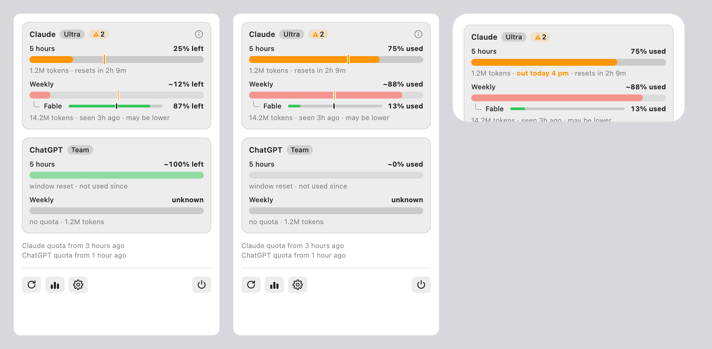
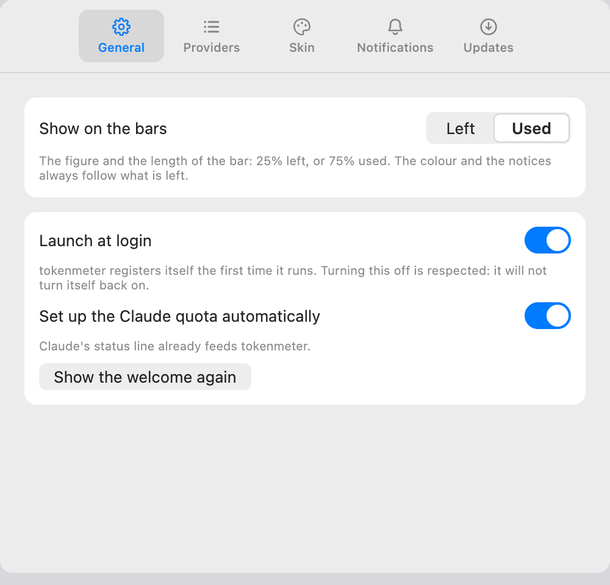
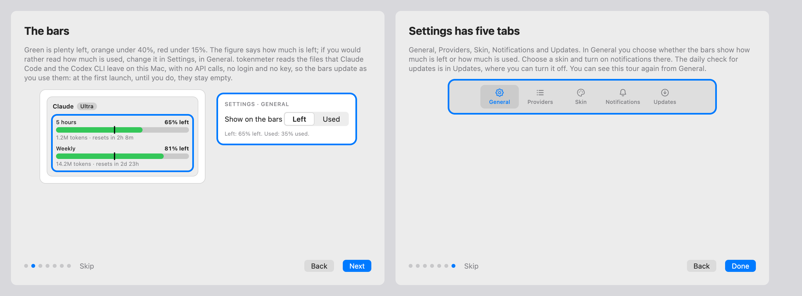

# Bars, left or used, proposal

The design that was chosen. It was drawn as a canvas in Claude, which is deleted once the feature is implemented; this page is what
stays. **Every number in the images is a sample.**

## What changes

| Surface  | What it shows                                                                                                                       |
| :------- | :---------------------------------------------------------------------------------------------------------------------------------- |
| Panel    | In Used: `75% used` instead of `25% left`, the bar filled to 75%, and the mark of the pace mirrored with it. Nothing else moves.    |
| Widget   | The same, in every size and skin, from the same choice. It has no mark, and keeps its phrase `out today 4 pm`.                      |
| Settings | In General, a first group with a segmented control **Show on the bars: Left, Used** and one line saying what stays on what is left. |
| Wizard   | Page 2 and page 7 say it; see below.                                                                                                |

## The wizard

Page 2 says the figure is what is left and where to change it, and shows the control beside the panel, outlined. Page 7 adds the choice to
what General holds. The other five pages stay as they are.

## Decisions taken in the design

- **One global choice**, not one per provider or per window: the question is how a person reads a bar, and it is the same for all.
- **A segmented control, not two rows with a sample bar.** The two variants were drawn; the control is the smaller change and the sample
  bars repeat what the line under the control already says. The other variant was deleted with the canvas.
- **The colour keeps following what is left.** A bar at `75% used` is orange, because 25% is left: red under 15% left keeps its meaning in
  both readings, and so does the green of a bar that has plenty.
- **The mark of the pace mirrors with the bar**, so a bar that passes the mark still means the quota runs out before the reset.
- **The line of a notification follows the choice** (0.9.2): `91% used · resets in 2d 6h`. What makes a notice due, and the two lines of Settings that name the thresholds (`Under 10% left.`), stay on what is left: they define a threshold, not a bar.
- **The mark reads the other way on Used**, and says so: the `i`, the wizard and the docs explain it in the reading chosen (0.9.2).
- **The stats follow the choice** (added on 2026-11-03, in 0.9.1: a person who reads the bars as used should not meet `left` in the charts): the row of a window that ended, and the two sentences of the verdict that name a percentage.
- **A window with nothing used is an empty bar**, `~0% used`, not the smallest sliver that a nearly empty `left` bar shows.

## What is new to build

- A choice of two values, kept in the app's defaults and published to the widget in the snapshot.
- The views read it and draw the figure, the bar and the mark from it.
- The segmented control, now a component of the Design System, with the group that holds it.
- The two pages of the wizard.
