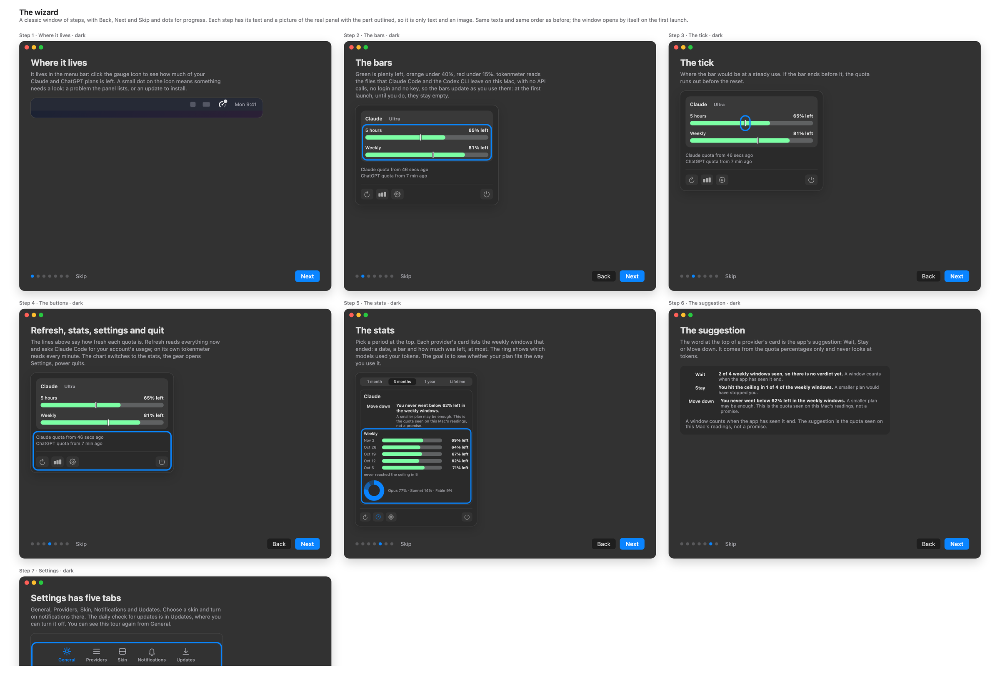
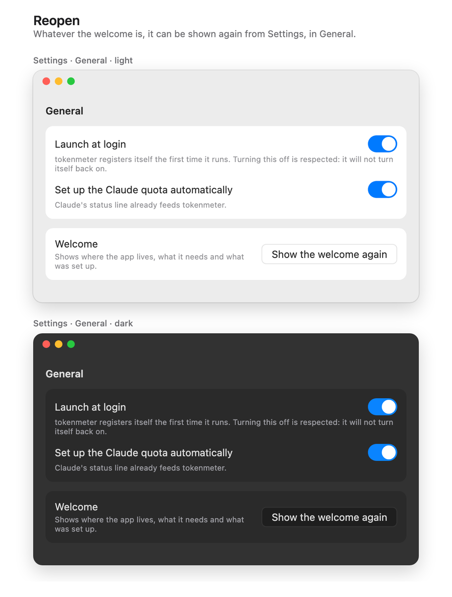

# Welcome tour, proposal

The design that was chosen: a classic wizard in a window of its own. It was drawn as a canvas in Claude, which is deleted once the feature is
implemented; this page is what stays. **Every number in the images is a sample.**

## The pages

Each page has a title, a short text and a picture of the real panel with the part outlined. Back, Next and Skip are in the footer, with dots for
progress; the last page has Done.

| Page               | What it says                                                                                                                                                                                                                                                                                               | From                              |
| :----------------- | :--------------------------------------------------------------------------------------------------------------------------------------------------------------------------------------------------------------------------------------------------------------------------------------------------------- | :-------------------------------- |
| 1 · Where it lives | It lives in the menu bar: click the gauge icon to see how much of the Claude and ChatGPT plans is left. A small dot on the icon means something needs a look: a problem the panel lists, or an update to install.                                                                                          | the app's own dot                 |
| 2 · The bars       | Green is plenty left, orange under 40%, red under 15%. It reads the files Claude Code and the Codex CLI leave on this Mac, with no API calls, no login and no key, so the bars update as they are used: empty at first.                                                                                    | [Bars](../../use/bars.md)         |
| 3 · The tick       | Where the bar would be at a steady use; if the bar ends before it, the quota runs out before the reset.                                                                                                                                                                                                    | [Bars](../../use/bars.md)         |
| 4 · The buttons    | The two lines say how fresh each quota is. Refresh reads now and asks Claude Code for the account's usage; the chart switches to the stats; the gear opens Settings; power quits.                                                                                                                          | the code of `Meter.refresh`       |
| 5 · The stats      | Pick a period at the top. Each provider's card lists the windows that ended: a date, a bar and how much was left, at most. A bar marked ~ and at half strength was read well before its end, so it may have ended with less. The ring shows which models used the tokens, and only those this Mac counted. | [Stats](../../use/stats.md)       |
| 6 · The suggestion | The word at the top of a card is the app's suggestion: Wait, Stay or Move down. It comes from the quota percentages only and never looks at tokens.                                                                                                                                                        | [Stats](../../use/stats.md)       |
| 7 · Settings       | The five tabs: General, Providers, Skin, Notifications, Updates. The daily check for updates is in Updates, where it can be turned off. The tour can be seen again from General.                                                                                                                           | [Settings](../../use/settings.md) |

## What stays true

- **No API calls.** The app calls no API, asks for no login, key or token and does not use the plan. The one request of its own is a daily
  check for a new version, which can be turned off in Settings.
- **The dot keeps its one meaning.** It is the icon's own colour, 8 points in the top right corner, and shows when the panel lists a problem or
  an update waits.
- **The pictures are of the real panel**, drawn from its own views with sample data, never with real usage.

## Rules

- **It opens by itself once, when it was never seen**: the first time the app opens a version that has it, on a fresh install and on the first
  update alike.
- **It counts as seen** when the person reaches Done, skips, or closes the window; quitting the app in the middle leaves it unseen, so it opens
  again at the next launch.
- **It is shown again** from Settings, in General, with a button **Show the welcome again**.
- **A person who already uses the app** sees it once after the update. The first pages are written to hold for them too: nothing in them says
  the bars are empty now, only that they start empty.

## What is new to build

- A window of its own, opened by the app, with the seven pages, the footer and the dots.
- The pictures of the real panel, light and dark, one per page.
- A flag in the defaults that says it was seen, and the button in Settings.

## Decisions taken in the design

- **A wizard, not a tour over the panel.** A tour that points at the icon and dims the panel needs the app to reach its own menu-bar item and open
  its panel from code; SwiftUI's menu-bar item gives neither. A window needs nothing of the sort.
- **Pictures, not live views**: the page is text and an image, so the wizard stays simple.
- **One concept per page.** How the data is collected sits in the bars page, where the empty bars ask for it.
- **No summary page of what was set up.** The panel already lists problems; a wizard page that restated them mixed concepts.
- **No widget page.** How the widget is added on the author's Mac was not verified, so the tour does not say.
