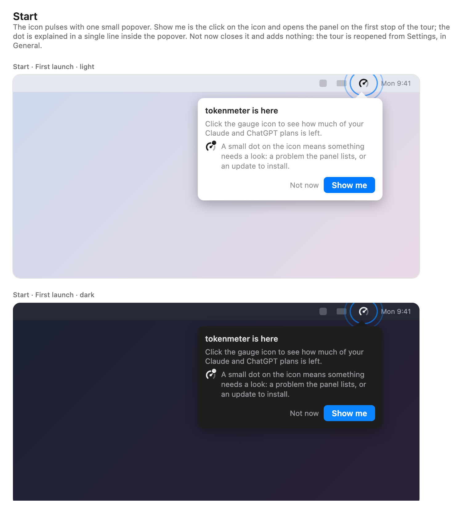
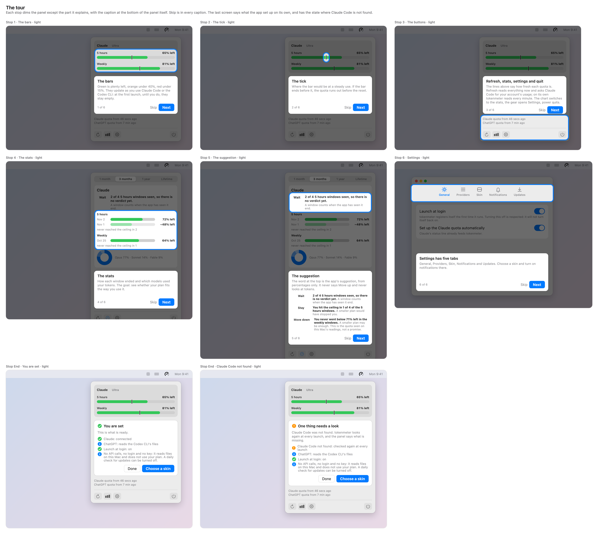
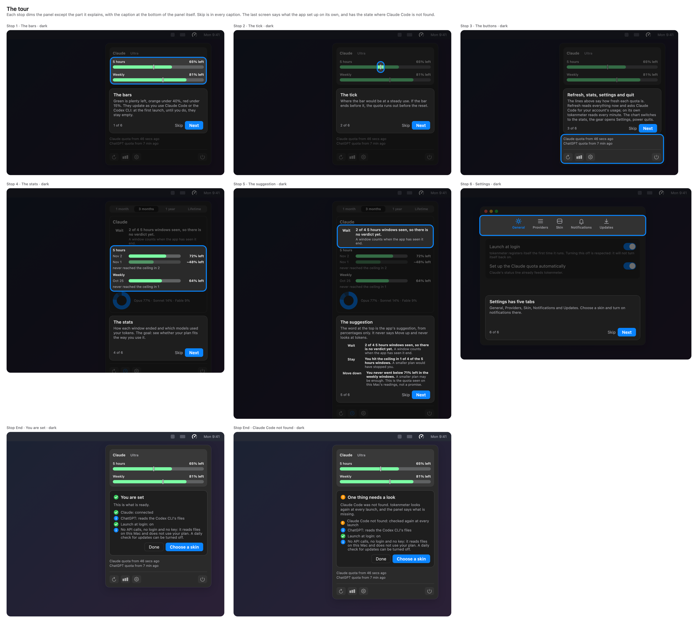

# Welcome tour, proposal

The design that was chosen. It was drawn as a canvas in Claude, which is deleted once the feature is implemented; this page is what
stays. **Every number in the images is a sample.**

## The flow

| Step               | Where           | What it says                                                                                                                                                                                             | From                              |
| :----------------- | :-------------- | :------------------------------------------------------------------------------------------------------------------------------------------------------------------------------------------------------- | :-------------------------------- |
| Start              | Menu bar        | The icon pulses and a popover says tokenmeter is here. One line explains the dot: it means something needs a look, a problem the panel lists or an update.                                               | the app's own dot                 |
| 1 · The bars       | Panel           | Green is plenty, orange under 40%, red under 15%. The bars update as you use Claude Code or the Codex CLI; at the first launch, until you do, they stay empty.                                           | [Bars](../../use/bars.md)         |
| 2 · The tick       | Panel           | Where the bar would be at a steady use; if the bar ends before it, the quota runs out before the reset.                                                                                                  | [Bars](../../use/bars.md)         |
| 3 · The buttons    | Panel           | The two lines say how fresh each quota is. Refresh reads now and asks Claude Code for the account's usage; the chart switches to the stats; the gear opens Settings; power quits.                        | the code of `Meter.refresh`       |
| 4 · The stats      | Stats view      | How each window ended and which models used the tokens. The goal: see whether the plan fits the way it is used.                                                                                          | [Stats](../../use/stats.md)       |
| 5 · The suggestion | Stats view      | The word at the top, from percentages only: Wait, Stay or Move down, with the app's own sentences. It never says Move up and never looks at tokens.                                                      | [Stats](../../use/stats.md)       |
| 6 · Settings       | Settings window | The five tabs: General, Providers, Skin, Notifications, Updates.                                                                                                                                         | [Settings](../../use/settings.md) |
| End                | Panel           | What the app set up on its own: Claude's status line, ChatGPT read from the Codex CLI's files, launch at login, and no API calls. With a "One thing needs a look" version when Claude Code is not found. | the app's own texts               |

Skip is in every caption. **Not now** at the start adds nothing to the icon: the tour is shown again from Settings, in General, with a button
**Show the welcome again**.

## What stays true

- **No API calls.** The app calls no API, asks for no login, key or token and does not use the plan. The one request of its own is a daily
  check for a new version, which can be turned off in Settings, and the end screen says so.
- **The dot keeps its one meaning.** It is the icon's own colour, 8 points in the top right corner, and shows when the panel lists a problem
  or an update waits. The tour never uses it for anything else.
- **The panel is the real panel.** Each stop dims it except the part explained; nothing is drawn over it that is not there.

## What is new to build

- A popover under the menu-bar icon, with a ring round the icon, and a way to open the panel from it.
- A veil with a hole over the panel, and a caption card inside the panel's own window (the panel is 300 points wide, so a bubble beside it
  would need a window of its own).
- A flag that says the tour was seen, kept in the defaults, and the button in Settings.
- The end summary, built from what the app already knows: Claude's status line state, launch at login.

## Decisions taken in the design

- **One popover, not three steps, for the start.** The dot is one line inside it.
- **The bars stop says the bars are empty at first launch**, instead of a stop of its own.
- **The summary is at the end, not in the middle.** It is a report of what was set up, not a lesson.
- **No widget step.** How the widget is added on the author's Mac was not verified, so the tour does not say.
- **Six stops**, with the stats in two (the view and its suggestion).
- **It starts once, when it was never seen**: on a fresh install and on the first update. It counts as seen when it ends or is skipped, and
  it is shown again from Settings.

## Not decided here

- **The wording for someone who already uses the app.** The start and the first stop talk to a new person ("tokenmeter is here", the
  bars are empty until the first use). After an update the person already knows the icon and may have full bars, so the same words would
  not be true. Either the tour is written to hold for both, or its first words depend on what the panel holds.

How the app points at its own icon and opens its panel: SwiftUI's menu-bar item does not expose either. That is the
[ADR](../../adr/0014-welcome-tour.md), with a spike first.
