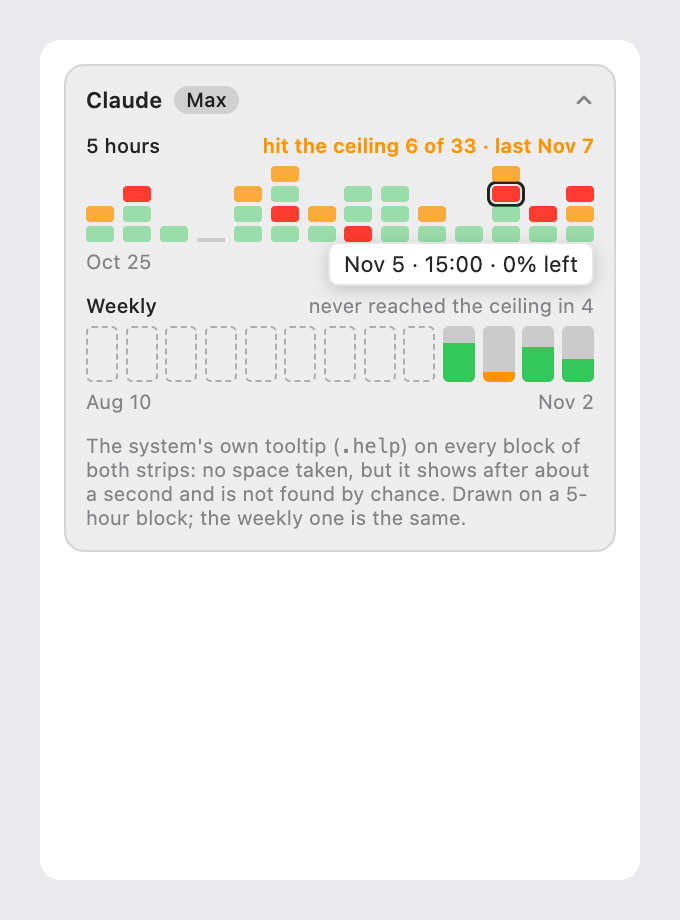
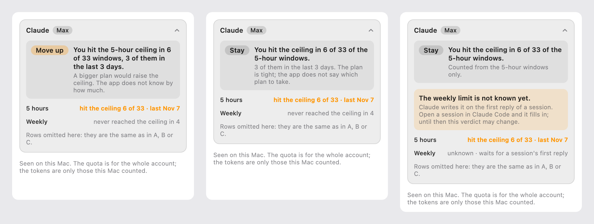
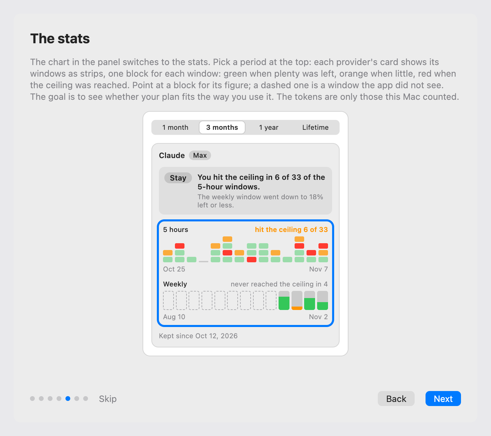
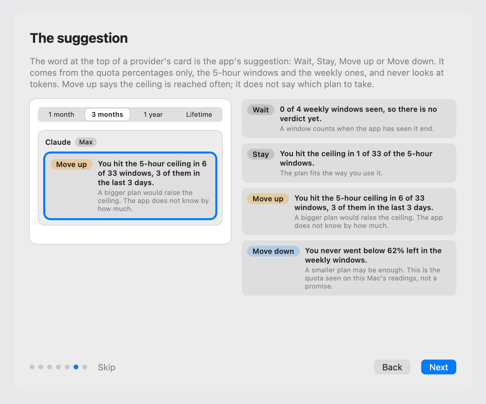

# Stats, windows as strips, proposal

The design that was chosen. It was drawn as a canvas in Claude, which is deleted once the feature is implemented; this page is what
stays. **Every number in the images is a sample**, from a Max plan that has both windows; the author's own plan has no 5-hour window.

## What changes

| Surface               | What it shows                                                                                                                                                                             |
| :-------------------- | :---------------------------------------------------------------------------------------------------------------------------------------------------------------------------------------- |
| Stats card, open      | Two strips in place of the rows: the **5 hours** over the last 14 days, one block per window, stacked by day; the **weekly** over the range, one block per week. Time runs left to right. |
| A block               | The colour a bar of what was left would have: green when plenty was left, orange under 40%, red under 15%. A weekly block is filled as a bar is. The figure is in the system's tooltip.   |
| A week not seen       | A dashed block, never a block drawn as if nothing had been used.                                                                                                                          |
| The summary line      | `hit the ceiling 6 of 33 · last Nov 7` above the 5-hour strip, `never reached the ceiling in 4` above the weekly one.                                                                     |
| The verdict           | Counts the 5-hour windows as well as the weekly ones, and gains a word: Move up.                                                                                                          |
| Weekly not known      | A notice says what is missing, and the verdict says it was drawn from the 5 hours alone.                                                                                                  |
| Wizard, pages 5 and 6 | Page 5 describes the strips and the figure on a point; page 6 names the words of the suggestion. See below.                                                                               |

## The verdict

The verdict counts the 5-hour windows. Hitting the ceiling often is the clearest sign that a plan is tight, and it counted for nothing.
When the weekly is not known yet, the verdict is drawn from the 5 hours and a notice says what is missing and that it may change.

## The wizard

Page 5 says the windows are strips, what the colours mean, that a dashed block is a window the app did not see, and that a point shows
the figure. Page 6 names the four words of the suggestion and says it counts the 5 hours too. Both pages are drawn here, with the strips and with
the four verdict boxes. The text of both pages is a draft.

## Decisions taken in the design

- **Time runs left to right.** The weekly was drawn as rows first, with the date down the side; the author chose the horizontal time for
  both strips.
- **The figure is in the system's tooltip.** Eight ways to give the number were drawn: the hour on each row, one row per day, a reading
  line under the strip, the figure under the lowest block, the tooltip, the strip with the rows on request, only the fill of small bars,
  and the digits under the blocks. The tooltip was chosen: it takes no space and no state, and it is the weakest one at being found.
- **The tooltip follows Show on the bars**, as the rows do today: `18% left` or `82% used`. The colour of a block follows what is left,
  as the bars do: the threshold of 30% in the images was a draft, the app uses the bars' own.
- **The 5-hour strip is the last 14 days**, whatever the range. The weekly strip is the range, 13 blocks for 3 months.
- **A window the app did not see is dashed.** It was seen only from the day the app first ran this version.
- **The rows of today go**, the 5-hour ones that were never shown and the weekly ones that were. What they said is in the tooltip.

## Move up

**The verdict gains a word: Move up** (chosen by the author on 2026-11-09). It says the ceiling is reached often, and that the app does
not know the size of the other plan: it never says which plan to take. Without it the same case would have stayed a Stay with a line
saying the plan is tight; that version was drawn and dropped. Until now the stats never said Move up, because the size of the other
plans is not known; a threshold on how often the ceiling is reached does not need it.

## For the plan

Questions for the code, not decided here:

- The rule of Move up and the thresholds of the verdict for the 5 hours: how many windows are enough, what share at the ceiling, how
  recent, and how it combines with the weekly.
- The Use page on the stats says the verdict never says Move up: it changes with this feature.
- What the 5-hour strip shows for 1 year and Lifetime: the last 14 days, as drawn, and how many weekly blocks fit.
- Each block needs a label for VoiceOver, because a tooltip is not enough.
- The tooltip's text of a 5-hour block: the hour of its end and the figure, from what a reading holds (`resetsAt`, the highest use
  seen, the first and last time it was seen). The store keeps one reading per window, so no curve inside a window is possible.
- The words and the text of the two new verdict lines, and of the notice for the weekly not known, are drafts.
- The Use pages on the stats and on the suggestion, and the wizard's pictures, which are screenshots of the real panel with sample data.

## Not verified

The look on the real app: light and dark, the other skins, and 52 weekly blocks. That the system's tooltip shows in the panel at all.
The colour threshold in the Used reading. The canvas was rendered offline from its files, not opened.
