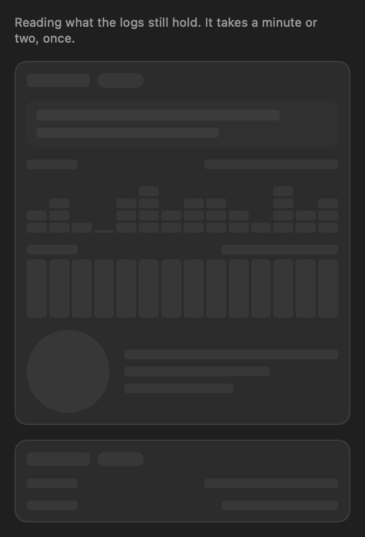
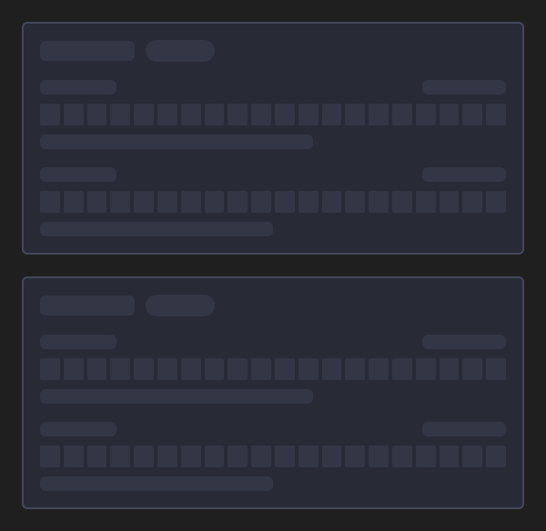

# Loading skeleton, proposal

The design that was chosen, variant C of three. It was drawn as a canvas in Claude, which is deleted once the feature is implemented;
this page is what stays. The images are the app's own views drawn offscreen: they hold no data.

## The variants

| Variant | What it was                                                                     |
| :------ | :------------------------------------------------------------------------------ |
| A       | The shape of the cards, standing still.                                         |
| B       | The same shape, pulsing slowly; still with Reduce Motion.                       |
| **C**   | **As B, with the line that says why the first reading of the logs takes long.** |

## What changes

| Surface                          | What it shows                                                                                                                      |
| :------------------------------- | :--------------------------------------------------------------------------------------------------------------------------------- |
| Panel, before the first reading  | Two empty provider cards: a name, a plan chip, two windows with their label, figure, bar and detail line. In place of the spinner. |
| Stats, while the history opens   | Empty stats cards: the first open (verdict, the two strips, the ring), the others closed.                                          |
| Stats, the first reading of logs | The same, under the line "Reading what the logs still hold. It takes a minute or two, once."                                       |
| Unchanged                        | The small spinners of Refresh and of "Checking…" in Settings, which belong to an action. The widget, which has no spinner.         |

The same in all: the shapes are in the skin's track colour, the bars are the skin's own bars with no fill (blocks in Dracula, a line in
One Dark, an outline in Nord), one card for each provider shown, two when they are not known yet, and no figure.

