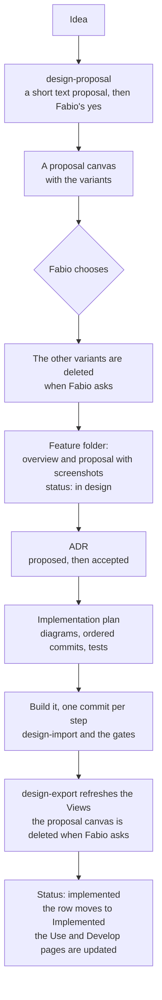

# Features

The things tokenmeter does, one by name, **newest first**. Every feature has the same three pages: an **overview**, its
**proposal** (the design that was chosen, with its screens) and its **implementation plan**. The decisions behind it
are [ADRs](../adr), and its overview links them.

## Implemented

| Feature                                                                                                                          | Date       | Pages                                                                                                                                                                            |
| :------------------------------------------------------------------------------------------------------------------------------- | :--------- | :------------------------------------------------------------------------------------------------------------------------------------------------------------------------------- |
| [Alerts with a fix](./2026-10-30-alerts-with-a-fix/index.md): the app tells what is wrong and offers a fix                       | 2026-10-30 | [Overview](./2026-10-30-alerts-with-a-fix/index.md), [Proposal](./2026-10-30-alerts-with-a-fix/proposal.md), [Implementation plan](./2026-10-30-alerts-with-a-fix/plan.md)       |
| [Provider cards](./2026-10-30-provider-cards/index.md): a card per provider, the windows you choose, in your order               | 2026-10-30 | [Overview](./2026-10-30-provider-cards/index.md), [Proposal](./2026-10-30-provider-cards/proposal.md), [Implementation plan](./2026-10-30-provider-cards/plan.md)                |
| [Hide a provider](./2026-10-30-provider-visibility/index.md): an eye button takes a provider's card off the panel and the widget | 2026-10-30 | [Overview](./2026-10-30-provider-visibility/index.md), [Proposal](./2026-10-30-provider-visibility/proposal.md), [Implementation plan](./2026-10-30-provider-visibility/plan.md) |

## In design and build

| Feature | Date | Pages |
| :------ | :--- | :---- |

## The pattern: from idea to implemented

Every feature goes through the same steps, and each step leaves something in the feature's folder. The order does not
change.

| Step                  | Leaves                                                                             | In                                   |
| :-------------------- | :--------------------------------------------------------------------------------- | :----------------------------------- |
| Proposal              | the chosen design, drawn in a canvas named `TokenMeter Proposal · <area> · <date>` | Claude (private, temporary)          |
| Overview and proposal | `index.md` and `proposal.md`, with a screenshot of the chosen design               | `docs/features/<yyyy-mm-dd>-<name>/` |
| Decision              | the ADR, written before the plan                                                   | `docs/adr/`                          |
| Plan                  | `plan.md` with diagrams, the order of commits and the tests                        | the feature's folder                 |
| Code                  | one commit per step of the plan, each leaving the gate green                       | the repository                       |
| Done                  | the status in the overview, the row in this list, the Use and Develop pages        | `docs/`                              |

[Implement a Feature](../develop/implement-a-feature.md) says what to do and run at each step.

The skills that do the design work are `design-proposal` (a proposal), `design-import` (a proposal into the code) and
`design-export` (the code into the design artifacts); they live in `.claude/skills/`.

## How a feature is written

| Part                    | Answers                                                                                                              | File          |
| :---------------------- | :------------------------------------------------------------------------------------------------------------------- | :------------ |
| **Overview**            | What it is, its date and its status, and links to the other two parts and to its ADRs.                               | `index.md`    |
| **Proposal**            | What it looks like and how it behaves: the chosen design with a screenshot of it, the states and what is still open. | `proposal.md` |
| **Implementation plan** | How it is built: the modules, the data flow with diagrams, the order of commits and the tests.                       | `plan.md`     |

- **The proposal keeps the screenshot.** The design is drawn in a canvas that is deleted once the code is in, so the page,
  with its pictures, is what stays.
- **Order.** A feature's folder is `docs/features/<yyyy-mm-dd>-<name>/` and its sidebar label is the feature's title, not the name of a concept in the code. Its `_category_.json` carries a `position` of 99999999
  minus its date as `YYYYMMDD`, so the sidebar lists the newest first without renumbering the others.
- **Status.** A feature is listed under _In design and build_ until its code is in; then its overview says so and it
  moves to _Implemented_, with the date it was implemented.
- Write the ADR before the plan, and the plan before the code.
