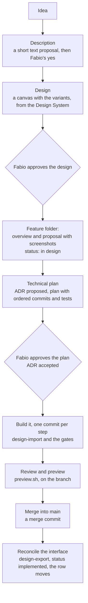

# Features

The things tokenmeter does, one by name, **newest first**. Every feature has the same three pages: an **overview**, its
**proposal** (the design that was chosen, with its screens) and its **implementation plan**. The decisions behind it
are [ADRs](../adr), and its overview links them.

## Implemented

| Feature                                                                                                                                                                      | Date       | Pages                                                                                                                                                                               |
| :--------------------------------------------------------------------------------------------------------------------------------------------------------------------------- | :--------- | :---------------------------------------------------------------------------------------------------------------------------------------------------------------------------------- |
| [Alerts with a fix](./2026-10-30-alerts-with-a-fix/index.md): the app tells what is wrong and offers a fix                                                                   | 2026-10-30 | [Overview](./2026-10-30-alerts-with-a-fix/index.md), [Proposal](./2026-10-30-alerts-with-a-fix/proposal.md), [Implementation plan](./2026-10-30-alerts-with-a-fix/plan.md)          |
| [Provider cards](./2026-10-30-provider-cards/index.md): a card per provider, the windows you choose, in your order                                                           | 2026-10-30 | [Overview](./2026-10-30-provider-cards/index.md), [Proposal](./2026-10-30-provider-cards/proposal.md), [Implementation plan](./2026-10-30-provider-cards/plan.md)                   |
| [Hide a provider](./2026-10-30-provider-visibility/index.md): an eye button takes a provider's card off the panel and the widget                                             | 2026-10-30 | [Overview](./2026-10-30-provider-visibility/index.md), [Proposal](./2026-10-30-provider-visibility/proposal.md), [Implementation plan](./2026-10-30-provider-visibility/plan.md)    |
| [Model limits](./2026-10-30-model-limits/index.md): a limit for one model, part of Weekly, as a compact line                                                                 | 2026-10-30 | [Overview](./2026-10-30-model-limits/index.md), [Proposal](./2026-10-30-model-limits/proposal.md), [Implementation plan](./2026-10-30-model-limits/plan.md)                         |
| [Windows by plan](./2026-10-31-windows-by-plan/index.md): a card shows only the windows the plan has                                                                         | 2026-10-31 | [Overview](./2026-10-31-windows-by-plan/index.md), [Proposal](./2026-10-31-windows-by-plan/proposal.md), [Implementation plan](./2026-10-31-windows-by-plan/plan.md)                |
| [Burn rate](./2026-10-31-burn-rate/index.md): a window says when it runs out at its pace, when before the reset                                                              | 2026-10-31 | [Overview](./2026-10-31-burn-rate/index.md), [Proposal](./2026-10-31-burn-rate/proposal.md), [Implementation plan](./2026-10-31-burn-rate/plan.md)                                  |
| [Pace on the bars](./2026-11-01-pace-on-bars/index.md): a mark on the bar says whether the quota lasts, a hover says when it runs out                                        | 2026-11-01 | [Overview](./2026-11-01-pace-on-bars/index.md), [Proposal](./2026-11-01-pace-on-bars/proposal.md), [Implementation plan](./2026-11-01-pace-on-bars/plan.md)                         |
| [Settings switches](./2026-11-01-settings-switches/index.md): a switch hides a provider, a switch for each window under it                                                   | 2026-11-01 | [Overview](./2026-11-01-settings-switches/index.md), [Proposal](./2026-11-01-settings-switches/proposal.md), [Implementation plan](./2026-11-01-settings-switches/plan.md)          |
| [Usage stats](./2026-11-02-usage-stats/index.md): a second view in the panel, from facts the app has seen, no estimates                                                      | 2026-11-02 | [Overview](./2026-11-02-usage-stats/index.md), [Proposal](./2026-11-02-usage-stats/proposal.md), [Implementation plan](./2026-11-02-usage-stats/plan.md)                            |
| [Menu bar: icon only](./2026-11-02-menu-bar-icon-only/index.md): the bar is the icon, a dot says it is worth a look                                                          | 2026-11-02 | [Overview](./2026-11-02-menu-bar-icon-only/index.md), [Proposal](./2026-11-02-menu-bar-icon-only/proposal.md), [Implementation plan](./2026-11-02-menu-bar-icon-only/plan.md)       |
| [Updates](./2026-11-02-updater/index.md): the app tells you about a new version and installs it, widget included                                                             | 2026-11-02 | [Overview](./2026-11-02-updater/index.md), [Proposal](./2026-11-02-updater/proposal.md), [Implementation plan](./2026-11-02-updater/plan.md)                                        |
| [Notifications](./2026-11-02-notifications/index.md): a notice when a window is running out, once for each window and reset                                                  | 2026-11-02 | [Overview](./2026-11-02-notifications/index.md), [Proposal](./2026-11-02-notifications/proposal.md), [Implementation plan](./2026-11-02-notifications/plan.md)                      |
| [Seasonal easter eggs](./2026-11-02-seasonal-easter-eggs/index.md): in the week of Halloween, Christmas and Easter, a small icon on the bars and a corner piece on the cards | 2026-11-02 | [Overview](./2026-11-02-seasonal-easter-eggs/index.md), [Proposal](./2026-11-02-seasonal-easter-eggs/proposal.md), [Implementation plan](./2026-11-02-seasonal-easter-eggs/plan.md) |
| [Skins](./2026-11-02-skins/index.md): five looks for the panel, the widget and the stats, each with its own colours, bars and typeface                                       | 2026-11-02 | [Overview](./2026-11-02-skins/index.md), [Proposal](./2026-11-02-skins/proposal.md), [Plan](./2026-11-02-skins/plan.md)                                                             |
| [Settings in tabs](./2026-11-02-settings-tabs/index.md): the Settings window shows one section at a time, chosen from a row of tabs                                          | 2026-11-02 | [Overview](./2026-11-02-settings-tabs/index.md), [Proposal](./2026-11-02-settings-tabs/proposal.md), [Plan](./2026-11-02-settings-tabs/plan.md)                                     |
| [Welcome tour](./2026-11-03-welcome-tour/index.md): a wizard that says where the app lives and walks the panel in seven pages                                                | 2026-11-03 | [Overview](./2026-11-03-welcome-tour/index.md), [Proposal](./2026-11-03-welcome-tour/proposal.md), [Plan](./2026-11-03-welcome-tour/plan.md)                                        |

## In design and build

| Feature                                                                                                                                        | Date       | Pages                                                                                     |
| :--------------------------------------------------------------------------------------------------------------------------------------------- | :--------- | :---------------------------------------------------------------------------------------- |
| [Accounts](./2026-11-03-accounts/index.md): several accounts of the same tool, one folder and one card each, status line and `/usage` for each | 2026-11-03 | [Overview](./2026-11-03-accounts/index.md), [Proposal](./2026-11-03-accounts/proposal.md) |

## The pattern: from idea to implemented

Every feature goes through the same steps, and each step leaves something in the feature's folder. The order does not
change.

| Step                   | Leaves                                                                             | In                                   |
| :--------------------- | :--------------------------------------------------------------------------------- | :----------------------------------- |
| Description and design | the chosen design, drawn in a canvas named `TokenMeter Proposal · <area> · <date>` | Claude (private, temporary)          |
| Overview and proposal  | `index.md` and `proposal.md`, with a screenshot of the chosen design               | `docs/features/<yyyy-mm-dd>-<name>/` |
| Decision               | the ADR, written before the plan and accepted before the code                      | `docs/adr/`                          |
| Plan                   | `plan.md` with diagrams, the order of commits and the tests                        | the feature's folder                 |
| Code                   | one commit per step of the plan, each leaving the gate green                       | the repository                       |
| Review and preview     | the branch seen running, without installing it                                     | your Mac                             |
| Merge                  | a merge commit on `main`                                                           | the repository                       |
| Reconciliation         | the Views and Design System as built, the status, the row in this list             | `docs/` and the design artifacts     |

[Implement a Feature](../develop/implement-a-feature.md) says what to do and run at each step.

The skills that do the design work are `design-proposal` (a proposal), `design-import` (a proposal into the code) and
`design-export` (the code into the design artifacts); they live in `.claude/skills/`.

## How a feature is written

| Part                    | Answers                                                                                                              | File          |
| :---------------------- | :------------------------------------------------------------------------------------------------------------------- | :------------ |
| **Overview**            | What it is, its date and its status, and links to the other two parts and to its ADRs.                               | `index.md`    |
| **Proposal**            | What it looks like and how it behaves: the chosen design with a screenshot of it, the states and what is still open. | `proposal.md` |
| **Implementation plan** | How it is built: the modules, the data flow with diagrams, the order of commits and the tests.                       | `plan.md`     |

- **The proposal keeps the screenshot.** The design is drawn in a canvas that is deleted once the code is in, so the page,
  with its pictures, is what stays.
- **Order.** A feature's folder is `docs/features/<yyyy-mm-dd>-<name>/` and its sidebar label is the feature's title, not the name of a concept in the code. Its `_category_.json` carries a `position` of 99999999
  minus its date as `YYYYMMDD`, so the sidebar lists the newest first without renumbering the others. Two features of the same
  day are told apart by subtracting one more for each that comes later in the day, as the skins and the settings in tabs do.
- **Status.** A feature is listed under _In design and build_ until its code is in; then its overview says so and it
  moves to _Implemented_, with the date it was implemented.
- Write the ADR before the plan, and the plan before the code, and have each approved.
