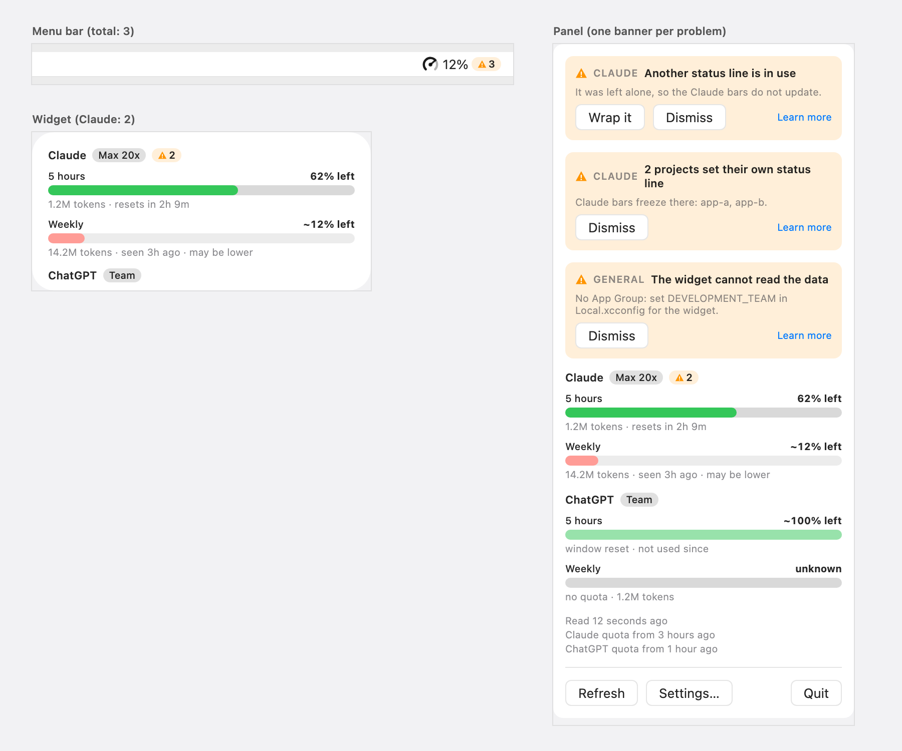
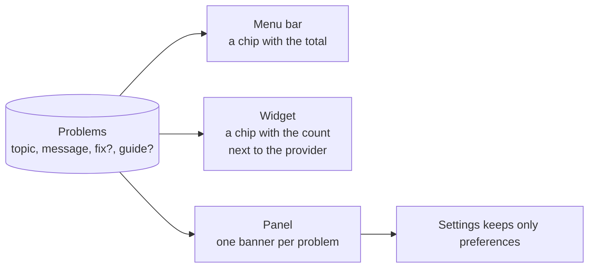
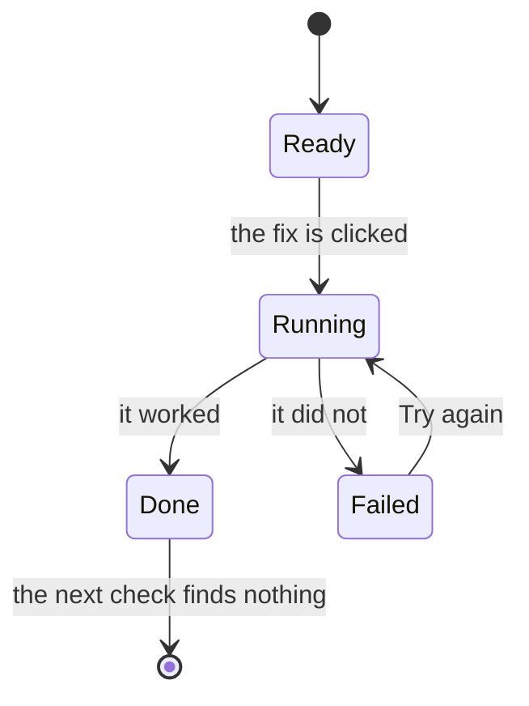
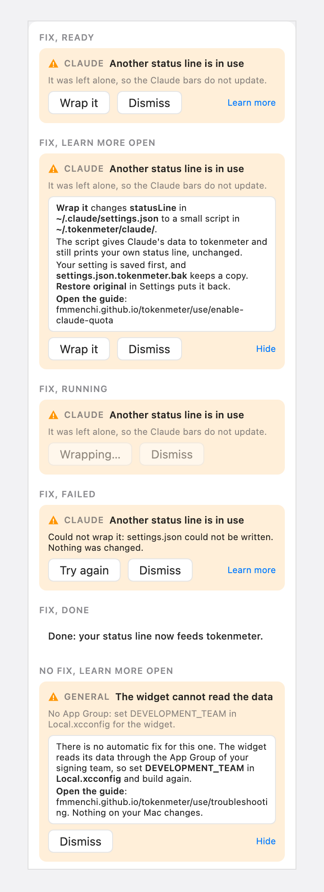

# Problems: proposal

The design that was chosen from four variants. It was drawn as a canvas of artboards in Claude, which is deleted once
the feature is implemented; this page is what stays. The decisions behind it are in
[ADR 0030](../../adr/0030-problems-with-a-topic-and-a-fix.md).

## Intent

A short, compact signal on the small surfaces, and the place to read and fix on the panel.

## The proposal



The menu bar, the widget and the panel, as drawn. The chip is the same on all three; the panel adds one banner per
problem, each with its topic, its actions and **Learn more**.

## Where it shows



| Surface  | What it shows                                                                                                                            | Why                                                                                                                                                       |
| :------- | :--------------------------------------------------------------------------------------------------------------------------------------- | :-------------------------------------------------------------------------------------------------------------------------------------------------------- |
| Menu bar | The gauge and the percentage, then a small chip with the warning icon and the total, for example `▲ 3`.                                  | It is what the user sees all day; one click opens the panel.                                                                                              |
| Widget   | A small chip with the icon and the count, next to the name of the provider the problems are about, for example `Claude · Max 20x · ▲ 2`. | It takes no extra row, and a line after the providers would be clipped out of the medium widget as it is coded. The widget only counts: it has no action. |
| Panel    | One banner per problem, above the providers: the topic, a one-line message, a line of detail, and the actions.                           | The panel is where the fix runs, and it already holds the read ages and the buttons.                                                                      |
| Settings | Preferences only. The status line captions and the Wrap it button move to the panel.                                                     | Nobody opens Settings to find a problem.                                                                                                                  |

The chip is the same on all three surfaces: the warning icon and a number, in the same size and colours, so a provider's
signal reads the same everywhere. The menu bar counts every problem; the widget and the panel count the provider's own.

## A banner

```text
▲  CLAUDE  Another status line is in use
It was left alone, so the Claude bars do not update.
[ Wrap it ]  [ Dismiss ]                        Learn more
```

- **Topic**: `CLAUDE`, `CHATGPT`, another provider, or `GENERAL` for the app itself.
- **Message** in one line, **detail** in one more.
- **Actions**: the fix when there is one, always **Dismiss**, and always **Learn more**.

## Actions

| Action                    | Does                                                                                                                                                                   | After it                                    |
| :------------------------ | :--------------------------------------------------------------------------------------------------------------------------------------------------------------------- | :------------------------------------------ |
| A fix (today **Wrap it**) | Runs now.                                                                                                                                                              | The problem leaves at the next check.       |
| **Dismiss**               | Hides this problem.                                                                                                                                                    | It returns only if its message changes.     |
| **Learn more**            | Opens two or three lines in the banner and a link to a docs page. For a fix it says what it does technically; for a problem with no fix, what is wrong and what to do. | Nothing changes. **Hide** closes the lines. |

For Wrap it, Learn more says that it changes `statusLine` in `~/.claude/settings.json` to a small script in
`~/.tokenmeter/claude/`, that the script feeds tokenmeter and still prints the user's own status line, that the original
setting and a copy, `settings.json.tokenmeter.bak`, are saved first, and that **Restore original** puts it back.



- **Running**: the buttons are disabled and the label reads "Wrapping…".
- **Failed**: the error replaces the detail, nothing was changed, the button reads "Try again".
- **Done**: a quiet line ("Done: your status line now feeds tokenmeter."), then the banner goes.

Fix all and Re-check are not part of this design.



## Examples used in the design

| Topic   | Problem                                         | Action     |
| :------ | :---------------------------------------------- | :--------- |
| Claude  | Another status line is in use.                  | Wrap it    |
| Claude  | 2 projects set their own status line.           | Learn more |
| General | The widget cannot read the data (no App Group). | Learn more |

ChatGPT has no problem of its own today, so none is invented.

## Accessibility

The warning colour and the system secondary text miss the 4.5:1 contrast the design system asks for (they are the system
colours, kept as the app draws them). The chip's count is in the primary text colour for that reason, and the icon
always comes with a number or a message, never alone.

## Open

- Whether **Restore original** stays in Settings when the status line is wrapped.
- Whether the widget counts the `general` problems, or only the menu-bar total does.
- How long Dismiss lasts: until the message changes, or until the next launch.

## Related

- [Overview](./index.md) and [implementation plan](./plan.md)
- [Reading the Bars](../../use/bars.md)
