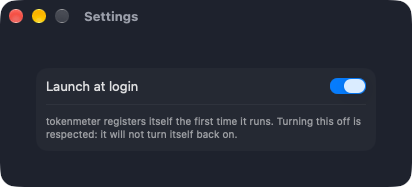

# Install and Run

Build the app, give it a signing team and keep it running in the menu bar.

## Intent

Go from a clean checkout to a gauge icon in the menu bar whose panel shows your bars. Turning on
the Claude quota and the desktop widget are the next two guides.

## Prerequisites

- macOS 14 or later, and Xcode with the Swift 6 toolchain.
- [XcodeGen](https://github.com/yonaskolb/XcodeGen): `brew install xcodegen`.
- An Apple signing team. The widget reads the snapshot through an App Group, and an App Group
  needs a team ([ADR 0003](../adr/0003-host-app-widget-and-app-group.md)). A free Personal Team
  builds and runs, but its provisioning profile lasts seven days: rerun `./scripts/install.sh` to
  renew it. The paid Apple Developer Program gives a profile that lasts a year
  ([ADR 0020](../adr/0020-bundle-identifiers-under-the-paid-team.md)). The bundle identifiers are
  `com.fmmenchi.tokenmeter.app` and `.app.widget`; one that another team already registered cannot
  be registered by yours, so a fork changes them in `project.yml`.
- Claude Code and/or the Codex CLI: both providers are read from what those tools leave on disk.

## Step 1: Set your team

```bash
cp Local.xcconfig.example Local.xcconfig
```

Open `Local.xcconfig` (git-ignored) and replace `XXXXXXXXXX` with your team ID. It is listed under
Xcode, Settings, Accounts, or by `defaults read com.apple.dt.Xcode IDEProvisioningTeamByIdentifier`.

## Step 2: Generate the project and build

```bash
xcodegen generate
xcodebuild -project TokenMeter.xcodeproj -scheme TokenMeter -configuration Debug \
  -derivedDataPath .build/xcode -allowProvisioningUpdates build
```

The `.xcodeproj` is generated from `project.yml` and is not committed. Run `xcodegen generate`
again after adding or removing source files.

## Step 3: Run it

```bash
open .build/xcode/Build/Products/Debug/TokenMeter.app
```

The app has no Dock icon and no window: look for the gauge icon in the menu bar and click it to
open the panel. Without a team the app still runs, but the panel warns that the widget cannot read
the snapshot.

## Step 4: Install it and let it start at login

One command builds the app, installs it in `/Applications` and sets up the Claude status line
([ADR 0019](../adr/0019-install-sets-up-the-claude-status-line.md)):

```bash
./scripts/install.sh
```

It runs [Package and Distribute](./package-and-distribute.md), copies the app, starts it, and runs
`scripts/install-statusline.sh`, which puts `claude-statusline.sh` in `~/.tokenmeter/` and points
`statusLine` in `~/.claude/settings.json` at it. If you already have another status line, it is left
alone and the script says so: see [Enable the Claude Quota](./enable-claude-quota.md).



The app **registers itself to start at login the first time it runs**
([ADR 0011](../adr/0011-launch-at-login.md)). You will see it under System Settings, General, Login
Items. **Settings…** in the panel has a **Launch at login** switch; if you turn it off the app never
turns it back on. Run the copy in `/Applications`: the registration belongs to the copy that
registered it.

:::info[Verified]
The zip's app, copied to `/Applications`, starts from there with a valid signature and the widget
registered at that path.
:::

## Check from the terminal

```bash
swift run tokenmeter-probe
```

Prints each provider's 5h and 7d window with its tokens and remaining quota. If the probe shows the
numbers you expect and the panel does not, the problem is in the app, not in the data.

## Related

- [Enable the Claude Quota](./enable-claude-quota.md)
- [Add the Widget](./add-the-widget.md)
- [Troubleshooting](./troubleshooting.md)
