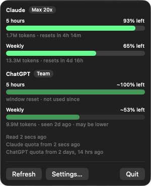

# tokenmeter

A macOS menu-bar app and widget showing how much of your **Claude** and **ChatGPT** plan quota is
left, as a bar for the 5-hour window and one for the weekly window.

## What you get

- Two bars per provider, coloured by how much is left, with the time to reset.
- Tokens used under each bar.
- A clear difference between a **fresh** reading, a **stale** one and an **inferred** reset.
- A WidgetKit widget with the same bars on the desktop.
- Claude and ChatGPT out of the box, and [more providers from a JSON file](./guides/configure-providers.md).

## What it looks like

The panel as it looks on a Mac with both CLIs installed: a stale reading is dimmed and marked
`~`, as the weekly ChatGPT bar is. [Reading the Bars](./reference/bars.md) explains every state.

## What it needs

- macOS 14 or later, Xcode, XcodeGen and an Apple signing team.
- Claude Code with a one-line status-line setting, and/or the Codex CLI.

No credentials and no network: tokenmeter only reads files those tools leave on your machine.

:::caution[Status]
Early. Verified: the providers read from real logs, the quota for both, the bars, the panel and the
Settings window opened on screen, and the app registered to start at login. **Not verified**: the
widget on the desktop end to end, a real reboot with launch at login, and the GitHub Pages deploy.
See [Troubleshooting](./guides/troubleshooting.md).
:::

## 🚀 Guides

1. [Install and Run](./guides/install-and-run.md): build the app and keep it in the menu bar.
2. [Enable the Claude Quota](./guides/enable-claude-quota.md): one setting in Claude Code.
3. [Add the Widget](./guides/add-the-widget.md): the bars on the desktop.
4. [Package and Distribute](./guides/package-and-distribute.md): a zip of the app.
5. [Configure Providers](./guides/configure-providers.md): another AI tool, from a JSON file.
6. [Add a Provider](./guides/add-a-provider.md): the same, in Swift, when the file cannot say it.
7. [Troubleshooting](./guides/troubleshooting.md) and [Contribute](./guides/contribute.md).

## 🛠 Reference

- [Reading the Bars](./reference/bars.md): colours, the four states, the `~`.
- [Data Sources](./reference/data-sources.md): where each number comes from and what is not seen.
- [Commands and Files](./reference/commands.md): commands, paths and the snapshot format.

## 🏗 Concepts

- [Concepts](./concepts/index.md): the philosophy, the architecture and how a window gets its state.
- [Decisions](./adr): the ADRs behind each choice.
