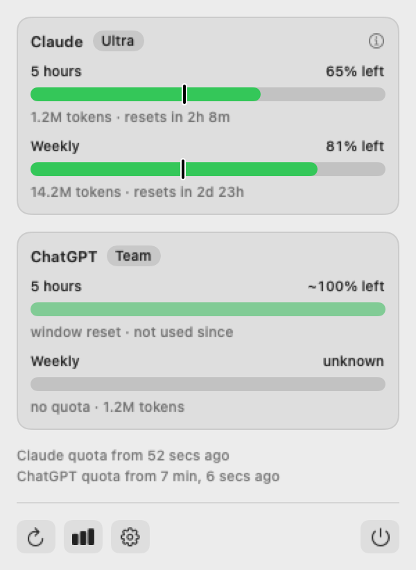

# Reading the Bars

What each bar, colour, symbol and line of text under it means.

Each provider has two bars: **5 hours** and **Weekly**. A bar shows how much of the window is
**left**, not how much is used. The figure on the right is that percentage, and the line under the
bar is the detail.

## Colour

| Left          | Colour          |
| :------------ | :-------------- |
| 40% or more   | green           |
| 15% up to 40% | orange          |
| under 15%     | red             |
| unknown       | grey, empty bar |

The thresholds are in `tint` in `Shared/UsageViews.swift`.

## The four states

| State        | Looks like                    | Detail line example                         | Meaning                                                                           |
| :----------- | :---------------------------- | :------------------------------------------ | :-------------------------------------------------------------------------------- |
| **Reported** | solid bar, `62% left`         | `1.2M tokens · resets in 2h 9m`             | The provider reported it within the last 10 minutes.                              |
| **Stale**    | dimmed bar, `~12% left`       | `14.2M tokens · seen 3h ago · may be lower` | Last reported more than 10 minutes ago. Use since then can only have lowered it.  |
| **Reset**    | dimmed full bar, `~100% left` | `window reset · not used since`             | The window ended and no use was recorded after it, so it is full again. Inferred. |
| **Unknown**  | grey empty bar, `unknown`     | `no quota · 1.2M tokens`                    | No quota is available for this window. Only consumption is shown.                 |

A `~` before the figure always means "not a fresh provider reading".

:::info[Resets happen on their own]
When a reported window's reset time passes, the bar turns into a **Reset** bar immediately, even
if the data on disk is old ([ADR 0008](../adr/0008-remember-last-quota-and-flag-stale.md)). If
there was use after the reset and no new quota was reported, the window stays **Unknown** rather
than claiming to be full ([ADR 0007](../adr/0007-expired-window-reads-as-reset.md)).
:::

## Reading the mark

A bar says how much is left, not whether it lasts until the reset. The **mark** on the bar does: it is where the bar would
end if the window were used steadily from its start to its reset ([ADR 0039](../adr/0039-the-pace-is-drawn-on-the-bar.md)).

- **A bar that ends before the mark** means you are going too fast: at this pace the quota runs out before the reset. The
  mark is orange then.
- **A bar that ends after the mark** means the quota lasts until the reset. The mark is the colour of the text.
- **Hover the bar** to see when. A bubble above it says "At this pace you run out Thursday at 6 pm", the moment rounded to
  the hour as today, tomorrow or the weekday, or "At this pace it lasts until the reset". The bubble is the app's own, not
  the system tooltip, which does not show in a panel of an app with no Dock icon.
- **The `i`** beside the provider's name opens a short explanation of the mark, with a link to this section. It closes with
  its `x`, with a second click on the `i` or with a click outside it.

**No mark means nothing can be said**, not that the quota lasts. Nothing is estimated for a reset or unknown window, one
with no reset time, or one with less than a tenth of the window gone. A window where nothing was used has a mark and lasts.

- **A reading older than ten minutes keeps its mark, at half strength** and measured now, so it moves left as time passes.
  The bar is the last reading, which can only have gone down since. The mark is orange only when the bar is already before
  it, since then the quota runs out even if nothing was used. The bubble says how old the reading is. ChatGPT is like this
  most of the time: Codex writes its quota only when it runs.
- **The pace is the average since the window began**, so a quiet night counts as slow use and the mark is pessimistic for
  someone who does not work at night.
- **Claude's figure moves only while Claude Code runs**, so its mark and its hover go away after ten minutes and come back
  with the next session.
- **A model's limit under Weekly** has its own thin bar with its own mark. Its hover is the row's, and says when it runs out
  before saying what the row is part of.
- **The widget has no mark and no hover.** Where a window would run out before its reset, its detail line says so in
  short, in orange: `3.4B tokens · out Thu 6 pm · resets in 3d 14h`. A model's limit has no phrase of its own there.

## Tokens

The line under a bar shows **input + output** tokens seen in that window's own period: from its start, which is its reset
time minus its length, when the provider gave one ([ADR 0040](../adr/0040-a-windows-tokens-are-counted-in-its-own-period.md)),
and over the last 5 hours or 7 days when it did not. Cache reads and cache
writes are left out: they make up about 98% of the raw total and say nothing about plan use. The
count comes from local CLI logs only, so it covers Claude Code and Codex and not the web or desktop
apps, and it does not match how the plans count.

## The panel

| Element                                     | Meaning                                                                                                       |
| :------------------------------------------ | :------------------------------------------------------------------------------------------------------------ |
| `Read 12 seconds ago`                       | When the app last read the files.                                                                             |
| `Claude quota from 3 hours ago`             | When the status line last wrote Claude's quota.                                                               |
| `Claude quota: status line has not run yet` | The status line is not set up or no session has run. See [Enable the Claude Quota](./enable-claude-quota.md). |
| Orange warning about the App Group          | No signing team: the widget cannot read the snapshot.                                                         |
| **Refresh**                                 | Re-reads now and shows a spinner while it works.                                                              |

The panel also refreshes by itself whenever it opens. The menu-bar item itself is the gauge icon.

## Related

- [Data Sources](../develop/data-sources.md)
- [Troubleshooting](./troubleshooting.md)
