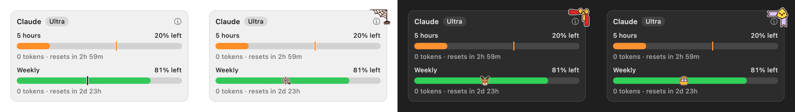

# Seasonal easter eggs

In the week of Halloween, Christmas and Easter the panel carries two small details. They are a bit of humour and they change
nothing of what the panel says.

## What you see

- **A small icon on the bar** where the plain tick would be, on a bar whose quota lasts until the reset: a pumpkin or a wrapped candy
  at Halloween, a reindeer or a bell at Christmas, a basket or a rabbit at Easter.
- **A corner piece on each card**, across its top right corner: a cobweb, a ribbon with a chick, a fir branch.
- **Where the quota will not last until the reset, the tick stays orange.** It is a warning and a joke never replaces it.

A different icon and a different piece are picked at random each time you open the panel, and they stay the same while it is
open.

## When

| Event     | The week it is on                                                                                    |
| :-------- | :--------------------------------------------------------------------------------------------------- |
| Halloween | The seven days up to 31 October.                                                                     |
| Christmas | The seven days up to 25 December.                                                                    |
| Easter    | The seven days up to Easter Sunday, which falls on a different day each year (2027: 22 to 28 March). |

The days are those of your own calendar and time zone.

## What they do not do

- They **do not change the colours** of your theme, the figures or the layout.
- They are **not in the widget, the menu bar or Settings**, and there is **no switch**: they are always on in their week.
- Nothing is read, nothing is sent and nothing is asked: they come from images inside the app.

## Not tried yet

The first time they can be seen in the app itself is in the week of the next event: there is no way to force one. Until then
they were checked on drawings of the app's own views, and the dates by tests.

## Related

- [Reading the bars](./bars.md): the tick that an icon takes the place of
- [Licences](./licenses.md): where the pieces come from
