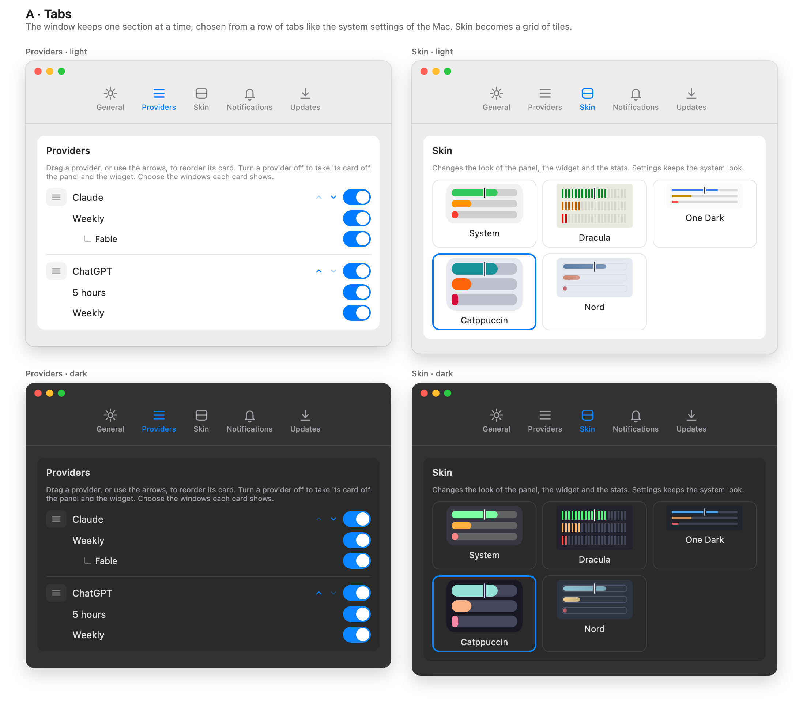

# Settings

Settings is a window with a row of tabs. Open it from the gear in the panel. It opens on **General**, and each tab is one section
that fits the window.

| Tab           | What is in it                                                                                                                                                                                                                                                                  |
| :------------ | :----------------------------------------------------------------------------------------------------------------------------------------------------------------------------------------------------------------------------------------------------------------------------- |
| General       | **Show on the bars**: left or used ([Reading the Bars](./bars.md#left-or-used)); launch at login, setting up the Claude quota automatically for each account ([enable the Claude quota](./enable-claude-quota.md)), and a button that shows [the welcome](./welcome.md) again. |
| Accounts      | The entries of `providers.json`: add, rename or remove an account, each a folder of Claude Code or the Codex CLI ([accounts](./accounts.md)).                                                                                                                                  |
| Skin          | The look of the panel, the widget and the stats ([skins](./skins.md)).                                                                                                                                                                                                         |
| Notifications | The three kinds of notice ([notifications](./notifications.md)).                                                                                                                                                                                                               |
| Updates       | Whether the app updates itself, the version and Check now ([updates](./updates.md)).                                                                                                                                                                                           |

The window has a fixed height, so it does not jump when you change tab; a section taller than the window scrolls. Settings keeps
the system look: a skin never applies to it.

The order of the cards, and which cards and windows are shown, are not in Settings: open the **lock** in the panel's row of
buttons, and the cards get arrows, an eye each and one on each window, and drag onto one another; a hidden card stays in sight,
dimmed, until the lock closes. The lock closes with the panel ([Reading the bars](./bars.md)).

## Related

- [Skins](./skins.md)
- [Accounts](./accounts.md)
- [Configure providers](./configure-providers.md)
