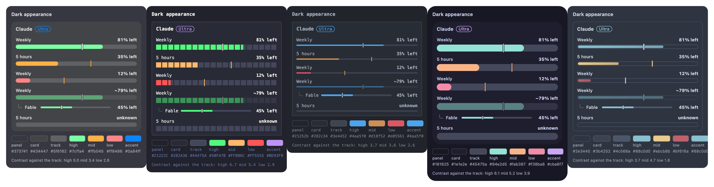
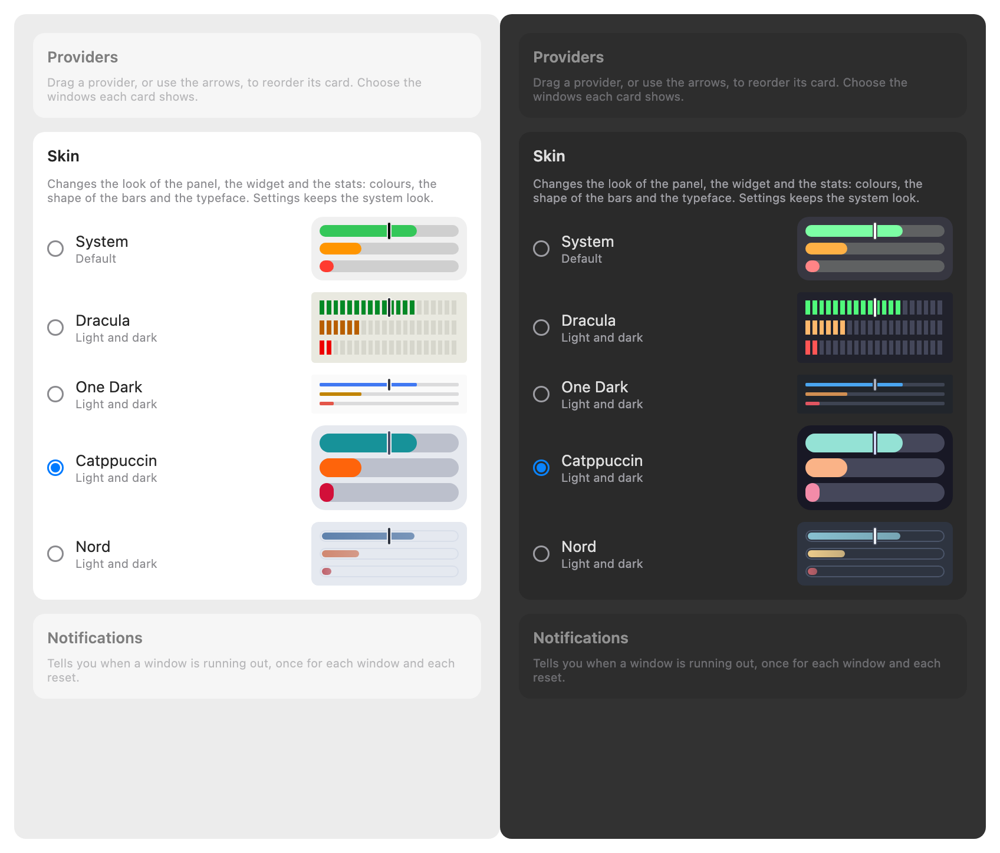

# Skins

A skin changes how the panel, the widget and the stats look: the colours, the shape of the bars and the typeface. There are five.

## Choosing one

Open [Settings](./settings.md) and choose in the tab **Skin**, a grid of tiles. Each tile is a small preview of its look and its name; the chosen one has a ring. The panel and the widget change at
once and the widget is asked to reload at once; macOS decides when it draws it. Settings itself keeps the system look.

## The five

| Skin       | Look                                                                | Colour for plenty left |
| :--------- | :------------------------------------------------------------------ | :--------------------- |
| System     | The look of before: the window's translucent material, round bars.  | green                  |
| Dracula    | A terminal: a bar of square blocks, monospace figures.              | green                  |
| One Dark   | An editor: a thin flat line, monospace figures.                     | blue                   |
| Catppuccin | Soft: thick pill bars, very round cards.                            | teal                   |
| Nord       | Frost: an outlined bar with a blue fill, a card with only a border. | blue                   |

Every skin except System has a dark and a light version and follows the appearance of the Mac. With a skin the panel is a solid
colour, not the window's translucent material.

## What a skin never changes

- **What a bar says.** A bar is in its low colour under 15% left and in its middle colour under 40%, in every skin, and the figures
  are the same.
- **The pace tick.** It is light on a dark panel and dark on a light one where the quota lasts, and in the skin's middle colour
  where it will not, so the warning is never lost in a palette.
- **The model row**, indented under its window, with its hook, its thin line and its figure.
- **The seasonal easter eggs**, which are drawn over every skin but One Dark: its bar is 3 points thick, too thin for the icon, so there the plain tick stays. The corner piece of a card is drawn in every skin.

## Where the colours come from

The colours of Dracula, One Dark, Catppuccin and Nord are those of the editor themes of the same names, all under the MIT licence;
their notices are on the [licences page](./licenses.md). Three things are **derived by us**, not the theme's: Dracula's light
version (its own light theme is not in the free repository), the card and track of One Dark's light version, and nine quota
colours that were under 3 : 1 against what the bar is drawn on; the licences page lists each of them.

## Not tried yet

The panel with a solid colour over the window's real material, and the widget in each size, were checked by drawing the app's own
views, not on a Mac. Every quota colour is at least 3 : 1 against the track (against the panel for Nord's outlined bar), which a
test checks; the track itself is close to the card in every skin, which is how the themes have it.

## Related

- [Reading the bars](./bars.md): what the colours and the tick mean
- [Seasonal easter eggs](./seasonal-easter-eggs.md): the details drawn over a skin
- [Licences](./licenses.md): where the colours come from
