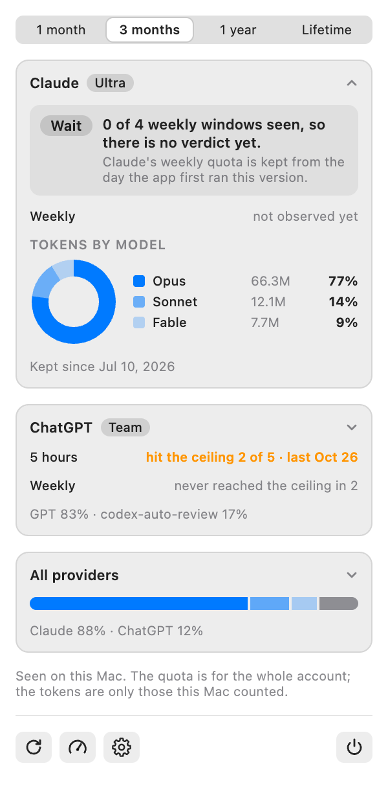

# Reading the Stats

What the stats view of the panel says, and what it leaves out on purpose.

## Open it

The row of icons at the bottom of the panel has a chart. Click it and the panel shows the stats instead of the current
quota; the icon becomes a gauge, and a click on it takes you back. The panel always opens on the current quota, and the stats are one click away.

## The range

The control at the top picks how far back the stats look: **1 month**, **3 months**, **1 year** or **Lifetime**, which is
everything the app has kept. It changes the tokens by model and how many windows are counted; the list of windows below is
always the latest few (four for a month, six for the longer ranges).

## A card for each provider, closed or open

Each provider that is on has a card, in the order of Settings. **One card is open at a time**, so the panel keeps a height that
fits the screen: the first one until you choose, then the one you opened last, which the panel remembers. Open, a card has the
verdict, the windows that ended and the models as a ring; closed, one line for each window (what the app saw) and one for the models.
**A click anywhere on a card opens it and closes the one that was open**, and a click on the open one closes it. **All providers** is a
card of its own, and counts as one of them: open, the models under their provider, indented, against one total; closed, a bar.

### The verdict

A word at the top of an open card, from percentages only:

| Word          | When                                                                                                                                                                           |
| :------------ | :----------------------------------------------------------------------------------------------------------------------------------------------------------------------------- |
| **Wait**      | Fewer than four windows of any length have ended in the range. Claude's weekly quota is kept from the day the app first ran this version, so it says Wait for the first weeks. |
| **Stay**      | The ceiling was reached in any window that counts, or the readings were not complete enough to say more, or the lowest margin was under 60% left.                              |
| **Move down** | The ceiling was never reached, every reading was seen near the end of its window and the lowest margin was 60% left or more.                                                   |

It never says Move up, because the size of the other plans is not known, and it never looks at tokens. The four windows and the 60%
are a choice and not a measurement.

### What an open card lists

Each provider that is on has a card, in the order of Settings. For each window the plan has:

| What you see                           | Meaning                                                                                                  |
| :------------------------------------- | :------------------------------------------------------------------------------------------------------- |
| A date, a bar and `12% left`           | A window that ended on that date, and **at most** that much was left: the highest use the app saw in it. |
| `~12% left`, the bar at half strength  | The last reading was a good while before the window ended, so it may have ended with less.               |
| `hit the ceiling 1 of 4 · last Oct 27` | In how many of the windows in the range the ceiling was reached (100%), and when it last was.            |
| `never reached the ceiling in 4`       | The windows the app saw in the range, none of which went to 100%.                                        |
| `not observed`                         | The app saw no window of that length end in the range. Nothing is made up for the gap.                   |

The **5-hour windows are not listed for now**, and the verdict does not use them: several of them end in one day, and how to show that
clearly is still to be designed. Only windows of a day or longer, such as the weekly one, are listed.

## Tokens by model

As a ring, the **first three models** by tokens, input plus output, with the rest as one slice. Hover a row for the count.
**N more models…** opens the rest, and what is under 2% is added into **Other**. Versions of a model add up
(`fable-5` and `fable-5-1` are Fable) and a name with no rule shows as it is; the rules are `usage.families` in
`providers.json` ([format](./configure-providers.md)). A provider whose log does not name the model says so.

## What it does not say

- **No estimate.** There is no size of a plan in tokens, no forecast and no verdict: they would rest on a ratio between tokens
  and the percentage that does not hold, because the percentage is the account's and the tokens are one Mac's.
- **The tokens are only those this Mac counted.** Use on another computer, on the web or in the phone is not in them. It is in
  Claude's quota, which the app asks Claude Code for every 15 minutes while it runs and the switch that sets up the
  Claude quota is on.
- **A window the app did not see is not drawn.** The quota of a window can only be written down while it is seen: Claude's
  history starts the day the app first ran this version, and ChatGPT's from what the Codex logs still hold.

## Where it keeps what it saw

In `~/Library/Application Support/TokenMeter/usage.sqlite`, a small file made by the app. Quit the app and delete it to start
again: the tokens and the models come back from the logs as far as they go, the quota readings do not.

The first time the app runs this version it reads every log the CLIs still keep. On the author's Mac that was 1,304 files,
7.4 GB, and took about a minute and a half off the main thread; after that it reads only what is new.

## Related

- [Reading the Bars](./bars.md)
- [Configure Providers](./configure-providers.md)
- [Data sources](../develop/data-sources.md)
- [Usage stats, the feature](../features/2026-11-02-usage-stats/index.md)
