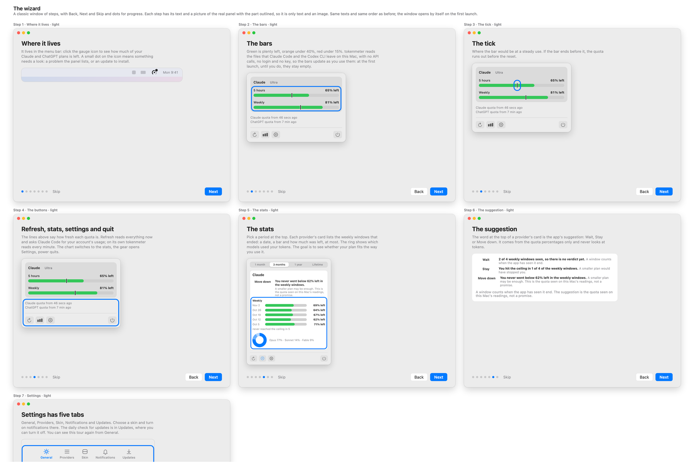

# The welcome

A short wizard that says where tokenmeter lives and how to read its panel.

## When it opens

It opens by itself **once**, the first time the app runs a version that has it: on a fresh install and on the first update alike. It
counts as seen when you reach **Done**, press **Skip** or close its window. If you quit the app in the middle, it opens again at the next
launch.

To see it again, open Settings from the gear in the panel and press **Show the welcome again** in **General**.

## The pages

| Page                              | What it says                                                                                                  |
| :-------------------------------- | :------------------------------------------------------------------------------------------------------------ |
| Where it lives                    | The gauge icon in the menu bar, and what the small dot on it means.                                           |
| The bars                          | The colours, and that they fill as Claude Code and the Codex CLI are used: empty at first.                    |
| The tick                          | Where the bar would be at a steady use.                                                                       |
| Refresh, stats, settings and quit | What the four buttons do, and what the two lines of text above them say.                                      |
| The stats                         | How each window ended, with its date, bar and what was left, and the tokens by model.                         |
| The suggestion                    | The word at the top of a card, Wait, Stay or Move down, from percentages only.                                |
| Settings has five tabs            | General, Providers, Skin, Notifications and Updates, and where the daily check for updates can be turned off. |

The pictures of the panel and the stats are the app's own views drawn with invented sample data: the figures in them are not yours.

## Related

- [Reading the Bars](./bars.md)
- [Stats](./stats.md)
- [Settings](./settings.md)
